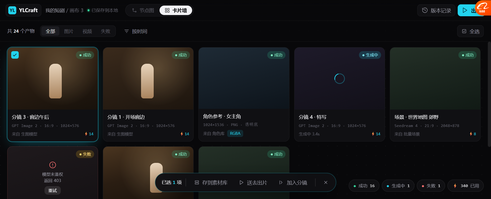

# 卡片墙视图 v7

> 原型：`docs/prototypes/canvas_cardwall_v7.html`
> 截图：`docs/prototypes/v7/01_card_wall.png`

---

## 一、它是什么

**同一份画布数据的第二种看法。** 不是新页面，是视图切换：

```
顶栏：  [节点图 | 卡片墙]
```

| 视图 | 用来干什么 |
| --- | --- |
| **节点图** | 搭流程、看数据流、排查失败 |
| **卡片墙** | 看成图、挑素材、批量操作、给客户看 |

---

## 二、界面



### 结构

```
┌──────────────────────────────────────────────────────────────────────┐
│ YL YLCraft  我的短剧/画布3 ●已保存   [节点图│卡片墙*]   [版本记录][出片] │
├──────────────────────────────────────────────────────────────────────┤
│ 共 24 个产物  [全部][图片][视频][失败]  [按时间]              [全选]   │
├──────────────────────────────────────────────────────────────────────┤
│ ┌──────┐ ┌──────┐ ┌──────┐ ┌──────┐ ┌──────┐                        │
│ │ ✓ 图 │ │  图  │ │  图  │ │ ⟳   │ │  图  │                        │
│ │      │ │      │ │      │ │      │ │      │                        │
│ ├──────┤ ├──────┤ ├──────┤ ├──────┤ ├──────┤                        │
│ │分镜3 │ │分镜1 │ │角色  │ │分镜4 │ │场景  │                        │
│ │GPT…  │ │GPT…  │ │透明底│ │生成中│ │Seed… │                        │
│ │来自…⚡14│ │来自…⚡14│ │RGBA  │ │3.4s⚡14│ │来自…⚡8│                        │
│ └──────┘ └──────┘ └──────┘ └──────┘ └──────┘                        │
│ ┌──────┐ ┌──────┐ ┌──────┐                                           │
│ │ 失败  │ │  图  │ │  图  │                                           │
│ └──────┘ └──────┘ └──────┘                                           │
├──────────────────────────────────────────────────────────────────────┤
│        [已选 1 项 │ 存到素材库 送去出片 加入分镜 │ ✕]      ●成功16 ●生成中1 ●失败1 ⚡340 │
└──────────────────────────────────────────────────────────────────────┘
```

### 卡片结构

```
┌────────────────────┐
│ ✓             ●成功 │  ← 左上勾选 / 右上状态
│                    │
│        [图]        │  ← 大图为主（Lovart 那种）
│                    │
├────────────────────┤
│ 分镜 3 · 窗边午后    │  ← 名字
│ GPT Image 2 · 16:9 │  ← 参数一行（Lovart 学来的）
│       · 1024×576   │
│ 来自 生图模型    ⚡14 │  ← 来源 + 成本
└────────────────────┘
```

**悬停时**：底部浮出「图层 / 存库」快捷操作，左上出现勾选框。

---

## 三、为什么这样设计

| 决策 | 依据 |
| --- | --- |
| 🔴 **大图为主，信息在下** | **Lovart 的技能卡就是这么做** —— 先看成品，再看参数 |
| 🔴 **参数压成一行** | Lovart `GPT Image 2 · 中 · 9:16(4k) · 1 img` |
| **状态用小圆点+文字** | BeefTV 的做法，不用大色块 |
| **左上勾选 + 底部批量条** | 素材库 `AssetGrid` 已有这套（多选 + 批量操作） |
| **顶部筛选 chips** | ArtCraft 资产浏览器（分类导航 + View all） |
| **右下统计** | 知道 16 成功 / 1 生成中 / 1 失败，不用一格格数 |
| **失败卡直接给"重试"** | BeefTV 的就地重试 |
| **视图切换放顶栏，用分段控件** | ArtCraft `Build \| Record` 同一个位置感 |

---

## 四、这张图特别在哪

**它证明了一件事：同一份画布数据，能出两种完全不同的界面。**

- 节点图里：这些卡片是**节点的输出产物**
- 卡片墙里：它们是**可以挑选、批量操作的素材**

**底层是同一份 `CanvasDocument`，只是渲染器不同。**
这就是为什么从架构上它是"视图"而不是"另一个页面"。

---

## 五、踩的坑（记一下，实现时会遇到）

做这版原型时卡片区一直不显示文字，查出来是：

> **`.card` 高度 139px，但图片 142px + 信息 79px = 221px。**
> `overflow:hidden` 把信息区整个裁掉了。

**原因**：`.card` 是 grid item，被我设了 `align-self:start` 后又加 `display:flex`，
高度计算互相打架。

**解法**：给 `.card` **固定高度 236px** + `display:flex; flex-direction:column`，
图片 `flex:1 1 auto`，信息区 `flex:0 0 auto`。**布局完全确定化，不再依赖内容推算。**

> 💡 **这条对实现有用**：卡片墙的卡片高度**必须固定**，
> 否则图片比例和信息区会互相挤压。虚拟滚动也要求固定高度。

---

## 六、还没做的

| 缺什么 | 说明 |
| --- | --- |
| 空态 | 一个产物都没有时（引导去节点图跑一次） |
| 虚拟滚动 | 24 个无所谓，2400 个会卡 |
| 拖拽多选 | 现在只有点击勾选 |
| 排序的实现 | 按钮画了，菜单没画 |
| 卡片尺寸切换（大/中/小） | 常见需求，没画 |
| 视频卡的播放预览 | 视频卡现在和图片一样是静态 |

---

## 七、和节点图的关系

```
同一份 CanvasDocument
    ├── 节点图渲染器：node + port + connection + trace
    └── 卡片墙渲染器：只取"产物节点"，排成网格
```

**实现上建议**：
- 卡片墙**只读** `CanvasNode[]` 里 `type in (image/video/asset)` 的节点
- 不改写文档，只在选中后发批量操作（存库/出片）
- 状态直接读 `WorkflowTrace`，不自己维护
