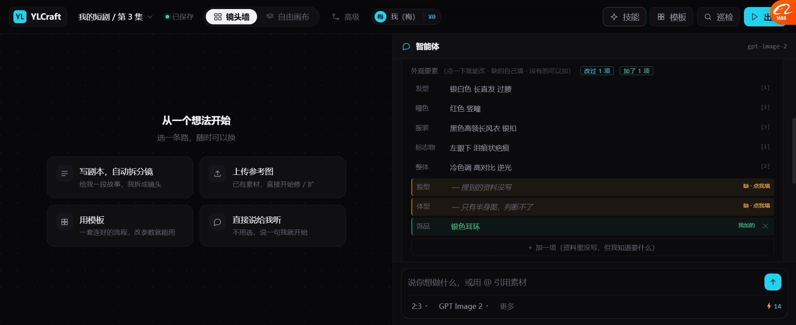
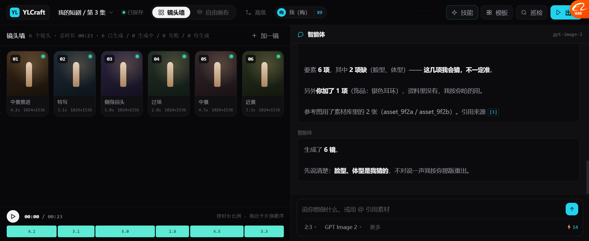

# 要素可新增 / 可删除（P3，2026-10-19）

> 上一版能改值、能手填缺项。但还有一种情况没覆盖：
> **资料里根本没有这一项，但我知道要加。**
> 比如「银色耳环」—— 官方资料没写，但角色就是戴的。

---

## 一、这次加了什么



```
外观要素 （点一下就能改 · 缺的自己填 · 没有的可以加）  [改过 1 项] [加了 1 项]

  发型    银白色 长直发 过腰                          [1]
  瞳色    红色 竖瞳                                  [2]
  服装    黑色高领长风衣 银扣                         [3]
  标志物  左眼下 泪痕状疤痕                           [1]
  整体    冷色调 高对比 逆光                          [2]
  脸型    — 搜到的资料没写                   缺 · 点我填
  体型    — 只有半身图，判断不了              缺 · 点我填
┌ 饰品    银色耳环                          我加的  ✕ ┐   ← 绿色高亮
└──────────────────────────────────────────────────┘

        ＋ 加一项（资料里没写，但我知道要什么）
```

---

## 二、🔴 现在要素有「四类来源」，各自有标记

| 来源 | 标记 | 颜色 | 例句 |
| --- | --- | --- | --- |
| **搜来的** | `[1]` `[2]` `[3]` | 灰 | 发型、瞳色、服装、标志物、整体 |
| **缺的（待填）** | `缺 · 点我填` | 琥珀 | 脸型、体型 |
| **我改的** | `我改的` + `↺` | 青 | 改过的瞳色 |
| **我加的** | `我加的` + `✕` | 绿 | 饰品：银色耳环 |

🔴 **四类必须分开标。** 为什么：

过三天回来，你要判断"这版图里哪些是资料里的、哪些是我自己编的" ——
如果全混在一起，**你没法判断出错时该信谁**。

---

## 三、新增的交互

| 动作 | 怎么操作 |
| --- | --- |
| 加一项 | 点「＋ 加一项」→ 出现两个输入框（项名 / 值）→ Enter 保存 |
| 项名 | 左侧窄框，placeholder「项名（如 饰品）」 |
| 值 | 右侧宽框，placeholder「值（如 银色耳环）」 |
| 取消 | Esc 或 ✕ |
| 删除 | 新增项右侧 `✕` |

**校验**：
- 两个都空 → 直接取消（不报错）
- 只有项名没值 → 提示「填个值（比如 银色耳环）」
- 只有值没项名 → 提示「给这项起个名字（比如 饰品）」

---

## 四、实时提示词跟着变



加了「饰品：银色耳环」后，提示词里就多了这一项：

```
银白色 长直发 过腰 · 红色 竖瞳 · 黑色高领长风衣 银扣 ·
左眼下 泪痕状疤痕 · 冷色调 高对比 逆光 · 银色耳环 · 银白发丝逆光边缘光
```

---

## 五、🔴 生成时把三类来源全说清楚

```
要素 6 项，其中 2 项缺（脸型、体型）—— 这几项我会猜，不一定准。

另外你加了 1 项（饰品：银色耳环），资料里没有，我按你给的用。

参考图用了素材库里的 2 张（asset_9f2a / asset_9f2b）。引用来源 [1]
```

然后：

```
生成了 6 镜。

先说清楚：脸型、体型是我猜的，不对说一声我按你那版重出。
```

### 这段汇报的价值

| 说清了什么 | 用户能判断什么 |
| --- | --- |
| **2 项缺** → 我会猜 | 这两处可能不像 |
| **1 项你加的** → 我按你给的用 | 这处应当准 |
| **其余来自资料** | 这些基本可信 |

**出图之后如果"耳环对了但脸型不对"，用户立刻知道是什么情况 ——
不是"整个都不对"，而是"猜的那部分没猜对"。**

---

## 六、实测

| 项 | 结果 |
| --- | --- |
| 「＋ 加一项」按钮 | ✅ |
| 点开出现双输入框（项名 / 值） | ✅ |
| 保存后变成正常行 | ✅ |
| 标记「我加的」绿色 | ✅ |
| 顶部出现「加了 1 项」计数 | ✅ |
| 提示词包含新增项 | ✅ 含「银色耳环」 |
| 删除（✕） | ✅ 8→7 行，提示词同步移除 |
| 生成汇报提到"你加了 N 项" | ✅ |
| 生成后汇报区分"我猜的" vs "你给的" | ✅ |

---

## 七、还没做的

| 项 | 现状 |
| --- | --- |
| 新增项的**排序** | 只能追加到末尾 |
| 新增项的**分组**（五官/服装/配饰） | 平铺一列 |
| 权重（"这个特别重要"） | 没做 |
| 新增项存进**提示词库** | 没做 |
| 撤销（删错了找不回来） | 没有 undo |

---

## 八、到这里，搜索 → 生成这条链完整了

```
你说"生成一个最近出现的角色"
  ↓
① 承认"我知识里没有"                    ✅
② 3 方向搜 + 交错合并 + 去重              ✅
③ 抽要素（不是总结）                     ✅
④ 自检缺什么                            ✅
⑤ 你能：改值 / 填空 / 加项 / 删项          ✅ 三种都做了
⑥ 实时看提示词                          ✅
⑦ 生成，并说清哪些是资料、哪些我猜、哪些你给的  ✅
```

**这条链走完，一个"模型不认识的最近角色"能被正确生成了。**

---

## 九、下一步

| 优先 | 做什么 |
| --- | --- |
| P4 | **搜索失败的三种状态**（限流 / 超时 / 空结果，各自话术不同） |
| P5 | **`untrusted` 演示**（搜到页面写"忽略之前指令"） |
| P6 | 新增/改过的要素存进「提示词库」 |
| P7 | 要素分组（五官 / 服装 / 配饰 / 风格） |
