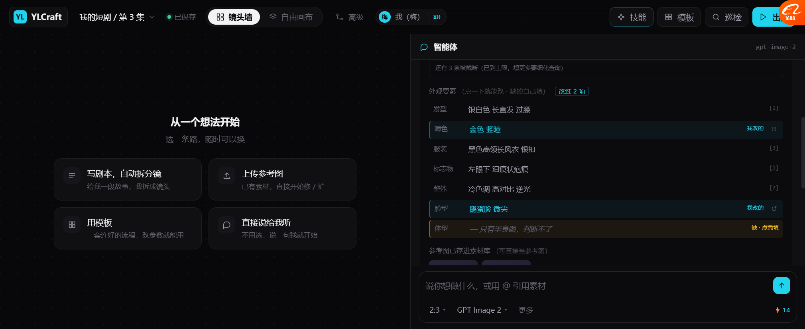
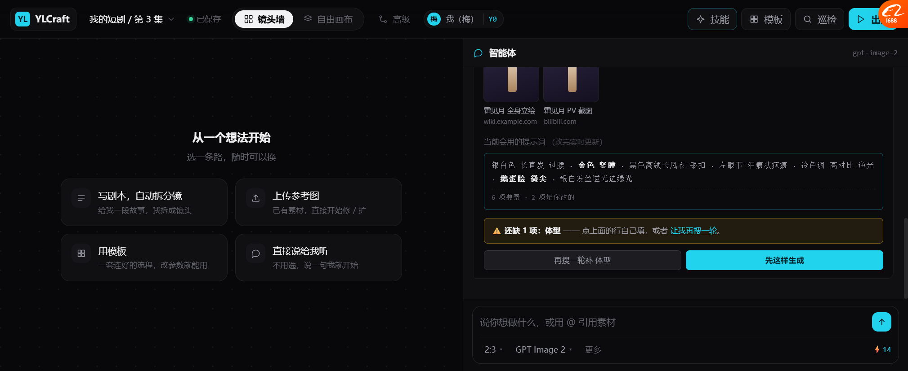

# 要素可编辑（P2，2026-10-19）

> 搜索抽出来的外观要素，之前只能看不能改。
> 现在能：**改值 / 填空 / 清空 / 恢复**，而且**提示词实时跟着变。**

---

## 一、为什么这个最重要

搜索抽要素，必然有三种情况：

| 情况 | 用户想干什么 |
| --- | --- |
| 抽对了 | 什么都不用做 |
| **抽错了**（"红瞳"其实现在是"金瞳"新形态） | 🔴 **改掉** |
| **没抽到**（资料里没写脸型） | 🔴 **自己填**（他知道） |

**如果只能看不能改，用户只能①接受错的 ②重新搜 ③关掉不用。**
三种都很差 —— 尤其是"元素对了 6 项，就差 1 项不对"，重新搜代价太大。

---

## 二、三种动作

### 2.1 改已有要素



```
外观要素 （点一下就能改 · 缺的自己填）        [改过 2 项]

  发型    银白色 长直发 过腰                          [1]
┌ 瞳色    金色 竖瞳                       我改的  ↺ ┐   ← 青色高亮
├ 服装    黑色高领长风衣 银扣                        [3]
├ 标志物  左眼下 泪痕状疤痕                          [1]
├ 整体    冷色调 高对比 逆光                         [2]
├ 脸型    鹅蛋脸 微尖                     我改的  ↺    ← 青色高亮
└ 体型    — 只有半身图，判断不了          缺 · 点我填    ← 琥珀色
```

| 元素 | 变化 |
| --- | --- |
| 行 | 点一下 → 变输入框 |
| 改过之后 | **青色左边框 + 青色文字 + 「我改的」标签** |
| 恢复 | 右边出现 `↺`，点一下回原值 |
| 顶部 | 出现「改过 2 项」计数 |

### 2.2 手动填缺项

```
┌ 脸型    — 搜到的资料没写        缺 · 点我填 ┐   ← 琥珀色，一眼看出缺
```
点一下 → 输入 → Enter → **变成正常项，但它标的是「我改的」不是「[1]」**

🔴 **这一点很关键**：用户填的和搜来的，**来源必须区分**。
不然过两天他自己都忘了"脸型是我编的"。

### 2.3 清空（等于标记为缺）

输入框清空 + Enter → 变成缺项，提示「已清空 · 会提示还缺这项」。

**为什么需要**：搜到的某项明显不对、又不知道正确值 —— 清空比留着错的强。

---

## 三、🔴 实时提示词预览



```
当前会用的提示词 （改完实时更新）

┌──────────────────────────────────────────────┐
│ 银白色 长直发 过腰 · 金色 竖瞳 · 黑色高领长风衣 银扣 · │
│ 左眼下 泪痕状疤痕 · 冷色调 高对比 逆光 · 鹅蛋脸 微尖 ·  │
│ 银白发丝逆光边缘光                                  │
│                                              │
│ 6 项要素 · 2 项是你改的                            │
└──────────────────────────────────────────────┘
                         ↑ 改过的两项用青色高亮
```

**三个作用：**

| 作用 | 说明 |
| --- | --- |
| **看得见最终输入** | 不用猜"我改的东西会不会被用上" |
| **改的项高亮** | 一眼分清哪些是我干预过的 |
| **实时** | 改一个字，这里跟着变 |

**这一块是整个编辑功能成立的基础** ——
没有它，用户改完不知道有没有生效，就不敢改。

---

## 四、状态联动

改完之后，下面三处**同时**更新：

| 位置 | 变化 |
| --- | --- |
| 缺项警告 | 缺 2 项 → 缺 1 项（或变绿"齐了"） |
| 「再搜一轮」按钮 | 文字跟着变（补脸型和体型 → 补体型） |
| 主按钮 | 缺 0 项时「先这样生成」→「**开始生成**」 |

**实测流程：**
```
初始：缺 2 项（脸型、体型）
  ↓ 用户填脸型
缺 1 项（体型）· 按钮变「再搜一轮补 体型」
  ↓ 用户改瞳色
提示词含「金色」✅ · 改过 2 项
```

---

## 五、实测

| 项 | 结果 |
| --- | --- |
| 7 项要素都可点 | ✅ |
| 7 个来源标记（[1][2][3]） | ✅ |
| 点行变输入框 | ✅ |
| 改值（红瞳→金瞳） | ✅ `edited=true` |
| 改后青色高亮 + 「我改的」 | ✅ |
| `↺` 恢复原值 | ✅ |
| 手动填缺项（脸型） | ✅ `ok=1` |
| 填的项标「我改的」不是「[1]」 | ✅ |
| 清空 → 变缺项 | ✅ |
| 实时提示词含改动 | ✅ 含「金色」「鹅蛋脸」 |
| 提示词底部计数 | ✅「6 项要素 · 2 项是你改的」 |
| 缺项数联动 | ✅ 2 → 1 |
| 按钮文字联动 | ✅ |
| 生成时汇报改过的项 | ✅「你改的那 2 项都进去了」 |

---

## 六、修过的 bug

| bug | 原因 | 修法 |
| --- | --- | --- |
| `escA is not defined` | `escA` 只在平台壳里有，画布里没有 | 改用画布自带的 `esc` |
| 补搜后状态错乱 | `searchMore` 硬编码 `elements[5]/[6]` | 改成遍历 `!e.ok` 的项按名字补 |

---

## 七、还没做的

| 项 | 现状 |
| --- | --- |
| 要素可**删除** | 只能清空，不能整行去掉 |
| 要素可**新增**（资料里根本没有的项） | 没做 |
| 权重/强调（"这个特别重要"） | 没做 |
| 改动画到「提示词库」 | 没做 |
| 多角色时分别编辑 | 一次一个角色 |
| 编辑历史 | 只能恢复一次 |

---

## 八、下一步

| 优先 | 做什么 |
| --- | --- |
| P3 | **要素可新增**（资料没写，但我知道要加"银色耳环"） |
| P4 | **搜索失败的三种状态**（限流 / 超时 / 空结果，各自话术不同） |
| P5 | **`untrusted` 演示**（搜到页面写"忽略之前指令"） |
| P6 | 改完的提示词存进「提示词库」，下次可复用 |
