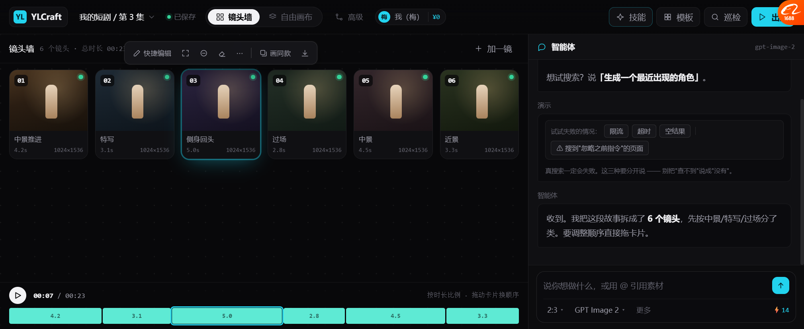
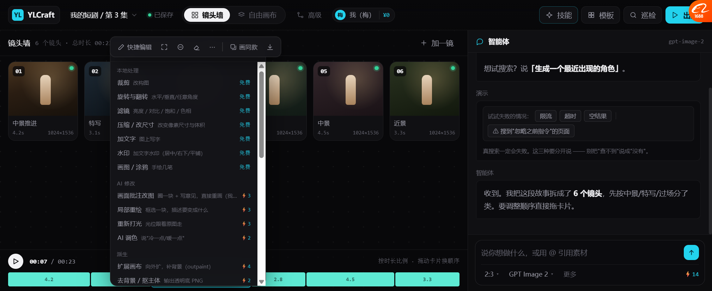

# 画布图片点击：改成 Lovart 的浮条（2026-10-19）

> 你说：**「画布图片点击不用大图了 lovart 应该就不是点击大图的 是周围出现按钮？」**
>
> **你说对了，而且我调研文档里就写着。**

---

## 一、我错在哪

我做的：**点图片 → 全屏 lightbox（大图 + 右侧 32 项能力面板）**

**这是错的。** 证据在我自己的调研里：

`docs/research/2026-10-19_lovart_function_inventory.md` 第 66 行：

```
### 3.1 图片上方浮出的快捷工具条（7 项）

[⇥ 快捷编辑] [⛶ 放大] [◑ 去背景] [✎ 橡皮工具] [⋯]  |  [◫ 画同款] [↓ 下载]
```

**Lovart 是「图片上方浮出工具条」，就地操作，不打断视野。**

---

## 二、为什么弹大图是错的

| | 弹大图（我之前） | 浮条（Lovart） |
| --- | --- | --- |
| 视野 | 🔴 被全屏遮住 | ✅ 还能看到其它镜头 |
| 对比 | 🔴 看不到前后镜 | ✅ 能直接对比 |
| 操作路径 | 点图 → 全屏 → 找按钮 → 操作 → 退出 | 点图 → **按钮就在这** → 操作 |
| 心理感受 | "我进了另一个页面" | "我在这张图上动手" |

**画布的价值就是"东西都摆在你眼前"。弹全屏正好把这个价值废掉了。**

---

## 三、改成了什么



### 3.1 点一下图片 → 上方浮出 7 项

```
        ┌──────────────────────────────────────────────┐
        │ ✎快捷编辑  ⛶  ◑  ⌐  ⋯  │  ▫画同款  ↓          │
        └──────────────────────────────────────────────┘
                 ▲
        ┌────────────────┐
        │   第 3 镜 图    │  ← 青色边框表示选中
        └────────────────┘
```

| 项 | 作用 |
| --- | --- |
| **✎ 快捷编辑** | 打开完整能力菜单 |
| **⛶ 放大** | 🔴 **只有点这个才进大图** |
| **◑ 去背景** | 输出透明底 PNG |
| **⌐ 橡皮** | 擦掉不要的部分 |
| **⋯ 更多** | 打开完整能力菜单（31 项） |
| **▫ 画同款** | 照这张的风格再出一张 |
| **↓ 下载** | 下载原图 |

**注意：「放大」是工具条里的一项，不是点击的默认行为。**

### 3.2 「⋯」→ 完整 31 项能力，分组



```
本地处理
  裁剪            改构图              免费
  旋转与翻转       水平/垂直/任意角度    免费
  滤镜            亮度/对比/饱和/色相   免费
  ...
AI 修改
  画面批注改图      圈一块 + 写意见       ⚡3
  局部重绘         框选一块，描述要变什么   ⚡3
  重新打光         光位跟着原图走        ⚡3
  AI 调色         说"冷一点/暖一点"     ⚡2
派生
  扩展画布         向外扩，补背景        ⚡4
  去背景 / 抠主体   输出透明底 PNG       ⚡2
  ...
```

### 3.3 交互细节

| 行为 | 结果 |
| --- | --- |
| 点图片 | 选中 + 浮条出现，**不弹大图** |
| 点浮条「放大」 | 才进大图 |
| 点空白处 | 取消选中 + 浮条消失 |
| 滚动 / 缩放窗口 | 浮条自动收起（跟着算太抖） |
| 右键图片 | 打开完整能力菜单 |
| 双击图片 | 进大图（保留快捷方式） |

---

## 四、实测

| 项 | 结果 |
| --- | --- |
| 点镜头 → 浮条出现 | ✅ 7 个按钮 |
| **点镜头 → 不弹大图** | ✅ `lightbox=0` |
| 点浮条「放大」→ 进大图 | ✅ `lightbox=1` |
| 点「⋯」→ 完整菜单 | ✅ 6 组 31 项 |
| 自由画布点图 → 浮条 | ✅ `lightbox=0` |
| 浮条位置（图片上方居中） | ✅ 超出屏幕会 clamp / 翻到下方 |
| 滚动自动收起 | ✅ |

---

## 五、顺手修掉的 bug

| bug | 原因 |
| --- | --- |
| `JS BROKEN` | 我用 PowerShell 往 JS 里塞反引号模板字符串，**反引号和引号都被吃掉** |
| | → 改成字符串拼接 + 用 `edit` 工具（老教训，又踩一次） |

🔴 **教训复用**：**永远不要用 PowerShell 字符串替换来改含引号/反引号的 JS。用 `edit` 工具。**

---

## 六、还没做的

| 项 | 现状 |
| --- | --- |
| 浮条里的动作真执行 | 只有 toast 提示 |
| 橡皮擦 / 画笔 | 没实现 |
| 多选（一次选几张批量操作） | 没做 |
| 浮条在小屏幕上换行 | 没有（现在会 clamp 但可能溢出） |
| 自由画布的浮条跟拖拽联动 | 拖完会藏起来，要重新点 |

---

## 七、这次又一次印证的事

**调研文档里明明写着答案，我却按自己的想象做了。**

这正是你今天批评的那个问题的另一个例子：
> 调研了 40 份文档，但决策的时候不去查。

已经做的修法：`RESEARCH_LEDGER.md` + baseline skill 第 0 步「改任何东西前先查台账」。
