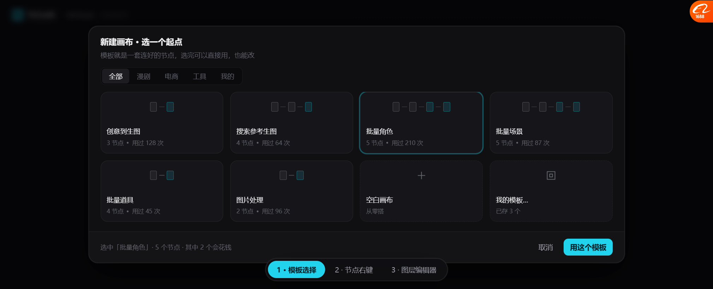
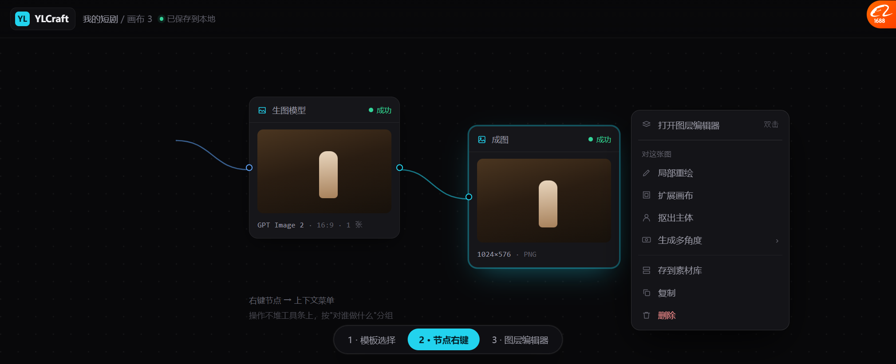
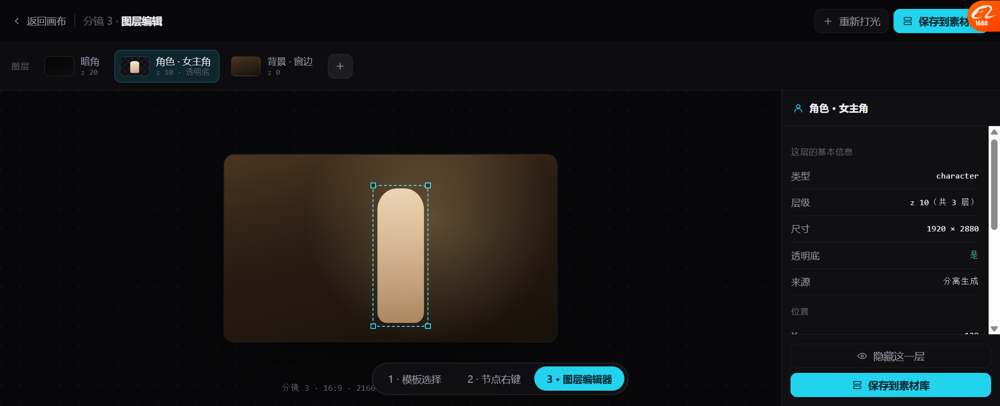

# 画布三屏流程原型 v8

> 原型：`docs/prototypes/canvas_flows_v8.html`（3 屏可点）
> 截图：`docs/prototypes/v8/01~03_*.png`
> 补齐了 v6 节点图之外的三条关键流程：**选模板 → 节点操作 → 改一张图**

---

## 屏 1 · 模板选择



```
┌──────────────────────────────────────────────────────────────┐
│ 新建画布 · 选一个起点                                          │
│ 模板就是一套连好的节点，选完可以直接用，也能改                  │
│ [全部][漫剧][电商][工具][我的]                                 │
│ ┌────────┐┌────────┐┌────────┐┌────────┐                     │
│ │ □—□—■  ││ □—□—□—■││□—□—■—■││ □—□—■—■│                     │
│ │创意到生图││搜索参考 ││批量角色★││批量场景 │                     │
│ │3节点 128次││4节点 64次││5节点 210次││5节点 87次│                 │
│ └────────┘└────────┘└────────┘└────────┘                     │
│ ┌────────┐┌────────┐┌────────┐┌────────┐                     │
│ │批量道具 ││图片处理 ││+空白   ││▣我的模板│                     │
│ └────────┘└────────┘└────────┘└────────┘                     │
│ 选中「批量角色」· 5 个节点 · 其中 2 个会花钱    [取消][用这个模板]│
└──────────────────────────────────────────────────────────────┘
```

### 四条设计

| # | 做法 | 来源 |
| --- | --- | --- |
| 1 | 🔴 **卡片里画小节点图**（`□—□—■`） | 我们自己的加法 —— 一眼看出**结构**，不只看到名字 |
| 2 | 🔴 **标节点数 + 使用次数** | **Lovart 技能卡**（用过 128 次） |
| 3 | **分类 chips** | **ArtCraft** 资产浏览器的分类导航 |
| 4 | 🔴 **底部标"其中 2 个会花钱"** | **ArtCraft 成本 chip** + 我们自己的成本透明 |

> **小节点图这个设计是这屏最有价值的**：
> Lovart 用成品缩略图，但模板的价值不是"成品好看"，是"流程对不对"。
> **画小图能让人一眼看出：几个节点、怎么连、哪些是产出。**

---

## 屏 2 · 节点右键菜单



```
右键「成图」节点：
┌──────────────────────────┐
│ ▤ 打开图层编辑器    双击  │
├──────────────────────────┤
│ 对这张图                  │
│ ✎ 局部重绘                │
│ ▣ 扩展画布                │
│ 👤 抠出主体               │
│ ◎ 生成多角度          ›   │
├──────────────────────────┤
│ ▤ 存到素材库              │
│ ⧉ 复制                    │
│ 🗑 删除              (红) │
└──────────────────────────┘
```

### 三条设计

| # | 做法 | 来源 |
| --- | --- | --- |
| 1 | 🔴 **按"对谁做什么"分组** | **Lovart 12 项右键菜单** —— 它把"图层拆分/编辑文字/多角度/扩展/矢量"归在一起 |
| 2 | **危险项（删除）标红** | 通用规范 |
| 3 | **`双击` 这种快捷键提示** | Lovart 右键菜单里也标了快捷键 |

> 🔴 **为什么用右键而不是工具条**：
> 节点能做的操作会越来越多（现在 8 项，将来 20 项）。
> **全堆工具条会变成 ComfyUI 那种"找不到按钮"。**
> Lovart 用 12 项右键菜单解决这个问题，我们照做。

---

## 屏 3 · 图层编辑器



**双击图片节点进入** —— 这是一个**全屏模式**，不是画布本身。

```
← 返回画布 │ 分镜 3 · 图层编辑        [重新打光][保存到素材库]
图层 [暗角 z20][角色·女主角 z10·透明底 ★][背景·窗边 z0][+]
┌──────────────────────────────────┬─────────────────┐
│                                  │ 👤 角色 · 女主角 │
│      ┌──────────────────┐        │ 这层的基本信息   │
│      │   分镜画框 16:9    │        │ 类型   character│
│      │  ┌ ─ ─ ─ ─ ┐     │        │ 层级   z10(共3层)│
│      │  │  角色 ★  │     │        │ 尺寸   1920×2880│
│      │  └ ─ ─ ─ ─ ┘     │        │ 透明底   是      │
│      └──────────────────┘        │ 来源   分离生成  │
│                                  │ 位置   X-120 Y+40│
│                                  │ 缩放   100%     │
│                                  │ ─────────────   │
│                                  │ 在这层上能做     │
│                                  │ 换一张角色图    ›│
│                                  │ 重新打光        ›│
│                                  │ 局部精修        ›│
│                                  │ 拖出画框成独立   ›│
│                                  │ [隐藏这一层]     │
│                                  │ [保存到素材库]   │
└──────────────────────────────────┴─────────────────┘
```

### 四个要点

| # | 做法 | 说明 |
| --- | --- | --- |
| 1 | 🔴 **图层条在顶部**（不是右侧） | 横排一眼看层序（左→右 = 下→上），不挡画布 |
| 2 | 🔴 **每层标 `z` + 是否透明底** | 角色层标 `z 10 · 透明底`，证明它是 RGBA |
| 3 | 🔴 **右侧只显示"选中这一层"的信息** | 类型/层级/尺寸/来源/位置，不是全局属性 |
| 4 | **"拖出画框成独立对象"放在层操作里** | 承接 v5 讨论的"框外拖"，但它是个动作不是拖拽姿势 |

---

## 三屏怎么串起来

```
新建画布 → [屏1 选模板] → 画布（节点图 v6）
                              ├─ 右键节点 → [屏2 菜单]
                              └─ 双击图片节点 → [屏3 图层编辑器]
                                                    ↓
                                              保存到素材库
```

---

## 这版踩的坑（实现时会遇到）

### 坑 1：顶栏位置算了两遍

`.stage{inset:52px 0 0 0}` 里面又放了 `.top{top:0}` → 顶栏实际偏移了 104px。

**教训**：顶栏应该在真正的内容容器**外面**，或者容器别自己留出顶栏高度。

### 坑 2：网格行被右侧内容撑破

量出来的数：
```
.lebody   高 386
.lecanvas 高 644   ← 比父容器还高
.frame    top 319   ← 在 644 里居中，所以偏下
```

**原因**：`.lebody` 是 grid，行高 `auto` 被 `.leaside`（右侧长列表）的内容撑到 644，溢出容器。
**`.lecanvas` 虽然只有 386 可用，但按 644 居中，所以画框跑到底部。**

**解法**：
```css
.lebody{grid-template-rows:minmax(0,1fr);overflow:hidden}
.lecanvas{min-height:0}
.leaside{min-height:0;overflow:hidden}
```

> 💡 **这条对实现很有用**：**grid/flex 嵌套时，每个中间容器都要 `min-height:0`**，
> 否则子内容会把行撑破，绝对定位的居中元素会算错基准。

### 坑 3：flex 居中比 `top:50%+translateY` 稳

一开始用 `position:absolute;top:50%;translateY(-50%)`，父容器尺寸一错就偏。
改成 `display:flex;align-items:center;justify-content:center` + `position:relative` 后，
**跟着容器走，容器对了它就对了**。

---

## 还没做的

| 缺什么 | 说明 |
| --- | --- |
| 模板的"编辑后存为我的模板" | 屏 1 有入口，但没有保存流程 |
| 节点右键的"运行此节点""换模型" | 屏 2 只画了图片节点的菜单 |
| 图层编辑器的拖拽交互 | 静态图，只画了选中框 |
| 图层编辑器的"重新打光"面板 | 只有按钮 |
| 视频节点的图层编辑器 | 视频没有"图层"，需要另一套 |
