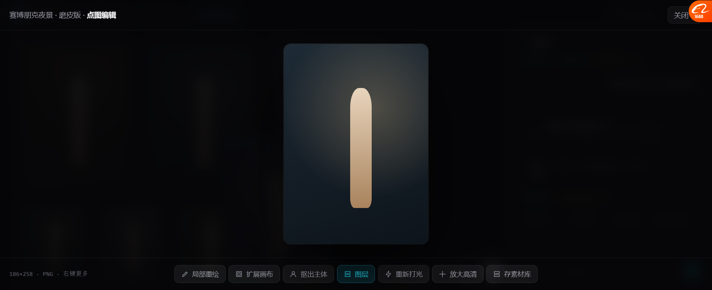
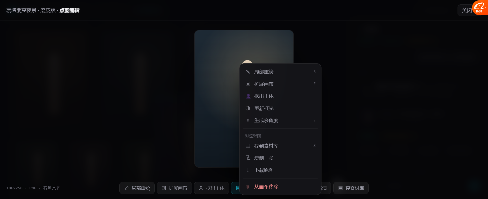
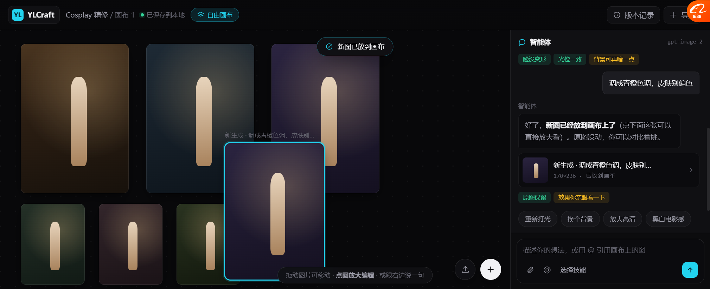

# 自由画布原型 v10（Coser / 摄影 / 电商）

> **打开**：`docs/prototypes/canvas_free_v10.html`
> 这是**三种模式里的第一种**：单张成品类，Lovart 那套。

---

## 一、这版是什么

**没有节点、没有端口、没有连线、没有工作流。**

用户只接触两样东西：**话，和图**。

```
┌──────────────────────────────────────┬───────────────┐
│  Cosplay 精修 / 画布 1  [自由画布]     │   智能体       │
├──────────────────────────────────────┤               │
│  ┌────┐  ┌────┐  ┌────┐              │ 你：这张磨皮，  │
│  │ 原片│  │夜景│  │冷调│              │ 背景换赛博朋克  │
│  └────┘  └────┘  └────┘              │               │
│  ┌──┐ ┌──┐ ┌──┐                      │ 我：好了，新图  │
│  └──┘ └──┘ └──┘                      │ 放右边了        │
│                                      │ [结果卡]       │
│                        [上传][+]     │ 自检 chips     │
│                                      ├───────────────┤
│                                      │ 描述你的想法 @ │
└──────────────────────────────────────┴───────────────┘
```

---

## 二、四个能点的动作

### 1 · 拖动图片

图片可自由拖、可叠、拖到最上层的会盖住下面的。

### 2 · 🔴 点图 → 放大 → 就地编辑



**这是 Lovart 最核心的交互，这版实现了：**

- 点图 → **图片居中放大**（不是跳页面，是"把这张图放大"）
- **背景还看得见画布**的其他图（有上下文感）
- 底部工具条：`局部重绘 / 扩展画布 / 抠出主体 / 图层 / 重新打光 / 放大高清 / 存素材库`
- 左下角标尺寸和格式

**关键**：放大的是**「这张图」**，不是"某个节点"。

### 3 · 右键 → 十项菜单



`局部重绘 R / 扩展画布 E / 抠出主体 / 重新打光 / 生成多角度 › / 存到素材库 S / 复制一张 / 下载原图 / 从画布移除`

> 这些全是从 Lovart 那 12 项右键菜单里挑的，**都属于"对一张成品图能做的事"**。

### 4 · 🔴 对话 → 新图自动落到画布



```
你说：调成青橙色调，皮肤别偏色
  ↓
我：正在做…
  ↓
新图出现在画布上（自动选中 + 标签"新生成 · 调成青橙色调"）
  + 右上角 toast「新图已放到画布」
  + 对话里出结果卡（点了能放大看）
```

**这就是"对话直接出图在画布上"** —— 不需要用户自己拖、不需要打开什么面板。

---

## 三、Agent 怎么说人话

这版报告**比漫剧那版轻**，因为单张成品不需要五段式：

```
你：这张 Cos 正片，脸磨一下，背景换成赛博朋克夜景

我：做好了，新图放在右边。原图保留，磨皮没过，光位跟着原图走。
   [结果卡]
   [脸没变形] [光位一致] [背景可再暗一点]
```

**三个诚实点**：

| 点 | 说明 |
| --- | --- |
| **"原图保留"** | 告诉你没毁掉原来的 |
| **"磨皮没过"** | 说清做了什么尺度 |
| **黄色 chip「背景可再暗一点」** | 🔴 **主动指出自己不满意的地方**，而不是说"完美" |

还有一条被隐藏的提示（可开）：
> 「我不太会判断**像不像本人**。如果磨皮过了，说一声我重做一版轻的。」

---

## 四、为什么这版没有工作流

**因为这类活真的只有 1~2 步。**

| 活 | 步骤 |
| --- | --- |
| Cos 精修 | 出图 → 修 |
| 摄影调色 | 调 → 出 |
| 电商主图 | 出图 → 排版 |

**硬套节点图是过度设计。** Lovart 没有工作流不是它做不到，是**它不需要**。

> 🔴 这条判断要守住：**自由画布模式不挂节点图**。
> 一旦挂了，就又变成"用户不知道看哪儿"。

---

## 五、实测验证过的

用浏览器真点过：

| 项 | 结果 |
| --- | --- |
| 6 张图在画布内、无裁切 | ✅ |
| 拖动 | ✅ 可拖，坐标跟着走 |
| 点图放大 | ✅ 居中放大，背景留上下文 |
| 底部工具条 7 项 | ✅ 显示正常 |
| 右键菜单 10 项 | ✅ 正常 |
| 对话出图 | ✅ 新图落到画布 (388,195)，自动选中 |
| 新图落位不超边界 | ✅ 修过一版（原来会掉出可视区） |
| Agent 面板不溢出 | ✅ 加 `overflow:hidden` 修过 |

---

## 六、还没做的

| 缺什么 | 说明 |
| --- | --- |
| 画布平移/缩放 | 只能拖图，不能拖画布 |
| 图片缩放（拖角） | 手柄画了但没绑 |
| 上传真的上传 | 按钮是示意 |
| 局部重绘的框选 | 只有入口，没画框选交互 |
| 版本记录 | 按钮没绑 |
| 真接后端 | 全是模拟 |

---

## 七、和漫剧那版的关系

```
自由画布（本版 v10）      ← Coser / 摄影 / 电商
镜头序列（待做）          ← 漫剧 / 短剧
流程视图（高级，已有）     ← 想改流程/做模板时
```

**三种模式共用**：同一个 Agent、同一套素材库、同一个画布引擎（`InfiniteCanvasSurface`）

---

## 八、需要你确认

| # | 问题 | 我的看法 |
| --- | --- | --- |
| 1 | 「点图放大」这个交互对不对 | 我觉得对了，比双击节点顺 |
| 2 | 对话出图自动落到画布，还是先给预览让你决定放哪 | **自动落**（Lovart 就是这样），但可以加"不要自动放"选项 |
| 3 | 这版要不要加画布平移缩放 | 要，但可以后补 |
| 4 | 接下来做**镜头序列**原型吗 | 建议做，两个放一起才好判断 |
