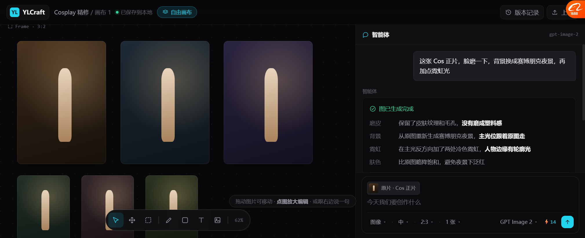
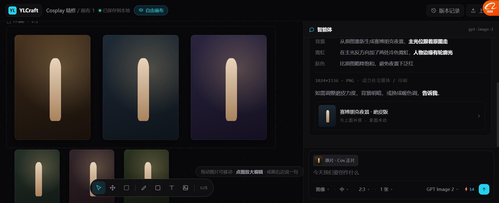
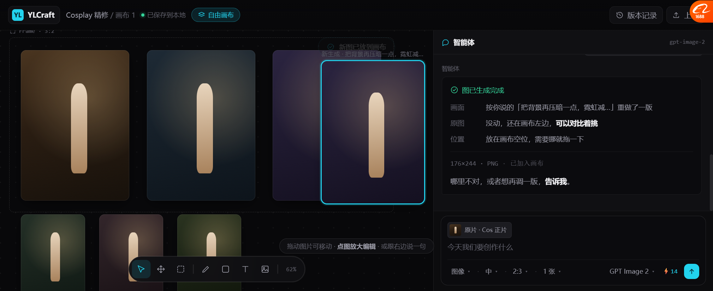
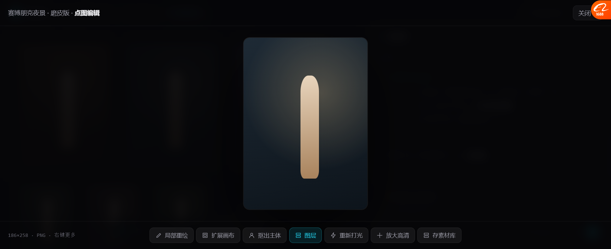

# 自由画布 v11 · 设计解说版

> **打开**：`docs/prototypes/canvas_free_v11.html`
> v10 的 Agent 报告是"自检"，看了 Lovart 真界面后**推翻重做**。

---

## 一、这版改了四处

| # | 改什么 | 依据 |
| --- | --- | --- |
| **1** | 🔴 **报告从"自检"改成"设计解说"** | Lovart 实际做法 |
| **2** | **右栏 344 → 480px** | 解说放得下 |
| **3** | **composer 加参数行** | Lovart `图像⌄ 中 1:1 1张⌄ … GPT Image 2⌄ ⚡15` |
| **4** | **画布加 Frame 框** | Lovart 有 Frame 对象 |

---

## 二、报告长什么样（核心改动）



```
✓ 图已生成完成

磨皮    保留了皮肤纹理和毛孔，没有磨成塑料感
背景    从原图重新生成赛博朋克夜景，主光位跟着原图走
霓虹    在主光反方向加了两处冷色霓虹，人物边缘有轮廓光
肤色    比原图略降饱和，避免夜景下泛红

1024×1536 · PNG · 适合社交媒体 / 印刷

如需调整磨皮力度、背景明暗，或换成暖色调，告诉我。
```



底部是结果卡：`赛博朋克夜景 · 磨皮版 / 与上图并排 · 原图未动`，点了能放大。

### 和 v10 的对比

| | v10（废弃） | v11 |
| --- | --- | --- |
| 形式 | 4 个 chip 横排 | **4 行"部位 + 做法"** |
| 内容 | "原图保留""脸没变形" | **"磨皮保留了毛孔没有磨成塑料感"** |
| 回答什么 | 你确定做好了吗 | 🔴 **它长什么样、为什么这样** |
| 结尾 | 撤销 / 版本差异按钮 | **"如需调整…告诉我"** |
| 用户能拿去用吗 | ❌ | ✅ **能直接发给客户** |

### 关键那句

```
如需调整磨皮力度、背景明暗，或换成暖色调，告诉我。
```

**不是** `⚠ 效果我没法确认`。

> **前者是服务，后者是免责。**
> 同样是"我没法判断好不好"，一个让你觉得被伺候，一个让你觉得被推卸。

---

## 三、composer 参数行



```
┌─────────────────────────────────────────────────────┐
│ [缩略图] 原片 · Cos 正片                              │
│ 今天我们要创作什么                          [↑]      │
│ 图像⌄ · 中⌄ · 2:3⌄ · 1张⌄      GPT Image 2⌄ ⚡14     │
└─────────────────────────────────────────────────────┘
```

**好处**：不用进检查器，一次看到"出什么、多大、几张、用哪个模型、花多少"。

---

## 四、对话出图（保持 v10 的能力）

```
你说：把背景再压暗一点，霓虹减一半
  ↓ 我：正在做…
✓ 图已生成完成
  画面   按你说的「把背景再压暗一点，霓虹减一半」重做了一版
  原图   没动，还在画布左边，可以对比着挑
  位置   放在画布空位，需要挪就拖一下
  176×244 · PNG · 已加入画布
  哪里不对，或者想再调一版，告诉我。
  ↓
新图出现在画布空位（自动选中）
```

**这版修了一个 bug**：v10 的新图会**压在原图上**，跟"原图还在左边可以对比"自相矛盾。
现在落位算法会细网格扫描找空位，找不到才级联。

---

## 五、点图放大编辑（不变）



点图 → 居中放大 → 底部工具条（局部重绘/扩展/抠主体/图层/重新打光/放大高清/存素材库）→ 右键 10 项。

---

## 六、实测过的

| 项 | 结果 |
| --- | --- |
| 右栏 480px | ✅ 量过，画布剩 744px |
| 报告 4 行解说 + 尺寸 + 邀请 + 结果卡 | ✅ 全部渲染 |
| composer 参数行 5 个选择器 | ✅ |
| Frame 框 | ✅ |
| 对话出图 + 解说 | ✅ |
| 新图不重叠、原图仍可见 | ✅ **修过一版** |
| 点图放大 + 工具条 | ✅ |
| 右键 10 项 | ✅ |

### 一个限制（不是 bug）

**测试窗口只有 549px 高**，报告 452px 放不下，聊天区需要滚动。
**1080p 下聊天区有 840px，全部可见。** 我截了「上半」「下半」两张来展示完整内容。

---

## 七、还没做的

| 缺什么 | 说明 |
| --- | --- |
| 参数选择器点开 | 是静态文字，点了没菜单 |
| 画布平移缩放 | 只能拖图 |
| 拖角改尺寸 | 没绑 |
| 真上传 | 示意 |
| 局部重绘框选 | 只有入口 |

---

## 八、关于记忆

你说过之前按 **harness + openclaw** 做过 Agent 记忆，后面再看。

**这版没碰记忆。** 但记一下 Lovart 的两个做法，将来对照：

| Lovart | 说明 |
| --- | --- |
| **自动更新记忆**（试用剩余7天） | 说过的偏好、传过的作品集，自动记着 |
| **自进化技能**（试用剩余7天） | 你做顺手的流程，存成技能，用得上的主动提给你 |
| **我学会的**：记忆 / 自进化技能 / **进化日志** | 能看到它学了什么、什么时候学的 |

> 「进化日志」这个我们可能没有 —— **能看到"它什么时候学了什么"**，是可解释性的一部分。

---

## 九、要你确认

| # | 问题 | 我的看法 |
| --- | --- | --- |
| 1 | 设计解说这个形式对不对 | 我觉得比 chip 好一个量级 |
| 2 | 「部位 + 做法」两列排版好不好 | 比项目符号更整齐，但不够自然 |
| 3 | 参数行要不要留 | 建议留 |
| 4 | 接下来做镜头序列原型吗 | 建议做 |
