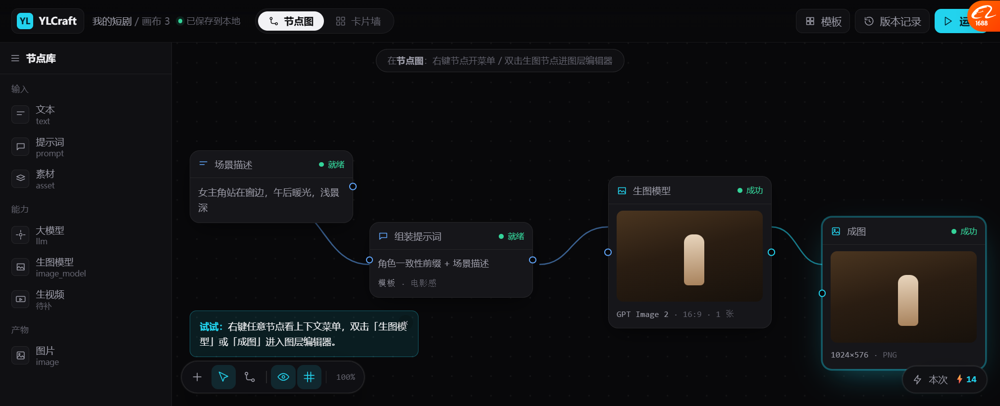
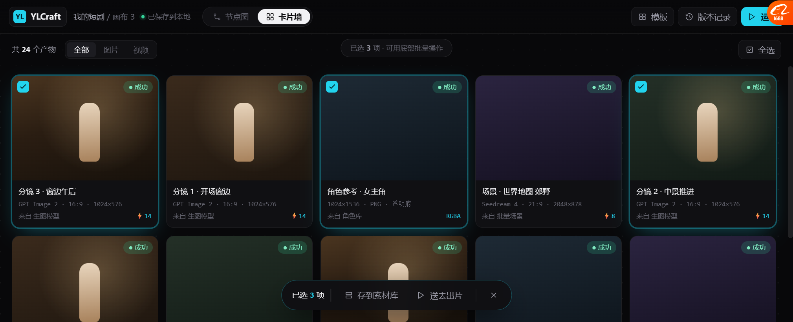
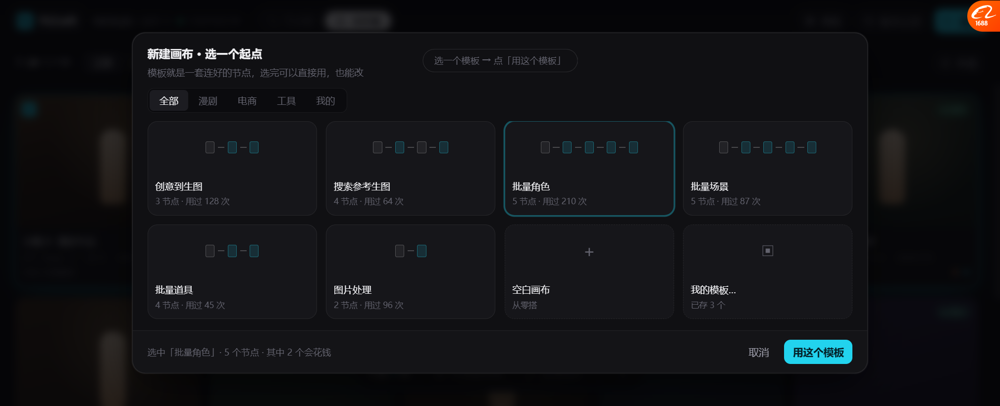
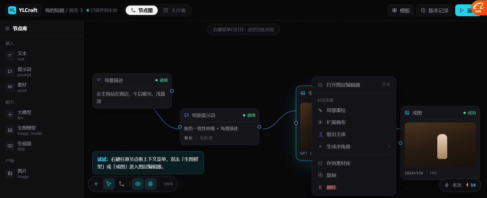
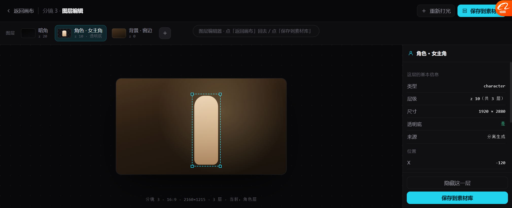

# 画布完整原型（单文件，可点）

> **打开这一个文件就行**：`docs/prototypes/canvas_full_prototype.html`
> 之前 v6/v7/v8 是拆开的，这版把全部流程合成**一套能点的东西**。

---

## 怎么点

### 顶部

| 点哪儿 | 会发生什么 |
| --- | --- |
| **节点图 / 卡片墙** | 真的切换视图（同一份数据两种看法） |
| **模板** | 弹出模板选择，选一个 → 点「用这个模板」→ 回到节点图 |
| **运行** | （示意，无实际动作） |

### 节点图里

| 操作 | 会发生什么 |
| --- | --- |
| **右键任意节点** | 弹出上下文菜单（图片类节点和普通节点菜单不同） |
| **双击「生图模型」或「成图」节点** | 进入**图层编辑器**全屏 |
| 单击节点 | 选中（青色描边） |
| 点空白处 | 取消选中 / 关闭右键菜单 |
| **Esc** | 关弹窗 / 关菜单 |

### 卡片墙里

| 操作 | 会发生什么 |
| --- | --- |
| 点卡片 | 多选（勾选 + 青色描边） |
| **全选** | 选中全部 |
| 已选 ≥1 | 底部浮出批量操作条（存到素材库 / 送去出片 / 清空） |

### 图层编辑器里

| 操作 | 会发生什么 |
| --- | --- |
| **返回画布** | 回到节点图 |
| **保存到素材库** | 提示"两份：合成图 PNG + 分层结构 3 层 RGBA"，然后返回 |
| 点图层块 | （示意，未做切换） |

**底部中间有一条灰色提示**，随时告诉你当前能点什么。

---

## 五个状态

### 1 · 节点图（默认）



左节点库 / 中画布（4 个节点 + 类型化连线）/ 底工具栏 / 右下成本 / 顶部视图切换。

### 2 · 卡片墙 + 多选



5 列大图卡，选中的有勾选和描边，底部浮出批量操作条。

### 3 · 模板选择



卡片里画**小节点图** `□—□—■`，一眼看出结构。标节点数 + 使用次数。底部标"其中 2 个会花钱"。

### 4 · 右键菜单



图片节点 8 项：打开图层编辑器 / 局部重绘 / 扩展画布 / 抠出主体 / 生成多角度 / 存到素材库 / 复制 / 删除。
普通节点另一套：运行此节点 / 复制 / 断开连线 / 只看这一支 / 编辑参数 / 删除。

### 5 · 图层编辑器



图层条在顶部（暗角 / 角色★ / 背景），右侧只显示选中层的信息，带「拖出画框成独立对象」。

---

## 实现时要注意的三个坑（这版踩出来的）

### 坑 1：class 名撞了，文字被压成竖排

模板卡文字渲染成了竖排，量出来：
```
.tpl        207 × 105
.tpl .tb     30 × 30   ← 只有 30px 宽
```

**原因**：`.tb` 这个名字**同时给了工具条按钮**（`width:30px;height:30px`）和**模板信息块**。
工具条样式赢在了模板卡上。

**解法**：
- 工具条按钮改成 `.bar .tb`（加作用域）
- 模板信息块改名 `.tinfo`

> 💡 **单文件原型一定要给 class 加命名空间**。分文件时看不出来，合到一起就互相污染。

### 坑 2：grid 行被右侧内容撑破

图层编辑器量出来：
```
.lebody    高 390
.lecanvas  高 644   ← 比父容器还高
.frame     top 319   ← 按 644 居中，所以偏下
```

**原因**：`.leaside`（右侧长列表）把 grid 行撑到 644，溢出容器。

**解法**：
```css
.lebody{grid-template-rows:minmax(0,1fr);overflow:hidden}
.lecanvas,.leaside{min-height:0}
```

> 💡 **grid/flex 嵌套时每个中间容器都要 `min-height:0`**，否则子内容撑破行，绝对定位的居中元素会算错基准。

### 坑 3：卡片高度必须固定

卡片墙第一版信息区完全不显示：
```
.card 高 139，但图片 142 + 信息 79 = 221
overflow:hidden 把信息区裁掉了
```

**解法**：`.card{height:236px;display:flex;flex-direction:column}`，
图片 `flex:1`、信息 `flex:0`。**不依赖内容推算。**
虚拟滚动本来也要求固定高度。

---

## 这版还没做的

| 缺什么 | 说明 |
| --- | --- |
| 节点拖拽 / 连线拖动 | 静态坐标，不能真的拖 |
| 缩放到画布 | 工具条按钮没绑事件 |
| 运行流程 | 「运行」按钮没有真的跑 |
| 图层拖拽 | 选中框是静态的 |
| 模板分类筛选 | chips 点了没反应 |
| 卡片的「图层/存库」悬停按钮 | 这版没画悬停态 |
| 视频节点 | 只有图片 |

**能点的都是刻意的**，不能点的都是故意留白的 —— 目的是让你判断**流程对不对**，不是测交互。
