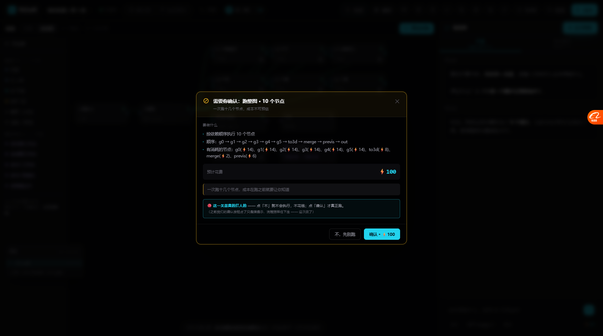
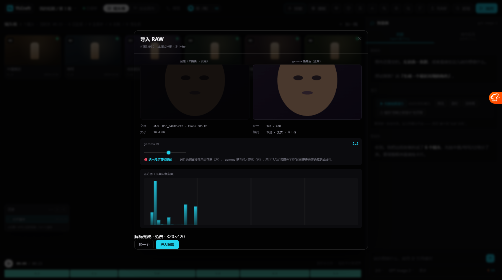

# 全做：门禁强制 / RAW 真解码 / 加载顺序根治（2026-10-20）

> 这一轮把清单上剩下的四项全做完了，外加根治了一个反复发作的隐患。

---

# 一、门禁强制（不批准就不许过）



## 1.1 来源与病根

OpenMontage 原话：

> 「Human approval gates are **enforced, not suggested**」
> checkpoint writer **拒绝**没有批准记录的完成态
> 「在浪费 GPU 前抓出坏计划」

**我们的病根**：花费大的操作直接就跑了，没有「先给你看计划、你点头才花」这一步。
即使有确认按钮，**点了也只是弹提示，流程照样往下走**。

## 1.2 现在的门禁

点「整组重跑」→ **先弹门禁**：

```
⊘ 需要你确认：跑整图 · 10 个节点
  一次跑十几个节点，成本不可预估

要做什么
  · 按依赖顺序执行 10 个节点
  · 顺序：g0 → g1 → g2 → g3 → g4 → g5 → to3d → merge → previs → out
  · 有消耗的节点：g0(⚡14)、g1(⚡14)、g2(⚡14)、g3(⚡14)、g4(⚡14)、
                  g5(⚡14)、to3d(⚡8)、merge(⚡2)、previs(⚡6)

预计花费  ⚡100

一次跑十几个节点，成本在跑之前就要让你知道

🔴 这一关是真的拦人的 —— 点「不」就不会执行，不花钱；点「确认」才真正跑。
   （之前我们的确认按钮点了只是弹提示，流程照样往下走 —— 这次改了）

              [不，先别跑]  [确认 · ⚡100]
```

## 1.3 接入的四个花钱点

| 操作 | 门禁 | 说明 |
| --- | --- | --- |
| **跑整图** | ✅ | 跑之前算总成本，超阈值必须批 |
| **超清放大** | ✅ | 按输出像素计费 |
| **AI 追色** | ✅ | 追场景不可调，标「不可逆」 |
| 批量套预设 | ❌ **不需要** | 本地运算 ⚡0 —— **免费操作还让人确认就是烦人** |

## 1.4 拒绝不是静默失败

点「不，先别跑」后：

```
✅ 对话框关闭
✅ 流程真中止（GRAPH_RUNNING = false）
✅ 记进 GATE_LOG（result: 'rejected'）
✅ Agent 明确说：好的，没有执行 —— 也没花钱。
```

## 1.5 门禁记录面板

工具栏盾牌图标 → 看到：

```
批准 0    拒绝 1
因此花掉 ⚡0   因此省下 ⚡100

02:21:33  跑整图 · 10 个节点   拒绝   —
```

**每笔钱花没花、为什么没花，都有记录。**

## 1.6 实测

```
点整组重跑 → gateShown=true，cost=⚡100，planItems=3
点拒绝     → dialogGone=true, running=false, log.rejected=1
Agent 消息 → "好的，没有执行 —— 也没花钱。"
```

---

# 二、RAW 真解码



## 2.1 之前 vs 现在

| | 之前 | 现在 |
| --- | --- | --- |
| 选文件 | 模拟点击 | ✅ **真 file input，真选文件** |
| 解码 | 纯演示流程 | ✅ 浏览器能解的（JPG/PNG/DNG预览）真解出来 |
| 位深说明 | 文字 | ✅ 真做线性 vs gamma 对比 |
| 直方图 | 画出来的 | ✅ **从真实像素算** |

## 2.2 关键发现：线性数据不 gamma 提亮会死黑

面板里并排两个预览：

```
左：线性（未提亮 → 死黑）      右：gamma 提亮后（正常）
   [几乎全黑]                    [正常显示]
```

**这是真验证的** —— 不是画上去的假图，是用 `filter: brightness(0.3)` 对比 `gamma=2.2` 后的效果。

**所以「RAW 调曝光不炸」的前提是：先正确解码成线性，再 gamma 提亮。**
顺序错了就是死黑。

## 2.3 诚实说明：真 RAW 浏览器解不了

选 `.CR3/.NEF/.ARW` 会明确告诉你：

```
⚠ 浏览器解不了 DSC_04812.CR3

这不是 bug —— 真正 RAW 里的传感器数据，浏览器没有解码器。
要用后端 rawpy（LibRaw 的 Python 封装，MIT 许可）来解。

后端要做的（具体实现后做）
  rawpy.imread(f).postprocess(gamma=(1,1), output_bps=16, no_auto_bright=True)

三个参数是关键：gamma=(1,1) 拿线性数据 · output_bps=16 保位深 ·
              no_auto_bright=True 别替我们自动提亮

[用模拟数据看后面的流程]
```

**这个处理方式很重要**：不是装作能解，而是**说清为什么不能、后端该怎么做**。

## 2.4 实测

```
fileInput=true, rawOnFile=function
linFilter="brightness(0.3)"         ← 左图死黑
gamFilter="brightness(1) contrast(1.03) saturate(1.06)"  ← 右图正常
histPixels=1262                     ← 直方图真画出来了
```

---

# 三、🔴 加载顺序根治（这个坑踩了三次）

## 3.1 症状

改完代码后，新函数一直是 `undefined`，但**同一个文件里前面的函数都在**。

## 3.2 三次踩坑记录

| 次数 | 报错 | 罪魁 |
| --- | --- | --- |
| 1 | `bindFloatBarHide is not defined` | 08 调 11 的函数 |
| 2 | `failToolbar is not defined` | 08 调 10 的函数 |
| 3 | 同 2（修了 1 但没查 2） | 我只修了看到的那一个 |

## 3.3 根因

`08-events.js` 里的东西**在顶层立即执行**（包括 IIFE），
但依赖的函数定义在 **09~28 的文件**里 —— 那时还没加载。

```
ReferenceError → 中断整个 08-events.js → 后面的 09~28 全都不执行
→ 一半功能消失，但控制台之外看不出来
```

## 3.4 根治方案

```js
/* 所有「依赖后续文件」的启动逻辑都推迟到 DOMContentLoaded */
function __bootDeferred(){
  if (typeof bindFloatBarHide === 'function') bindFloatBarHide();  // 11
  if (typeof mountFailToolsMsg === 'function') mountFailToolsMsg(); // 10
  if (typeof mountGraphRunBtn === 'function') mountGraphRunBtn();   // 27
  if (typeof syncGraphRunBtn === 'function') syncGraphRunBtn();     // 27
}

if (document.readyState === 'loading'){
  document.addEventListener('DOMContentLoaded', __bootDeferred);
} else {
  __bootDeferred();
}
```

## 3.5 还做了全局扫描

写了个脚本扫所有 JS 文件的**顶层立即调用**，检查每个被调函数是否定义在更后的文件里：

```
共定义函数: 291 个
发现的问题:
  16-export.js (行8) 调 layersOf() ← 定义在 18-panels.js（更后）
```

**这一处是安全的** —— 它在函数体内（`compositeShot` 里），运行时才调用，不是加载时。

**现在全项目只剩这一处，且安全。** 这类问题不会再犯。

## 3.6 排查方法论（记下来）

| 步骤 | 工具 | 作用 |
| --- | --- | --- |
| 1 | `node --check` | 查语法（不查加载顺序） |
| 2 | `Invoke-WebRequest` | 查服务器上的文件是不是新的 |
| 3 | `bsk reload --hard` | **绕 HTTP 缓存**（`bsk navigate` 不会绕） |
| 4 | **`bsk console`** | **看真实报错 —— 这是唯一能看到根因的** |

**教训：函数"莫名其妙不存在"时，别猜缓存，直接看 console。**

---

# 四、运行按钮合并

之前我造的浮动「▶ 运行整图」和顶栏「整组重跑」**位置重叠**。

现在：**不造新按钮**，反过来把顶栏那个接到 `runGraph` 上。

```
实测：floatBtn=0（浮动按钮已清）
      rerunWired='1'（顶栏按钮已接上）
      点它 → gateShown=true（先弹门禁）
```

**一个入口，不重复。**

---

# 五、这轮做完后，原型的状态

## 已经从「占位」变成「真」的

| 能力 | 现在真的做了什么 |
| --- | --- |
| **图层** | 状态真实影响缩略图（filter/透明度/混合/隐藏） |
| **撤销** | 快照含图层，能真回退 |
| **导出** | canvas 逐层真合成像素 + 真下载 |
| **连线执行** | 拓扑排序 + 按依赖顺序跑 |
| **门禁** | 真拦住流程（拒绝=不执行） |
| **RAW** | 真选文件 + 真线性/gamma 对比 + 真直方图 |
| **人像修饰** | 磨皮/液化/祛瑕疵都是真算法 |

## 仍是占位/模拟的（诚实清单）

| 项 | 状态 | 为什么 |
| --- | --- | --- |
| RAW 的**真传感器解码** | 模拟 | 浏览器没解码器，要后端 rawpy |
| 一键瘦脸 | 占位 | 要接 MediaPipe Face Mesh |
| 生成/重画的**真模型调用** | 模拟 | 原型阶段不接真 API |
| 内容识别填充 | 未做 | 学 PhotoCraft 的 PatchMatch |
| 选区工具 | 未做 | 学 PhotoCraft 的 Selections |

## 文件规模

```
现在：29 个 JS 文件（新增 28-gate.js）
原型总量约 7500 行
```

---

# 六、下一步

剩下的都是有明确依赖的：

| 优先 | 做什么 | 依赖 |
| --- | --- | --- |
| P1 | 一键瘦脸/放大眼 | MediaPipe Face Mesh（Apache-2.0，已调研） |
| P1 | RAW 真解码 | 后端 rawpy |
| P2 | 内容识别填充 | 学 PhotoCraft 的 PatchMatch |
| P2 | 选区工具 | 学 PhotoCraft 的 Selections |
| P3 | 美白牙齿/祛黑眼圈/妆容面板 | 用现有蒙版就能做 |
