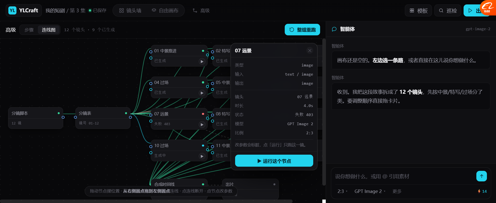

# 连线图：从"只读展示"改成"可编辑可运行"（v14.3）

> 你问：**「连线模式是实际可编辑运行的支持节点吗」**
>
> **诚实回答：改之前不是 —— 那只是张只读的示意图。现在改成真的了。**

---

## 一、先说清楚之前是什么

| | 改之前 | 改之后 |
| --- | --- | --- |
| 拖节点 | ❌ | ✅ 位置存回图数据 |
| 拖端口连线 | ❌ | ✅ 带**类型校验** |
| 断线 | ❌ | ✅ 点连线断开 |
| 改参数 | ❌ | ✅ 点节点出参数面板 |
| 跑单节点 | ❌ | ✅ 每个生成节点有 ▶ |
| 整组重跑 | ✅（有，但只是改状态） | ✅ 保留 |

**之前那版只是"把 DOC 的状态画成图"** —— 好看，但点不动。

---

## 二、我们代码里本来就是可编辑的（有证据）

`frontend/src/pages/canvas/index.tsx` 实查：

| 能力 | 代码位置 |
| --- | --- |
| **11 种可运行节点** | `isRunnableCanvasNode()` L1541：`text/content/prompt/asset/image/llm/platform_search/media_picker/image_transform/image_model/image_batch` |
| 每个节点带 `runnable` 标记 | L1586 `runnable: isRunnableCanvasNode(node)` |
| **端口类型匹配** | L380 `targetInputs.find(port => port.dataType === sourceDataType) \|\| ... === 'any'` |
| **循环检测** | L150 `hasCycle` / L1560-1565 检测 |
| **4 种连线关系** | `relation: 'sequence' \| 'context' \| 'generation' \| 'reference'`（L1967 / L2475 / L2610 / L2946） |
| 执行轨迹 | `WorkflowTrace` / `WorkflowTraceStep`（queued/running/success/error/skipped） |

**所以"可编辑可运行"不是新能力，是我们本来就有的。**
是原型为了简单，把它画成了静态图。

---

## 三、现在能做什么



### 1. 拖节点摆位置

**验证**：`g0` 从 `372px,16px` → `432px,56px` ✅

### 2. 从输出端口拖到输入端口连线

- 端口按类型上色：**蓝 = text**、**青 = image**、**紫 = video**、灰 = any
- 拖动时有一条**青色虚线**跟着鼠标
- 松手落在兼容的输入端口上 → 建立连线

### 3. 🔴 类型校验（连不上会告诉你为什么）

**验证**：
```
合法：script(text) → g0(text)   edges 26 → 27  ✅
非法：script(text) → merge(image)  edges 27 → 27  ❌ 拒绝，提示「类型不匹配：text ✕ image」
```

### 4. 点连线断开

**验证**：`edges 27 → 26` ✅，提示「已断开连线 script→board」

### 5. 点节点出参数面板

```
┌─ 07 远景 ─────────── ✕ ┐
│ 类型        image      │
│ 输入        text / image│
│ 输出        image      │
│ ─────────────────────  │
│ 镜头        07 远景     │
│ 时长        4.0s       │
│ 状态        失败 403    │
│ 模型        GPT Image 2 │
│ 比例        2:3        │
│ 改参数会标脏，点「运行」 │
│ 只跑这一镜。            │
│ [ ▶ 运行这个节点 ]      │
└────────────────────────┘
```

### 6. 跑单个节点

**验证**：`g0` `待生成 → 生成中 → 已生成` ✅
跑完会同步更新镜头墙和时间线。

---

## 四、这轮踩的同一个坑（第二次了）

**又是 `pointerdown` 里调 `renderGraph()`** —— 把正在拖的节点重建了，所以拖不动。

```js
// 错误
gSel = id; renderGraph();     // ← 元素被重建，后面 pointermove 拖的是幽灵

// 正确
gSel = id;
document.querySelectorAll('.gnode').forEach(x => x.classList.toggle('sel', x.dataset.id===id));
```

> 🔴 **教训**：**拖拽期间绝不能重建被拖的 DOM。**
> 我在自由画布上踩过一次，在节点图上又踩一次。
> **以后所有拖拽都先想这句话。**

---

## 五、实测结果

| 项 | 结果 |
| --- | --- |
| 渲染 | ✅ 16 节点 / 26 边 / **42 端口** / **12 个运行按钮** |
| 拖节点 | ✅ 坐标真的变（372,16 → 432,56） |
| 拖端口连线（合法） | ✅ 26 → 27 |
| 拖端口连线（类型不匹配） | ✅ 拒绝，不改数量 |
| 点连线断开 | ✅ 27 → 26 |
| 点节点出参数面板 | ✅ |
| 跑单节点 | ✅ 待生成 → 生成中 → 已生成 |
| 整组重跑 | ✅ 保留拖过的位置 |

---

## 六、还是"原型级"的地方（别当成真）

| 项 | 现状 | 真做要什么 |
| --- | --- | --- |
| 参数**不能真改** | 面板只显示，没输入框 | 换模型/比例/提示词输入 |
| 新增节点 | 没有入口 | 从节点库拖进来 |
| 删除节点 | 没有 | 右键删 |
| 连线**不存盘** | 刷新就恢复成默认 | 写回 DOC |
| 运行是**假跑** | `setTimeout` 改状态 | 接真后端 |
| 没有循环检测 | 可以连成环 | 复用代码里的 `hasCycle` |
| 缩放/平移 | 只能滚动 | 视口变换 |

---

## 七、要你确认

| # | 问题 | 我的看法 |
| --- | --- | --- |
| 1 | 连线图该不该做成**默认可编辑** | 应该，但默认给「步骤」视图，连线是进阶 |
| 2 | 参数面板要不要支持**真改** | 要，但那是下一步 |
| 3 | 新增/删除节点的入口放哪 | 节点库在左侧（现在是高级模式，可以临时弹出） |
| 4 | 要不要加**循环检测**（连成环就拒绝） | 要，代码里已有 `hasCycle` 可复用 |
