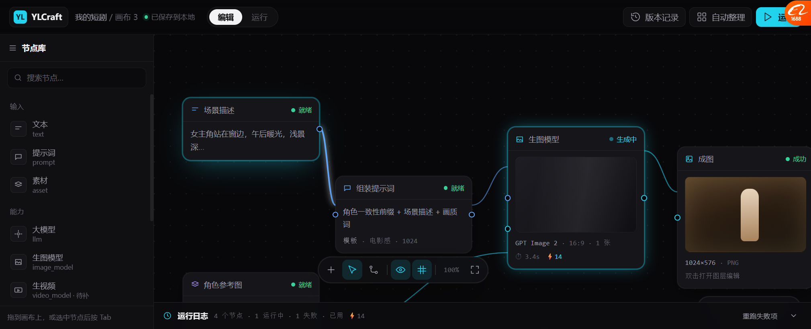

# 画布节点图原型 v6

> 原型：`docs/prototypes/canvas_graph_v6.html`
> 截图：`docs/prototypes/v6/01_node_graph.png`
> **这次是节点图，不是自由摆放的图片画布。**

---

## 一、为什么这版和前面不同

| | v4 / v5 | **v6** |
| --- | --- | --- |
| 画布形态 | 自由摆放的图片 | **节点流程图** |
| 节点 | 图片卡片 | **带端口的能力节点** |
| 连线 | 无 | **按类型上色的贝塞尔** |
| 对应我们的代码 | ✗ | ✅ `InfiniteCanvasSurface` 的 port/connection |

**v6 才是我们画布真实的样子。**

---

## 二、界面



### 骨架四区

| 区 | 位置 | 内容 |
| --- | --- | --- |
| **顶栏** | 52px | 品牌胶囊 / 面包屑 / ●已保存到本地 / **编辑\|运行** / 版本记录 / 自动整理 / **运行** |
| **节点库** | 左 232px | 按 **输入 / 能力 / 产物** 分组，可搜索，可拖 |
| **画布** | 中 | 点阵背景 + 节点 + 连线 |
| **运行日志** | 底（可折叠） | 每步耗时/状态，带「重跑失败项」 |

### 节点卡片

```
╭──────────────────────────╮
│ ⊞ 生图模型        ● 生成中 │  ← 图标 标题 状态点（不是彩色tag）
├──────────────────────────┤
│ ┌──────────────────────┐ │
│ │   骨架加载（微光扫过）  │ │  ← 运行中时：同尺寸骨架，不是转圈
│ └──────────────────────┘ │
│ GPT Image 2 · 16:9 · 1 张 │  ← 参数一行（学 Lovart）
│ ⏱ 3.4s   ⚡14             │  ← 耗时+成本（OhMyGame + ArtCraft）
╰──────────────────────────╯
```

### 五个状态都在原型里

| 状态 | 在哪个节点看到 |
| --- | --- |
| **就绪** | 场景描述、组装提示词、角色参考图 |
| **生成中** | 生图模型（边框青色脉冲 + 骨架微光） |
| **成功** | 成图（绿点） |
| **失败** | 生视频（**整卡淡红底 + 红边**，带「检查配置/重试」） |
| 跳过 | 未画（同一套样式，透明度 40%） |

### 端口按类型上色

| 类型 | 颜色 | 原型里 |
| --- | --- | --- |
| `text` | 蓝 | 场景描述 → 组装提示词 |
| `image` | 青 | 生图 → 成图；角色参考图 → 生图 |
| 连线悬停 | 加粗 + 发光 | 场景描述那条就是高亮态 |

**端口标签只在悬停时出现**（`文本` / `Prompt` / `参考图`），平时不占地方。

---

## 三、从各平台借了什么（每条对应原型里的什么）

| 借自 | 具体做法 | 原型里在哪 |
| --- | --- | --- |
| **BeefTV** | 品牌胶囊 + `●已保存到本地` | 左上 |
| **BeefTV** | **状态用小圆点，不用彩色 tag** | 每个节点头部右侧 |
| **BeefTV** | 白色圆形主操作 | 工具条最左 `+` |
| **ArtCraft** | **分段控件** `编辑 \| 运行` | 顶栏 |
| **ArtCraft** | 工具**分组带分隔线** | 底部工具条 `[+][选择][连线] \| [显示连线][吸附]` |
| **ArtCraft** | 成本 chip 常驻 | 右下 `本次 ⚡14 · ≈$0.14` |
| **OhMyGame** | **耗时 + 成本一行** | 节点底部 `⏱ 3.4s ⚡14` |
| **Lovart** | **参数压成一行** | `GPT Image 2 · 16:9 · 1 张` |
| **Lovart** | 右键菜单 | 未画（下一版） |
| **ComfyUI** | 左右端口 + 类型化连线 | 全部节点 |
| **我们自己的** | 执行日志可视化 | 底部 |

---

## 四、这版**故意没画**的（避免一次上太多）

| 没画 | 为什么 |
| --- | --- |
| 右侧检查器面板 | 会占掉 280px，这个视口里挤不下 |
| 小地图 | **试过，压住节点**。节点多了再出现 |
| 模板选择卡片 | 独立一屏更好展示 |
| 右键菜单 | 独立一屏 |
| 双击 → 图层编辑器 | 独立一屏 |
| 连通高亮（选中时上下游亮） | 需要真交互，静态图画不出 |

---

## 五、我发现的一个问题

**这个浏览器视口只有约 1344×547 CSS px，很窄。**

真实 1080p 下：
- 画布区域宽高都够
- 右侧检查器、小地图都放得下
- 节点可以更大

**所以我在原型里做了妥协**：去掉检查器和小地图，保证节点图本身看得清。

---

## 六、下一步

**你确认这个形态对不对**：
- 节点卡片长这样行不行
- 端口上色行不行
- 状态点 / 骨架 / 错误红卡 行不行

**过了我就补另外三屏**：
1. 模板选择（卡片式）
2. 节点右键菜单
3. 双击 → 图层编辑器

**然后再动代码。**
