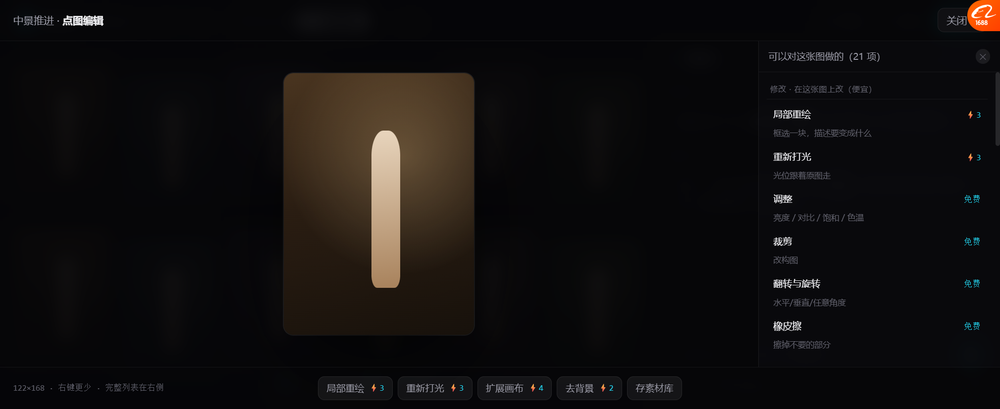
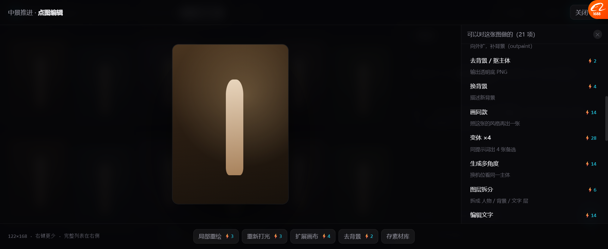

# 图片能力全表：从"只统计"到"进原型"（v14.4）

> 你说得对：**前面调研的图片能力，我们只做进文档，原型里只留了个「更多…」占位。**
> 现在补上了 —— **24 项，分 4 组，全部可见可选。**

---

## 一、现在长什么样



点图放大后：**左边大图，右边完整能力列表**。

```
可以对这张图做的（21 项）

修改 · 在这张图上改（便宜）
  局部重绘        ⚡3    框选一块，描述要变成什么
  重新打光        ⚡3    光位跟着原图走
  调整            免费    亮度/对比/饱和/色温
  裁剪            免费    改构图
  翻转与旋转      免费    水平/垂直/任意角度
  橡皮擦          免费    擦掉不要的部分

派生 · 生成新图（中等）
  扩展画布        ⚡4    向外扩，补背景（outpaint）
  去背景 / 抠主体  ⚡2    输出透明底 PNG
  换背景          ⚡4    描述新背景
  画同款          ⚡14   照这张的风格再出一张
  变体 ×4         ⚡28   同提示词出 4 张备选
  生成多角度      ⚡14   换机位看同一主体
  图层拆分        ⚡6    拆成 人物/背景/文字 层
  编辑文字        ⚡14   OCR 抽字重绘（会丢原字体效果）

批量 · 一次出多张（贵）
  多机位九宫格    ⚡126  一张 → 9 个机位
  角色三视图      ⚡42   正面/侧面/背面
  剧情推演四宫格  ⚡56   情节往下推 4 格
  25 宫格连贯分镜 ⚡350  一次出 25 格（一次别点）
  画面推演·3秒后  ⚡14   ← 灰掉（要视频模型）

输出
  存到素材库      免费   合成图 + 分层结构两份
  下载原图        免费
  复制一张        免费
  转矢量 SVG      ⚡9   ← 灰掉（暂不做）
  Mockup 样机     ⚡2   ← 灰掉（暂不做）
```



---

## 二、每项能力是哪来的（对照表）

| 能力 | 来自 |
| --- | --- |
| 图层拆分 / 编辑文字 / 多角度 / 扩展 / 裁剪 / 调整 / 翻转 / 矢量 / Mockup | **Lovart 右键 12 项** |
| 快捷编辑 / 放大 / **去背景** / **橡皮工具** / **画同款** / 下载 | **Lovart 选中浮条 7 项** |
| **局部重绘**（imageInpaint）/ **打光**（imageLighting）/ **多角度**（imageMultiAngle）/ **扩展**（imagePanorama）/ **变体**（variation） | 🔴 **Toonflow `imageNode` 源码里的 5 个实现** |
| **多机位九宫格 / 剧情推演四宫格 / 25宫格连贯分镜 / 角色三视图 / 光影矫正** | 🔴 **LibTV Slash 六项** |
| 存素材库 / 下载 / 复制 | 我们自己的约定 + 三平台都有 |

**四个来源拼起来的完整表 —— 这是第一次真正合到一处。**

---

## 三、四个设计决定

### 3.1 🔴 价格必须标，而且来自模型配置

不是硬编码 `⚡3`。原型里这个数是**示意**，真实现应该是：

```
局部重绘 → 选了什么模型 → 读 price_per_unit → 算出来
```

**同一件事换模型价格会变**（NanoBanana ⚡3 vs GPT Image 2 ⚡14）。
> 这就用上了我们 `ai_connector.py` 里已有的 `price_per_call`，但要补 `price_per_unit` + `unit`（per_image / per_second）。

### 3.2 🔴 按"便宜→贵"分组，不是按功能分类

| 组 | 特点 | 心理门槛 |
| --- | --- | --- |
| **修改** | 免费~⚡3 | 随便点 |
| **派生** | ⚡2~⚡28 | 想想再点 |
| **批量** | ⚡42~⚡350 | **一次别点** |
| **输出** | 免费 | 随便点 |

**用户一眼知道哪组贵。** 25 宫格 ⚡350 摆在最显眼的位置，就不会误点。

### 3.3 每项都写一个「会怎样」

```
局部重绘    框选一块，描述要变成什么
编辑文字    OCR 抽字重绘（会丢原字体效果）   ← 说明代价
25 宫格     一次出 25 格（一次别点）         ← 直白警告
```

**不写"功能说明"，写"后果"。**

### 3.4 灰掉的三项，明确说明为什么

| 灰掉的 | 原因 |
| --- | --- |
| 画面推演·3秒后 | 要视频模型，我们还没接 |
| 转矢量 SVG | 暂不做 |
| Mockup 样机 | 暂不做 |

面板底部直接写：
> 灰掉的三项：**画面推演**要视频模型、**矢量/Mockup** 暂不做。

**不藏起来，也不假装有。**

---

## 四、实测

| 项 | 结果 |
| --- | --- |
| 4 组渲染 | ✅ |
| 24 项全列出（21 启用 + 3 灰） | ✅ |
| 每项带说明 + 价格 | ✅ |
| 底部快捷 5 项（常用） | ✅ 局部重绘/重新打光/扩展/去背景/存素材库 |
| 点击都走 `doOp` | ✅ 有价格提示，无价格的不提示 |
| 灰项点了提示"暂不做" | ✅ |
| 预览小人渲染 | ✅ **修过**（`.fig` 样式原来只作用在 `.item`/`.shot` 下） |
| 存素材库 → 关闭并提示两份产物 | ✅ |

---

## 五、这些只是"列出来"，还没真跑

| 项 | 现状 |
| --- | --- |
| 点击执行 | 只 toast 提示，没有真的调模型 |
| 参数填不了 | 局部重绘要框选、编辑文字要选哪条，都没有输入界面 |
| 价格是示意 | 没有从模型配置读 |
| 批量项产出 | 没有真的往画布放多张 |

**这版目的是：把"我们支持哪些图片能力"这件事第一次在原型里说全。**
真做要从「修改组」开始（最便宜、最常用）。

---

## 六、建议的落地顺序

| 阶段 | 做哪些 | 理由 |
| --- | --- | --- |
| **P0** | 局部重绘 / 重新打光 / 扩展画布 / 去背景 | 4 项覆盖 80% 需求，成本低 |
| P1 | 图层拆分 / 编辑文字 / 多角度 | 差异化能力（Lovart 有，我们缺） |
| P2 | 多机位九宫格 / 角色三视图 | 🔴 **漫剧真正的刚需**（LibTV 验证） |
| P3 | 25 宫格连贯分镜 | 一次出 25 格，要控制成本 |
| 不做 | 矢量 / Mockup / 画面推演 | 跟我们的场景关系不大 |

---

## 七、要你确认

| # | 问题 | 我的看法 |
| --- | --- | --- |
| 1 | 24 项这个范围对不对，有没有该删的 | 矢量/Mockup/画面推演 可以彻底删 |
| 2 | 分组方式（修改/派生/批量/输出）行不行 | 按价格分，比按功能分好懂 |
| 3 | 价格要不要更显眼（比如标人民币） | 现在 ⚡，可以加 ≈¥ |
| 4 | P0 那 4 项对不对 | 对，先做这 4 个 |
