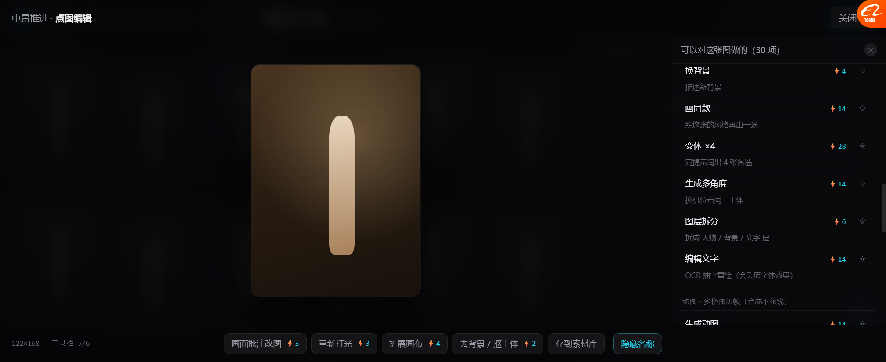

# 补上我们自己的家底 + 自定义工具栏（v14.5）

> 你说：**「我们之前 AI 生图里加了动图，还有图片编辑里面也有些常用功能，是不是也可以放进来」**
>
> **对，这些我们本来就有，但一个都没进画布。现在补上了 —— 24 项 → 32 项。**

---

## 一、先盘我们自己的家底（代码实查）

| 我们已有的能力 | 在哪 | 进原型了吗 |
| --- | --- | --- |
| 🔴 **动图（motion GIF）** | `pages/image-gen` + `components/motion-gif/`（**10 个文件**） | ❌ **之前没进** |
| 🔴 **画面批注改图** | `image-gen` 的「编辑台」：参考图上圈选 + 写修改意见 | ❌ **之前没进** |
| 🔴 **9 个本地编辑工具** | `pages/image-editor`（78 KB） | ❌ **之前没进** |
| **帧级滤镜**（亮度/对比/饱和/色相/旋转） | `motionGifConfig.ts` L59-63 | ❌ |
| **自定义切分网格**（格子线可手拖） | `MotionGridEditor.tsx` / `gridDrag.ts` | ❌ |
| 文生图 / 图生图 / 批量生成 | `image-gen` | — |

### 动图到底是什么（容易误解）

代码注释写得很清楚（`image-gen/index.tsx` L1609-1610）：

> 「开动图后会生成一张**多格图**（不是一段视频）。
> 出来后在这里选一张，再去动图工作台切帧合成 —— **切帧与合成不花钱**。」

**所以我们的"动图"= 多格图 → 切帧 → 合成 GIF/WebP/MP4。**
这跟 LibTV 的「多机位九宫格」是**同一类能力**，只是目标不同（我们做动效，它们做机位）。

### 图片编辑器的 9 个工具（L1082-1090）

```
压缩/尺寸 · 裁剪 · 旋转/翻转 · 滤镜 · 字符画 · 画图 · 文字 · 视觉水印 · Base64
```

**全部是本地处理，不调模型，免费即时。**

---

## 二、合并后的完整清单：32 项 · 6 组


| 组 | 项数 | 来源 | 特点 |
| --- | --- | --- | --- |
| **本地处理** | 9 | 🔴 **我们自己的 image-editor** | 全免费、即时 |
| **AI 修改** | 4 | 🔴 **我们的画面批注** + Lovart/Toonflow | ⚡2~⚡3 |
| **派生** | 8 | Lovart 右键 + Toonflow imageNode | ⚡2~⚡28 |
| **动图** | 4 | 🔴 **我们自己的 motion-gif** | 生成 ⚡14，切帧合成免费 |
| **批量** | 4 | LibTV Slash | ⚡42~⚡350 |
| **输出** | 3 | 三平台都有 | 免费 |

### 新增的两组

**① 本地处理（9 项，全免费）**

```
裁剪        改构图
旋转与翻转   水平/垂直/任意角度
滤镜        亮度/对比/饱和/色相
压缩/改尺寸  改变像素尺寸与体积
加文字      图上写字
水印        居中/右下/平铺
画图/涂鸦    手绘几笔
字符画      转成字符拼成的图      ← 灰（开发工具）
Base64     导出编码，给开发用     ← 灰
```

**这 9 项不用调模型，点了就有** —— 之前完全没在画布里出现。

**② 动图（4 项）**

```
生成动图        一次画多格画面（不是视频）  ⚡14
切帧合成 GIF    选格数 → GIF/WebP/MP4      免费
帧级滤镜        亮度/对比/饱和/色相/旋转    免费
自定义切分网格   格子分割线可以手拖          免费
```



---

## 三、Lovart 的「自定义工具栏」也做了

你发的那张图是 Lovart 的**自定义工具栏**弹窗。我按它的逻辑实现了：


| Lovart 的做法 | 我们的实现 |
| --- | --- |
| 每项右边一个 ★ / ☆ 切换 | ✅ 一样 |
| 顶部实时预览工具栏 | ✅ 底部工具栏实时跟着变 |
| 工具栏最多放几个 | ✅ 限制 **6 个** |
| 「显示工具名称」开关 | ✅ 有 |

**默认置顶 5 个**（最常用的）：
```
画面批注改图 ⚡3 · 重新打光 ⚡3 · 扩展画布 ⚡4 · 去背景/抠主体 ⚡2 · 存到素材库
```

**验证**：加「裁剪」→ 5→6；去掉「重新打光」→ 6→5；工具栏实时更新 ✅

---

## 四、实测

| 项 | 结果 |
| --- | --- |
| 6 组渲染 | ✅ |
| **32 项**（30 启用 + 2 灰） | ✅ |
| 每项带说明 + 价格 + ★ | ✅ |
| 🔴 **★ 置顶/取消** | ✅ 5→6→5，工具栏实时同步 |
| 工具栏上限 6 | ✅ 超了提示「先去掉一个」 |
| 显示/隐藏工具名称 | ✅ |
| 动图组渲染 | ✅ 生成 ⚡14 + 3 项免费 |
| 价格不可加灰项 | ✅ 提示「这项暂不做，不能加」 |

---

## 五、一个发现：我们的家底比以为的厚

| 我们有的 | 对应别家的 | 谁更全 |
| --- | --- | --- |
| **动图多格切帧** | LibTV 多机位九宫格 | 不同用途，同等复杂 |
| **画面批注改图** | Lovart 局部重绘 | 我们多了"写意见"这一层 |
| **9 个本地工具** | Lovart 的调整/裁剪 | **我们更全**（多了画图/水印/字符画/压缩） |
| **帧级滤镜 + 手拖网格** | 别家没有 | 🔴 **我们独有** |

**问题不是"没有"，是"散在三个页面里，画布里看不到"。**

---

## 六、还没做的

| 项 | 现状 |
| --- | --- |
| 点击执行 | 只 toast，没真跑 |
| 本地工具的真界面 | 裁剪要框、文字要输入、水印要填，都没有面板 |
| 动图流程接入 | 要能点「生成动图」→ 多格图 → 切帧 → 合成 |
| 置顶**不持久** | 刷新就回默认 5 个 |
| 价格 | 示意值，没从模型配置读 |

---

## 七、下一步建议

| 优先 | 做什么 | 理由 |
| --- | --- | --- |
| **P0** | 把 **9 个本地工具**接上真界面 | 全免费、不用调模型、我们已有实现、接入最快 |
| P1 | **画面批注改图**接入 | 它是我们最接近"局部重绘"的现成能力 |
| P2 | **动图流程**接入 | 多格图 → 切帧 → 合成，我们全有 |
| P3 | AI 修图 4 项 | 要接模型，成本最高 |

**我建议先接本地工具** —— 它不花钱、不用等模型、而且我们已经写好了。

---

## 八、要你确认

| # | 问题 | 我的看法 |
| --- | --- | --- |
| 1 | 32 项这个范围对吗 | 字符画/Base64 可以删（不是创作功能） |
| 2 | 「本地处理」放第一组对不对 | 对，免费的先让用户试 |
| 3 | 工具栏上限 6 个合适吗 | 合适，再多放不下 |
| 4 | 先接哪块 | **本地 9 工具**（最快见效） |
