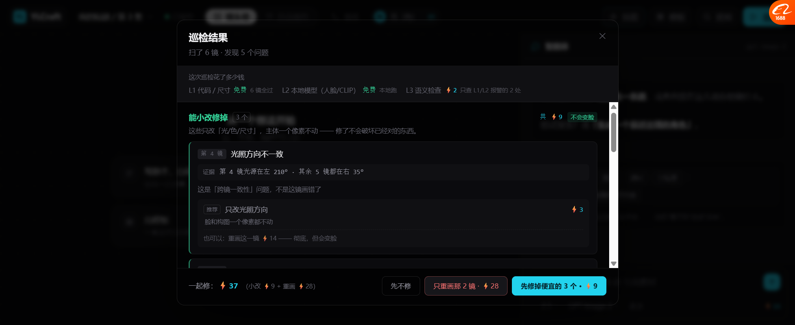
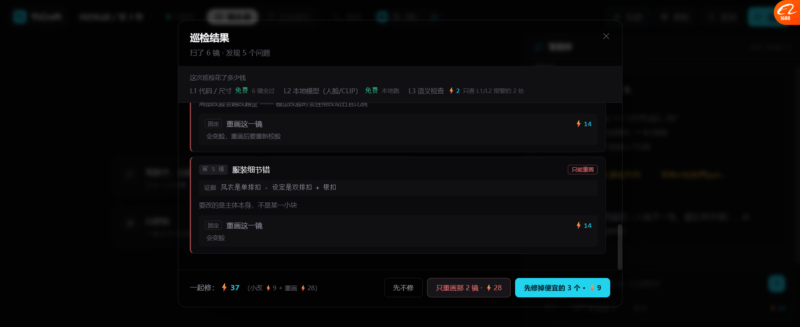

# 巡检：按「变化量」给修法（2026-10-19）

> 之前巡检只说「这镜有问题」，点「修复」不知道会发生什么。
> 现在：**每个问题都告诉你——最便宜的修法是哪个、花多少、会不会变脸。**

---

## 一、核心：同一个毛病，修法代价差一个数量级

拿「光照方向不对」举例：

| 修法 | 代价 | 副作用 |
| --- | --- | --- |
| **只改光照方向** | ⚡3 | 脸、构图一个像素都不动 |
| 重画这一镜 | ⚡14 | 会变脸，要重新校脸 |

**差 4.7 倍，而且副作用完全不同。**

为什么差这么多：**改动范围越大，越容易把原本对的东西搞坏。**

---

## 二、面板长什么样

### 2.1 上半部分：能小改修掉的



```
巡检结果
扫了 6 镜 · 发现 5 个问题

这次巡检花了多少钱
L1 代码 / 尺寸           免费  6 镜全过
L2 本地模型（人脸/CLIP）  免费  本地跑
L3 语义检查              ⚡2   只查 L1/L2 报警的 2 处

✅ 能小改修掉  3 个              共 ⚡9   [不会变脸]
这些只改「光/色/尺寸」，主体一个像素不动 —— 修了不会破坏已经对的东西。

┌─ 第 4 镜  光照方向不一致 ──────────────────────┐
│ 证据   第 4 镜光源在左 210° · 其余 5 镜都在右 35°  │
│                                                │
│ 这是「跨镜一致性」问题，不是这镜画错了              │
│                                                │
│ 推荐  只改光照方向                        ⚡3   │
│       脸和构图一个像素都不动                      │
│       也可以：重画这一镜 ⚡14 —— 彻底，但会变脸     │
└────────────────────────────────────────────────┘

┌─ 第 1 镜  色调偏冷 ─────────────────────────┐
│ 证据   色温 5200K · 序列均值 6100K              │
│ 推荐  调色  ⚡2  纯色彩运算，画质无损              │
└────────────────────────────────────────────┘

┌─ 第 6 镜  尺寸不对 ─────────────────────────┐
│ 证据   1024×1024 · 序列其余都是 1024×1536      │
│ 推荐  扩展画布  ⚡4  只补边缘，中间不动            │
└────────────────────────────────────────────┘
```

**每个问题四段：**
1. **证据**（数字）—— 第几镜、偏差多少
2. **为什么**（这问题是什么性质）—— "跨镜一致性"而不是"这镜画错了"
3. **推荐修法 + 代价 + 副作用**
4. **也可以的方案**（贵但彻底的那个）

### 2.2 下半部分：必须重画



```
⚠️ 必须重画  2 个              共 ⚡28   [会变脸]
这些要改的是主体本身。局部改只会越改越歪 —— 所以老实说只能重画。

┌─ 第 3 镜  人脸不一致            [只能重画] ────┐
│ 证据   与参考图相似度 0.62 · 阈值 0.85          │
│                                                │
│ 局部改脸会越改越歪 —— 模型改脸时会连带改动五官比例  │
│                                                │
│ 固定  重画这一镜                          ⚡14  │
│       会变脸，重画后要重新校脸                    │
└────────────────────────────────────────────────┘

┌─ 第 5 镜  服装细节错            [只能重画] ────┐
│ 证据   风衣是单排扣 · 设定是双排扣 + 银扣          │
│ 要改的是主体本身，不是某一小块                      │
│ 固定  重画这一镜  ⚡14  会变脸                    │
└────────────────────────────────────────────────┘
```

🔴 **注意标记从「推荐」变成「固定」** —— 因为没得选。
右上角还有个红色徽章「只能重画」。

### 2.3 底部：分两个按钮，不是一个

```
一起修：⚡37（小改 ⚡9 + 重画 ⚡28）

[先不修]  [只重画那 2 镜 · ⚡28]  [先修掉便宜的 3 个 · ⚡9]
                                          ↑ 主按钮
```

**为什么分两个而不是一个「全部修」：**

| 你的想法 | 点哪个 |
| --- | --- |
| 只想省钱，人脸差点算了 | 先修掉便宜的 ⚡9 |
| 只要能过审，脸必须对 | 只重画那 2 镜 ⚡28 |
| 全都修 | 两个都点（共 ⚡37） |

**便宜的默认推荐（青色主按钮），因为它不会破坏你已经满意的东西。**

---

## 三、🔴 一条不能妥协的规则

**「只能重画」必须明说。**

人脸不像、内容画错、整体风格错 —— 这三类局部改只会更糟。

**如果为了"看着便宜"硬塞一个 ⚡3 的方案，结果修不好，你还得再花 ⚡14 ——
那比一开始就说「这个只能 ⚡14」更坑。**

所以面板里：
- 「只改光照」标 **推荐**（真的有得选）
- 「重画这一镜」标 **固定**（没得选，别给假希望）

---

## 四、巡检成本也透明了

```
L1 代码 / 尺寸           免费  6 镜全过
L2 本地模型（人脸/CLIP）  免费  本地跑
L3 语义检查              ⚡2   只查 L1/L2 报警的 2 处
```

**三层成本，只在前两层报警的项上才花第三层的钱。**

这就是之前定的「巡检成本分层」规则 —— 现在在界面上能看到了。

---

## 五、点完之后 Agent 会汇报

点「先修掉便宜的 3 个 · ⚡9」：

```
修好了 3 处，花了 ⚡9。

· 第 4 镜 光照方向 → 已对齐到右 35°
· 第 1 镜 色温 → 5200K → 6100K
· 第 6 镜 尺寸 → 1024×1536

这三处都没动到人脸和构图 —— 原来对的东西还在。

还剩 2 个问题必须重画（人脸不一致、服装细节错），共 ⚡28。要现在处理吗？
```

**注意最后一句** —— 不催你，但把剩下的事和代价说清楚。

---

## 六、实测

| 项 | 结果 |
| --- | --- |
| 「巡检」按钮能打开面板 | ✅ |
| 扫了 6 镜 / 5 个问题 | ✅ |
| 三层成本显示（L1/L2 免费，L3 ⚡2） | ✅ |
| 分成「能小改」和「必须重画」两堆 | ✅ |
| 每个问题有证据（数字） | ✅ |
| 每个问题说清"为什么" | ✅ |
| 推荐修法 + 代价 + 副作用 | ✅ |
| 「也可以」的备选方案 | ✅ |
| 「只能重画」红色徽章 | ✅ |
| 标记「推荐」vs「固定」 | ✅ |
| 两个独立按钮 + 主按钮推荐便宜的 | ✅ |
| 点按钮 → 面板关闭 → Agent 汇报 | ✅ |
| 汇报说清"没动到人脸和构图" | ✅ |
| 滚动条样式 | ✅ |

---

## 七、还没做的

| 项 | 现状 |
| --- | --- |
| 真巡检 | 5 个问题写死在 `INSPECT_FINDINGS` |
| 变化量判断靠规则 | 现在是数据里写死的 `level`，真做要规则表 |
| 修完之后重新巡检 | 只汇报，没有再扫一次 |
| 修复失败升级到下一步 | 文案提了"会提示升级"，没实现 |
| 单镜单独修 | 只能整堆修，不能只修第 4 镜 |
| 修完前后对比 | 没有 |

---

## 八、和「图片能力命名」的关系（那个你说不用改）

你说图片能力不用改名（自用）。**但「变化量」这个概念现在还是用上了 ——
在巡检里，因为它跟钱直接相关。**

所以：
- ❌ 图片能力菜单：保持现在的技术名（自用够用）
- ✅ 巡检面板：用「变化量」决定推荐哪个修法

**两个问题其实可以分开处理。这样更省事。**
