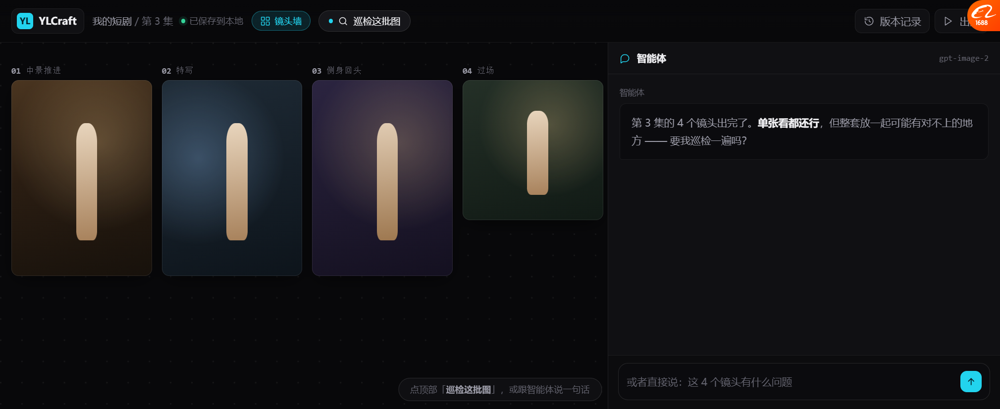
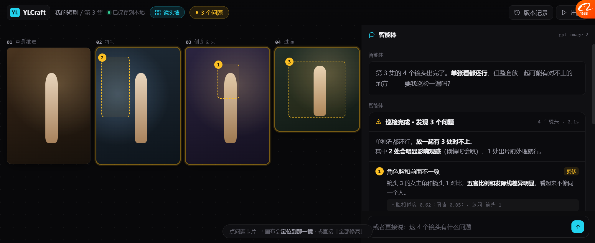
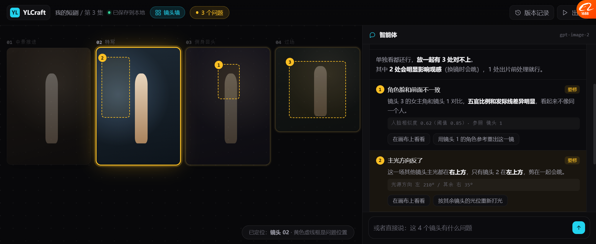
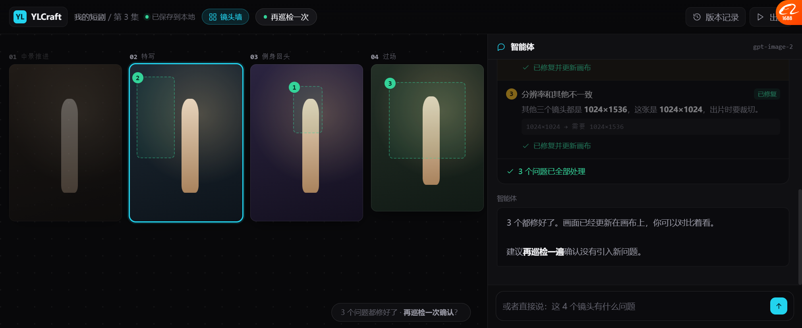

# 画布巡检 v12 · 自检的正解

> **打开**：`docs/prototypes/canvas_inspect_v12.html`
> 这版把前两轮一直没做对的「Agent 自检」换了个形态 —— 从**对话里贴 chip** 改成**独立的巡检动作**。

---

## 一、为什么要重做

### 我之前的做法（v10，已废）

```
做好了，新图放在右边。原图保留，磨皮没过，光位跟着原图走。
[原图保留] [脸没变形] [光位一致] [背景可再暗一点]
```

**问题：**
- 单张图的检查 → **发现不了"一套图放一起才有的问题"**
- Agent 自己声明 → **没有可验证的依据**
- 混在对话里 → 用户很容易忽略

### Lovart 2.0 的做法（今天上线，实测）

> 「**画布巡检就是帮你检查画面和要求有没有对上，发现问题会给出提醒。**
> 尤其是一套图，**单张看着还行，放到一起就可能发现字体、风格不一样，就等于是有一个兜底的质检。**」

**实测发现真问题**：目录刊名里的「好」字跟封面笔迹没对上。

---

## 二、四个状态

### 1 · 巡检前



Agent 主动提议：
> 「第 3 集的 4 个镜头出完了。**单张看都还行，但整套放一起可能有对不上的地方** —— 要我巡检一遍吗？」

**这句话本身就在建立预期**：单个没问题，整体可能有问题。

### 2 · 巡检报告



```
⚠ 巡检完成 · 发现 3 个问题            4 个镜头 · 2.1s

单独看都还行，放一起有 3 处对不上。
其中 2 处会明显影响观感（换镜时会跳），1 处出片前处理就行。

① 角色脸和前面不一致                       [要修]
   镜头 3 的女主角和镜头 1 对比，五官比例和发际线差异明显，看起来不像同一个人。
   人脸相似度 0.62（阈值 0.85）· 参照 镜头 1
   [在画布上看看]  [用镜头 1 的角色参考重出这一镜]

② 主光方向反了                             [要修]
   这一场其他镜头主光都在右上方，只有镜头 2 在左上方，剪在一起会跳。
   光源方向 左 210° / 其余 右 35°
   [在画布上看看]  [按其余镜头的光位重新打光]

③ 分辨率和其他不一致                        [建议]
   其他三个镜头都是 1024×1536，这张是 1024×1024，出片时要裁切。
   1024×1024 → 需要 1024×1536
   [在画布上看看]  [扩图到 1024×1536]

[全部修复]  [先不管]
```

**画布上同步标出**：3 个黄色虚线框 + 编号徽章，直接指到**哪一镜的哪个位置**。

### 3 · 点「在画布上看看」



- 目标镜头**金色高亮 + 外发光**
- 其他镜头**变暗**（`opacity .42` + 降饱和）
- 对应的问题卡**左侧金色边框**
- 底部提示：「已定位：**镜头 02** · 黄色虚线框是问题位置」

### 4 · 全部修复后



- 问题标记变**绿色 ✓**
- 每个问题标「已修复」+「✓ 已修复并更新画布」
- **画面真的变了**（镜头 2 光位从冷变暖、镜头 3 脸色调统一、镜头 4 扩图变高）
- 顶部按钮变「**再巡检一次**」
- Agent：「3 个都修好了…建议**再巡检一遍**确认没有引入新问题」

---

## 三、三个关键设计

### 3.1 🔴 每个问题必须带「证据」

| 问题 | 证据 |
| --- | --- |
| 角色脸不一致 | **人脸相似度 0.62（阈值 0.85）· 参照 镜头 1** |
| 主光方向反了 | **光源方向 左 210° / 其余 右 35°** |
| 分辨率不一致 | **1024×1024 → 需要 1024×1536** |

**这是从 Toonflow `director3dNode` 的提示词学的**：
> 「结束前必须通过 readDocument 读取检查结果，确认 `valid` 为 true；没有修改成功不能声称完成。」

**核心：不说"我觉得有问题"，说"0.62 低于 0.85"。**
用户可以自己判断，也能拿去追问。

### 3.2 🔴 巡检是「独立动作」，不是结果的一部分

| | v10 | v12 |
| --- | --- | --- |
| 形态 | 生成后自动贴 chip | **独立的「巡检」动作** |
| 触发 | 每次都贴 | 用户点 / Agent 提议 |
| 范围 | 单张 | **整套** |
| 输出 | 一句声明 | **问题列表 + 定位 + 证据** |

**它扫描的是"关系"，不是"单张质量"。** 单张好看不等于一套能看。

### 3.3 🔴 给严重度分级，不是一刀切

| 等级 | 例子 | 处理 |
| --- | --- | --- |
| **要修** | 脸不像、光位反 | 会明显影响观感，换镜会跳 |
| **建议** | 分辨率不一致 | 出片前处理就行 |

**摘要里直接说清**：「其中 **2 处会明显影响观感**，1 处出片前处理就行」——
用户不用逐条读完就知道轻重。

---

## 四、和 Toonflow / Lovart 的对应

| 能力 | 来源 | 我们这版 |
| --- | --- | --- |
| 巡检是独立动作 | **Lovart 2.0 画布巡检** | ✅ |
| 跨图一致性检查 | Lovart（"一套图放一起"） | ✅ |
| 问题定位到具体位置 | Lovart（回到画布看） | ✅ 虚线框 + 编号 |
| 可验证证据 | **Toonflow（valid 检查）** | ✅ 相似度/角度/尺寸 |
| 修复动作具体化 | 两者都有 | ✅ 「按其余镜头的光位重新打光」 |
| 修完再巡检 | Lovart | ✅ 按钮变「再巡检一次」 |

---

## 五、实测过的

| 项 | 结果 |
| --- | --- |
| 4 镜头一行排开不裁切 | ✅ 改过一版（原来两行被截） |
| 巡检扫描动画 | ✅ 扫描线 |
| 3 个问题带编号标记 | ✅ 画布 + 卡片同步 |
| 点问题 → 定位 | ✅ 其他变暗、目标高亮 |
| 全部修复 | ✅ 逐个延迟修复，画面真变化 |
| 修完状态 | ✅ 变绿 + 按钮变「再巡检」 |
| 报告收起 | ✅ |

---

## 六、还没做的

| 缺什么 | 说明 |
| --- | --- |
| 真接后端检查 | 现在是写死的 3 个问题 |
| 巡检项可配置 | 现在固定检查 4 类 |
| 「先不管」的后续 | 收了就没下文，应该留个"已知问题"入口 |
| 单图质量检查 | 只做了跨图，没做单张（模糊/畸变/手指） |
| 巡检历史 | 看不到上次查了什么 |
| 局部重绘的框选 | 只有入口 |

---

## 七、一个还没解决的设计问题

**巡检发现问题后，「修复」和「重出」是两件事。**

| 方式 | 例子 | 代价 |
| --- | --- | --- |
| **修复**（在现有图上改） | 重新打光、扩图 | 便宜，保留原构图 |
| **重出**（重新生成） | 脸不像 → 用参考图重出一张 | 贵，构图会变 |

**现在原型里混着用一个按钮。实际应该分开** —— 而且要让用户知道花了多少钱。

> 建议：修复按钮后面标价格（`重新打光 ⚡3` / `重出这一镜 ⚡14`）。

---

## 八、要你确认

| # | 问题 | 我的看法 |
| --- | --- | --- |
| 1 | 巡检这个形态对不对 | 比对话里贴 chip 好一个量级 |
| 2 | 三个问题的类型选得对不对（脸/光位/分辨率） | 是短剧最常见的三类 |
| 3 | 证据要不要更技术（相似度 0.62 这种） | 要，这是可信度来源 |
| 4 | 修复 vs 重出要不要分开标价 | 建议分开 |
| 5 | 接下来做**镜头序列/镜头墙**原型吗 | 这版已经是镜头墙形态了，可以正式化 |
