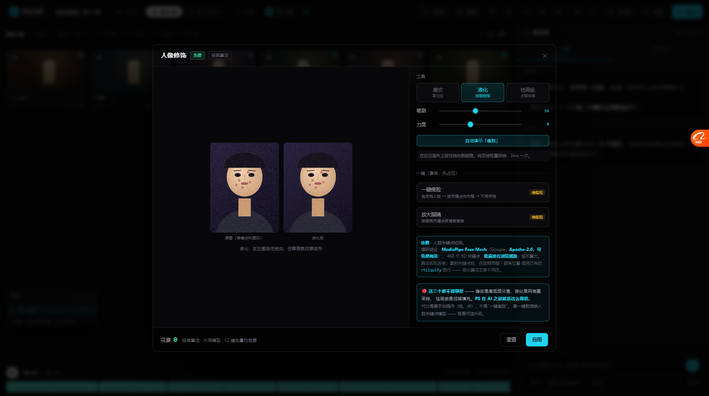

# 人脸关键点调研结论 + 一键功能占位（2026-10-20）

> 你的要求：**「调研结果是什么，收尾，把依赖那个先占位到原型，具体实现时候再实现」**
>
> 这份回答三件事：① 调研结论 ② 占位了什么样 ③ 这一轮的收尾。

---

# 一、调研结论：MediaPipe Face Mesh

## 1.1 结论

| 项 | 结论 |
| --- | --- |
| **选谁** | **MediaPipe Face Mesh**（Google） |
| **许可证** | **Apache-2.0 —— 可以免费商用** |
| **关键点数量** | **468 个 3D 关键点**（够做瘦脸、放大眼、修鼻） |
| **能不能在浏览器跑** | ✅ 能（WebAssembly + JS，`@mediapipe/face_mesh`） |
| **要不要钱** | 不要，本地跑，**零成本** |
| **要不要联网** | 不要（模型文件本地加载即可） |

## 1.2 Apache-2.0 意味着什么（原文核实）

据 [QuickPose 的 FAQ](https://quickpose.ai/faqs/can-mediapipe-be-used-commercially/) 对 MediaPipe 许可证的说明：

> **「Yes — free commercial use, with no restrictions」**
> MediaPipe 是 Google 发布的 **Apache 2.0** 开源框架，
> **明确允许免费商用、修改、分发**。

Apache-2.0 的要求（很轻）：
1. 保留版权声明
2. 分发时附一份许可证
3. 改过的文件标注出来
4. 不能用 MediaPipe/Google 商标给你的产品背书

**对我们（自用）来说，这些都不是负担。**

## 1.3 但有一个要注意的地方

MediaPipe 的**代码**是 Apache-2.0，但**预训练模型权重**的许可证要单独确认
（官方 issue 里有 [「Can the pretrained models be used for commercial purposes?」](https://github.com/google-ai-edge/mediapipe/issues/2595) 这个讨论）。

**自用阶段不需要纠结**，但记录在这里：
> **如果要商用，Face Mesh 的模型权重许可证要单独核实一次。**

## 1.4 备选方案对比

| 方案 | 许可证 | 关键点 | 浏览器能跑 | 评价 |
| --- | --- | --- | --- | --- |
| **MediaPipe Face Mesh** | Apache-2.0 ✅ | 468 | ✅ | **首选** |
| `@tensorflow-models/face-landmarks-detection` | Apache-2.0 ✅ | 468 | ✅ | 内部就是接 MediaPipe，多一层封装 |
| face-api.js | MIT ✅ | 68 | ✅ | 老，关键点少 |
| dlib（68 点） | Boost ✅ | 68 | ❌ 要 C++/WASM | 不够细 |

**选 MediaPipe Face Mesh。**

## 1.5 接上之后能做什么

拿到 468 个关键点后，**液化算法一行都不用改**，只是把「手拖的方向」换成「按关键点算的方向」：

| 功能 | 用哪些关键点 | 怎么算 |
| --- | --- | --- |
| **一键瘦脸** | 左右脸颊外侧 + 下颌 | 往脸中线方向内推，点越靠外推得越多 |
| **放大眼睛** | 眼角 + 上下眼睑 | 以眼中心为圆心做局部膨胀 |
| **修鼻** | 鼻翼两侧 | 向内收 |
| **尖下巴** | 下巴尖 | 向上/向内推 |

**这和 PS 的「人脸识别液化」是同一个思路**，PS 2019 之后才加的人脸识别，之前也是纯手拖。

---

# 二、原型里占位了什么样



人像修饰面板 → 液化 → 底部新增：

```
一键（要做，先占位）
┌────────────────────────────────────────────────┐
│ 一键瘦脸                              [待实现]   │
│ 自动找人脸 → 按关键点向内推 → 不用手拖           │
├────────────────────────────────────────────────┤
│ 放大眼睛                              [待实现]   │
│ 按眼角关键点做局部膨胀                          │
└────────────────────────────────────────────────┘

依赖：人脸关键点检测。
调研结论：MediaPipe Face Mesh（Google，Apache-2.0，可免费商用），
468 个 3D 关键点，能直接在浏览器跑，包不算大。

具体实现后做：拿到关键点后，在脸颊两侧 / 眼角位置
调用已有的 rtLiquify 就行 —— 液化算法本身不用改。
```

## 点了会怎样

弹一条 Agent 消息说清**缺的是什么**：

> 「一键瘦脸」还没做。
> 它缺的不是算法 —— **液化本身已经有了**（你刚才拖的就是）。
> 缺的是**「脸在哪里」**：得先检测出人脸关键点，才知道往哪个方向推。
> 调研结论：用 MediaPipe Face Mesh（Google 开源，Apache-2.0 可免费商用），468 个关键点，能直接在浏览器跑。
> 接上之后，自动瘦脸 / 放大眼睛 都能做 —— **液化算法一行都不用改**，只是把"手拖的方向"换成"按关键点算的方向"。
> **具体实现后做。**

**这正是你要的「先占位，具体实现后做」。**

---

# 三、这一轮的完整收尾

## 3.1 从「对照检查」到「补齐」

这一轮从你问「按像素蛋糕和 PS 平替检查下还差什么」开始，一共做了：

| 阶段 | 做了什么 | 提交 |
| --- | --- | --- |
| **对照检查** | 像素蛋糕 40 功能点 + PS 平替 17 项逐项对照，分级 P0/P1/P2/P3 | — |
| **P0**（4 项） | 批量应用 · 局部调整蒙版 · 预设 · 图层混合模式 | `313fea70` `2305ea1e` |
| **P1**（4 项） | 降噪锐化虚化柔化阴影 · HSL · 超清放大 · AI 追色三模式 | `d113e32e` |
| **认知修正** | 你问「PS 以前没有怎么做的液化美颜」→ 查出全是经典算法 | `30bac854` |
| **实证 + 实现** | 先写验证页证明三个算法能跑，再实现人像修饰 | `5e19983a` |
| **占位** | 一键瘦脸/放大眼（依赖 MediaPipe Face Mesh） | 本次 |

## 3.2 现在原型的图片编辑能力（11 个面板）

| 面板 | 状态 | 免费？ |
| --- | --- | --- |
| 31 项图片能力（裁剪/滤镜/抠图/派生/动图/批量） | ✅ | 混合 |
| 本地精调（曝光/对比/饱和/色温/色阶/分通道曲线） | ✅ | 🔴 免费 |
| 局部调整（蒙版 4 种） | ✅ | 🔴 免费 |
| 画质与色彩（降噪/锐化/柔化阴影/虚化/HSL） | ✅ | 🔴 免费 |
| **人像修饰（磨皮/液化/祛瑕疵）** | ✅ **真算法** | 🔴 免费 |
| 图层 + 混合模式（6 种） | ✅ | 🔴 免费 |
| 预设 + 批量应用 | ✅ | 🔴 免费 |
| RAW 导入 | 🟡 占位 | 🔴 免费 |
| 导出（三层非破坏） | 🟡 占位 | 🔴 免费 |
| 超清放大 | ✅ UI | 💰 调模型 |
| AI 追色（三模式） | ✅ UI | 💰 调模型 |
| **一键瘦脸/放大眼** | ⏸ **占位（依赖 MediaPipe）** | 🔴 免费（接上后） |

## 3.3 真正还需要模型的只剩

| 功能 | 为什么必须模型 |
| --- | --- |
| 闭眼修复 | 要"凭空生成"睁开的样子 |
| 换表情 | 同上 |
| 真超清 | 插值会糊，要真细节就得生成 |
| 自动人脸分割 | 可以让磨皮不用手刷蒙版（可选升级） |

**其余全是经典算法，全部免费。**

---

# 四、还欠什么（诚实清单）

## 4.1 本轮没做的

| 项 | 为什么 |
| --- | --- |
| **一键瘦脸/放大眼** | 依赖 MediaPipe Face Mesh，已占位，**具体实现后做** |
| 美白牙齿 / 祛黑眼圈 | 用现成蒙版就能做（局部提亮/色相），没单独做面板 |
| 妆容 | 颜色层 + 混合模式（我们已有），没单独做面板 |
| 自动人脸分割 | 依赖模型，可以让磨皮免手刷蒙版 |

## 4.2 更早欠的（也在等）

| 项 | 状态 |
| --- | --- |
| 图层/撤销**做真**（现在是占位） | 欠 |
| 导出**真合成**（现在是占位） | 欠 |
| RAW **真解码**（现在模拟） | 欠 |
| **门禁强制**（确认才许过） | 欠 |
| 常用问题诊断表 | 欠 |
| 连线**真执行**（现在连线是图不跑） | 欠 |

## 4.3 原型的体量

```
现在 30 个文件 / 26 个 JS / 约 7000 行
之前盘点还剩 26 项约 5600 行（本轮清掉 10 项左右）
```

---

# 五、一句话

> **一键瘦脸缺的不是算法，是「脸在哪里」。**
> 液化已经能用了（3ms），接上 MediaPipe Face Mesh（Apache-2.0 免费）就能自动。
> **已占位，具体实现后做。**
