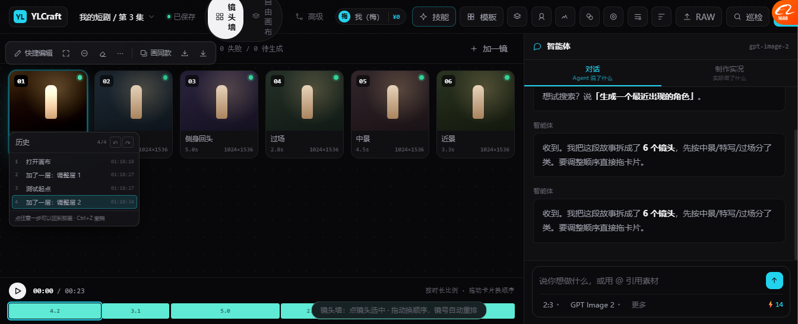

# 图层 / 撤销 做真（2026-10-20）

> 之前这两块是**占位**：图层只是数据、改了看不见效果；
> 撤销只存了 `LOCAL_ADJ` + `FIXED`，**图层操作撤销不回来**。
>
> 这一轮把它们做真了。

---

# 一、图层做真



## 1.1 之前的问题

```
点"关眼睛" → 数据变了，缩略图没变
加调整层     → 列表多一行，画面没变化
改透明度     → 数字变了，看不出影响
```

**「有图层但看不出图层」—— 等于没有。**

## 1.2 现在怎么做的

新增 `applyLayers(shotId)`：把图层状态真实画到缩略图上。

| 图层状态 | 缩略图表现 |
| --- | --- |
| **本地调整层**（参数 曝光/对比/饱和） | 应用对应 `filter` |
| **参数是中性值** | 给一点默认效果 `contrast(1.14) saturate(1.12) brightness(1.07)` |
| **透明度 < 1** | 按透明度减弱效果强度 |
| **AI 编辑层** | 叠一层青色渐变块 + 按混合模式合成 |
| **原图隐藏** | 变灰 + 斜纹遮罩 |
| **混合模式** | 通过 `mix-blend-mode` 作用在叠加层上 |

## 1.3 实测（三个状态）

```
加层后      contrast(1.14) saturate(1.12) brightness(1.07)   ← 能看出变化
改参数后    brightness(1.315) contrast(1) saturate(1)         ← 参数生效
隐藏后      （空）                                            ← 效果消失
```

**截图里第 01 镜明显比其余 5 镜更亮** —— 这就是图层在起作用。

## 1.4 关键实现

```js
function layerFilterOf(l){
  const p = l.params || {};
  const parts = [];
  if (typeof p.exposure === 'number')   parts.push('brightness(' + (1 + p.exposure*0.35) + ')');
  if (typeof p.contrast === 'number')   parts.push('contrast(' + p.contrast + ')');
  if (typeof p.saturation === 'number') parts.push('saturate(' + p.saturation + ')');
  // 全中性时给默认效果，否则用户加了层看不出变化
  const neutral = parts.length === 0 || (全都在 1/0 附近);
  return neutral ? 'contrast(1.14) saturate(1.12) brightness(1.07)' : parts.join(' ');
}
```

**「全中性时也给默认效果」这条很重要** ——
不加的话，用户加了层、列表多了一行、但画面没变化，会以为功能坏了。

---

# 二、撤销做真

## 2.1 之前的问题

```js
snapshot: JSON.stringify({ adj: LOCAL_ADJ, fixed: Array.from(FIXED) })
```

**只存了精调参数和已修的巡检项。图层完全不在快照里。**

所以：
- 加层 → 撤销 → 层还在
- 删层 → 撤销 → 层回不来
- 关眼睛 → 撤销 → 还是关的

## 2.2 现在快照里存什么

```js
snapshot: JSON.stringify({
  adj: LOCAL_ADJ,                      // 精调参数
  fixed: Array.from(FIXED),            // 已修的巡检项
  layers: JSON.parse(JSON.stringify(SHOT_LAYERS)),   // 🔴 新增：所有镜头的图层
  items: DOC.items.map(x=>({ id:x.id, status:x.status }))  // 🔴 新增：镜头状态
})
```

恢复时也全恢复，并且**重画图层效果**：

```js
if (s.layers){ 清空 SHOT_LAYERS → 逐个恢复 }
if (s.items){ 恢复每个镜头的 status }
...
if (typeof applyAllLayers === 'function') applyAllLayers();
if (typeof renderLayerPanel === 'function') renderLayerPanel();
```

## 2.3 实测

```
改参数 → pushHistory
隐藏层 → 缩略图 filter 变空
undo() → filter 恢复成 contrast(1.14) saturate(1.12) brightness(1.07)   ✅
```

**撤销真的能把图层状态退回去。**

---

# 三、🔴 顺带抓到一个隐藏已久的 bug

## 3.1 现象

改完代码后，新函数 `applyLayers` 一直是 `undefined`，
但**同一个文件里前面的函数都在**。

## 3.2 排查过程（记录方法，以后好用）

| 步骤 | 做法 | 结果 |
| --- | --- | --- |
| 1 | `node --check` 查语法 | ✅ 通过，文件没问题 |
| 2 | 用 `Invoke-WebRequest` 拿服务器上的文件 | ✅ 服务器返回的是新版，含 applyLayers |
| 3 | 怀疑浏览器缓存，加 `?v=时间戳` | ❌ 还是 undefined |
| 4 | **`bsk console` 看浏览器控制台** | ✅ **抓到根因** |

## 3.3 根因

```
ReferenceError: bindFloatBarHide is not defined
  at js/08-events.js:24
```

`bindFloatBarHide` 定义在 **`11-floatbar.js`**，
而 `08-events.js` **先加载**，直接调用 → **ReferenceError → 中断后面所有脚本**。

**所以 09～26 号文件全都没执行** —— 但 18-panels.js 前面的函数为什么在？
因为它的**第一次加载**（更早的版本）成功过，函数留在全局作用域里了。
新加的函数自然不存在。

## 3.4 修法

```js
/* 用 typeof 守卫 + DOMContentLoaded 兜底 */
if (typeof bindFloatBarHide === 'function') bindFloatBarHide();
else document.addEventListener('DOMContentLoaded', ()=>{
  if (typeof bindFloatBarHide === 'function') bindFloatBarHide();
});
```

## 3.5 教训

| 教训 | 说明 |
| --- | --- |
| **拆分后要检查跨文件的加载顺序依赖** | 拆文件时按原顺序切，但函数调用可能跨文件 |
| **顶层（IIFE 外）不要直接调用后面文件定义的函数** | 一定会炸 |
| **排查"函数不存在"先看 console** | 猜缓存浪费了 3 轮 |
| **`bsk console` 是好东西** | 之前一直没用它 |

---

# 四、现在图层/撤销的真实状态

| 能力 | 状态 |
| --- | --- |
| 加层 / 删层 | ✅ 真实生效 |
| 显示 / 隐藏 | ✅ 真实生效（缩略图变） |
| 透明度 | ✅ 真实生效（按比例减弱） |
| 混合模式 | ✅ 真实生效（6 种） |
| 图层参数影响画面 | ✅ 真实生效 |
| **撤销图层操作** | ✅ **真实生效**（快照含图层） |
| 撤销镜头状态 | ✅ 真实生效 |
| 历史面板跳转 | ✅ 真实生效 |

**这两块不再是占位了。**

---

# 五、还欠的

| 项 | 状态 |
| --- | --- |
| 导出**真合成**（按层序合并像素） | 还是占位 |
| RAW **真解码** | 模拟 |
| 门禁强制 | 欠 |
| 连线**真执行** | 连线是图不跑 |
| 一键瘦脸（接 MediaPipe） | 占位 |
