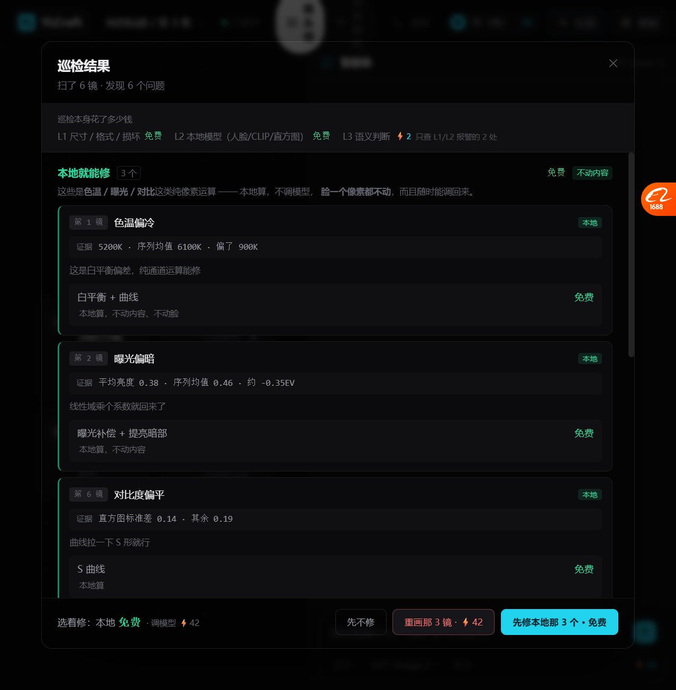
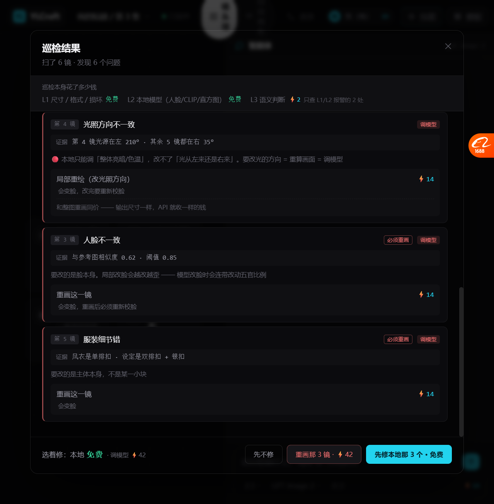
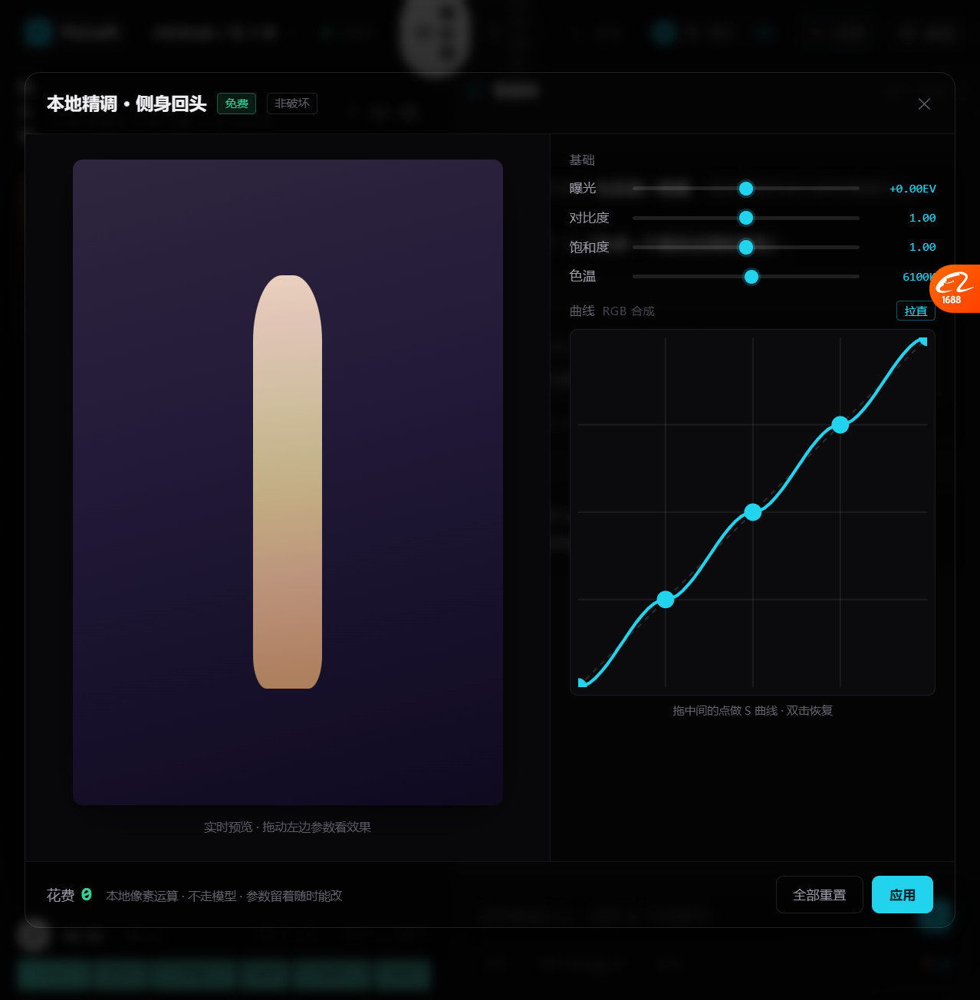
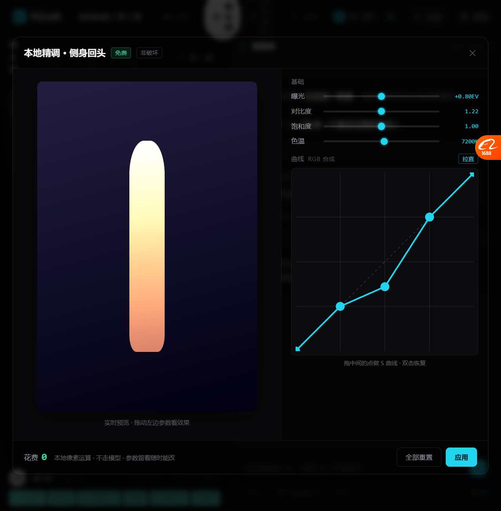
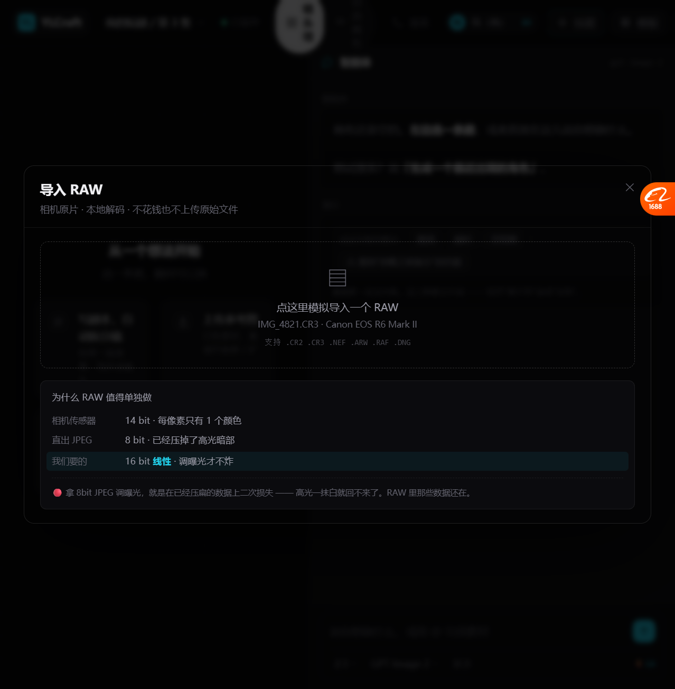
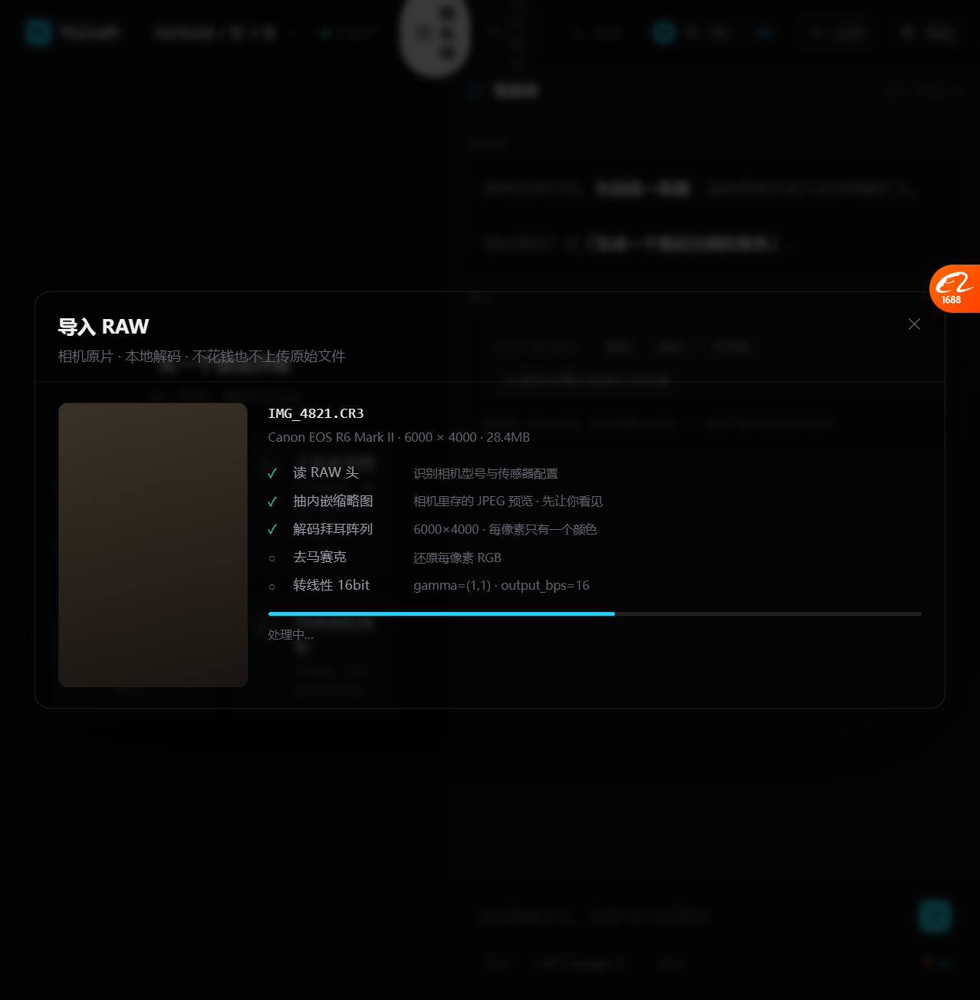
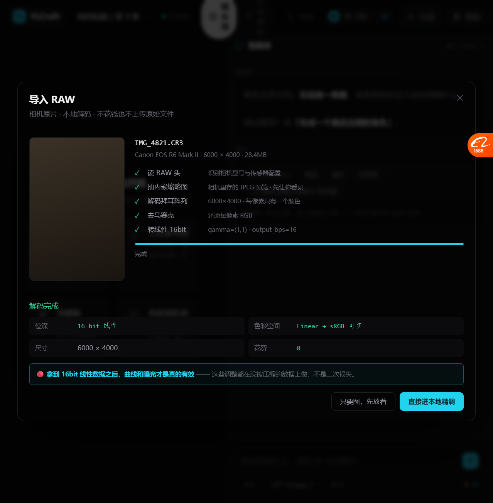

# 本地精调 + RAW + 巡检修正 + 主链路（2026-10-19）

> 这一轮全部围绕**一件事**：
> **哪些操作是真的免费，哪些必须花钱 —— 而且要把这条线在界面上说清。**

---

## 一、先修正上一轮的错误

### 我错在哪

我之前写「只改光照 ⚡3 / 重画 ⚡14」，暗示「改光照比较便宜」。

**实际：两个都调同一个生图接口（gpt-image-2 / flux），输出尺寸一样，价格一样。**

大多数生图 API 按「输出分辨率 × 质量」计费，**不按「你改了多少」**。

### 真实的分界线

```
第 1 层  本地像素运算          ✅ 免费
         曲线 / 色阶 / 曝光 / 白平衡 / 裁剪 / 旋转 / RAW 解码

第 2 层  本地模型              ✅ 免费（慢）
         人脸相似度 / CLIP / 直方图统计

第 3 层  云端生图模型          💰 花钱，改多改少一个价
         局部重绘 / 改光照 / 整图重画
```

🔴 **「改光照」属于第 3 层。我之前把它当成第 1 层了。**

---

## 二、巡检面板：改成「本地能修」vs「要调模型」



```
巡检结果
扫了 6 镜 · 发现 6 个问题

巡检本身花了多少钱
L1 尺寸/格式/损坏        免费
L2 本地模型(人脸/CLIP)   免费
L3 语义判断             ⚡2   只查 L1/L2 报警的 2 处

✅ 本地就能修  3 个        免费   [不动内容]
这些是色温/曝光/对比这类纯像素运算 —— 本地算，不调模型，
脸一个像素都不动，而且随时能调回来。

┌─ 第 1 镜  色温偏冷                    [本地] ─┐
│ 证据  5200K · 序列均值 6100K · 偏了 900K      │
│ 这是白平衡偏差，纯通道运算能修                  │
│ 白平衡 + 曲线                          免费   │
│ 本地算，不动内容、不动脸                       │
└──────────────────────────────────────────┘
（第 2 镜 曝光偏暗、第 6 镜 对比度偏平 同理）
```



```
⚠️ 必须调模型  3 个               共 ⚡42   [会变脸]
这些要改的是画面内容本身（光的方向、脸、衣服细节），
本地算法改不了。🔴 而且是「改多改少一个价」。

┌─ 第 4 镜  光照方向不一致              [调模型] ─┐
│ 证据  第4镜光源在左 210° · 其余 5 镜都在右 35°     │
│ 🔴 本地只能调「整体亮暗/色温」，改不了「光从左来    │
│    还是右来」。要改光的方向 = 重算画面 = 调模型    │
│ 局部重绘（改光照方向）                    ⚡14   │
│ 会变脸，改完要重新校脸                          │
│ 和整图重画同价 —— 输出尺寸一样，API 收一样的钱     │
└─────────────────────────────────────────────┘
```

### 关键变化

| 之前（错） | 现在（对） |
| --- | --- |
| 调色 ⚡2 | 调色 **免费** |
| 只改光照 ⚡3 | 改光照 **⚡14，和重画同价** |
| 按「便宜/贵」分组 | 按「**本地**/调模型」分组 |
| 「省 4.7 倍」 | 「**改多改少一个价**」 |

---

## 三、本地精调：曲线 / 曝光 / 白平衡（真的免费）



```
本地精调 · 侧身回头   [免费] [非破坏]

┌──────────────┬──────────────────────────┐
│              │ 基础                      │
│              │  曝光    [──●──] +0.00EV   │
│   [图片预览]  │  对比度  [──●──] 1.00      │
│              │  饱和度  [──●──] 1.00      │
│              │  色温    [──●──] 6100K     │
│              │                          │
│              │ 曲线 RGB 合成      [拉直]  │
│              │  ┌────────────────┐      │
│              │  │          ╱●    │      │
│              │  │      ●╱        │      │
│              │  │   ●╱           │      │
│              │  │ ●╱             │      │
│              │  └────────────────┘      │
│              │ 拖中间的点做 S 曲线·双击恢复 │
└──────────────┴──────────────────────────┘

花费 0   本地像素运算·不走模型·参数留着随时能改
                          [全部重置] [应用]
```



**拉 S 曲线 + 曝光 +0.8 + 色温 7200K 之后，画面明显变亮变暖 —— 而且花了 0。**

### 技术上怎么做的

**曲线 = 查找表（LUT）**，用 SVG 的 `feComponentTransfer`：

```html
<filter id="leCurve">
  <feComponentTransfer>
    <feFuncR type="table" tableValues="0 0.07 0.13 0.20 ..."/>
    <feFuncG type="table" tableValues="..."/>
    <feFuncB type="table" tableValues="..."/>
  </feComponentTransfer>
</filter>
```

拖曲线点 → 重算 16 个 `tableValues` → 浏览器实时重绘。**零成本、零延迟。**

### 🔴 一个必须记的技术坑

**默认曲线用 smoothstep（`3t²-2t³`）插值 → 曲线会在等距控制点之间鼓起来，默认状态下看起来就不是直线。**

修法：**改成分段线性插值**。

```js
function curveSample(pts, x){
  // 线性插值：默认完美直线，拖动后也不会过冲
  let k = 0;
  while (k < pts.length - 2 && x > pts[k+1][0]) k++;
  const t = (x - pts[k][0]) / (pts[k+1][0] - pts[k][0]);
  return pts[k][1] + (pts[k+1][1] - pts[k][1]) * t;
}
```

**实测**：默认 `tableValues = 0.00, 0.07, 0.13, 0.20, 0.27`（完美线性）。

---

## 四、RAW 导入：本地解码，零成本



```
导入 RAW
相机原片 · 本地解码 · 不花钱也不上传原始文件

┌──────────────────────────────────────┐
│ ▤  点这里模拟导入一个 RAW                │
│    IMG_4821.CR3 · Canon EOS R6 Mark II │
│    支持 .CR2 .CR3 .NEF .ARW .RAF .DNG   │
└──────────────────────────────────────┘

为什么 RAW 值得单独做
  相机传感器    14 bit · 每像素只有 1 个颜色
  直出 JPEG    8 bit · 已经压掉了高光暗部
  我们要的      16 bit 线性 · 调曝光才不炸   ← 高亮

🔴 拿 8bit JPEG 调曝光，就是在已经压扁的数据上二次损失 ——
   高光一抹白就回不来了。RAW 里那些数据还在。
```



```
IMG_4821.CR3
Canon EOS R6 Mark II · 6000×4000 · 28.4MB

✓ 读 RAW 头        识别相机型号与传感器配置
✓ 抽内嵌缩略图      相机里存的 JPEG 预览·先让你看见
✓ 解码拜耳阵列      6000×4000·每像素只有一个颜色
○ 去马赛克         还原每像素 RGB
○ 转线性 16bit     gamma=(1,1)·output_bps=16
━━━━━━━━━━━━━━━━━━━━━━━━━━━ 60%
处理中…
```



```
解码完成
  位深      16 bit 线性
  色彩空间   Linear → sRGB 可切
  尺寸      6000 × 4000
  花费      0

🔴 拿到 16bit 线性数据之后，曲线和曝光才是真的有效 ——
   这些调整都在没被压缩的数据上做，不是二次损失。

[只要图，先放着]  [直接进本地精调]
```

### 真做时的技术方案（已查证）

```python
import rawpy

with rawpy.imread('shot.cr3') as raw:
    rgb = raw.postprocess(
        gamma=(1,1),        # 🔴 不套 gamma → 拿线性数据
        no_auto_bright=True,
        output_bps=16       # 🔴 16 位
    )
```

| 项 | 情况 |
| --- | --- |
| 库 | **rawpy**（LibRaw 封装） |
| 许可 | **MIT** ✅ 可以直接用 |
| 平台 | Win/Mac/Linux 都有 wheel |
| 性能技巧 | `raw.extract_thumb()` 先出内嵌缩略图（瞬时），全质量后台算 |

---

## 五、主链路串联：状态真的流动

新增「花费」chip 在顶栏，以及「▶ 完整链路演示」按钮。


### 状态联动（实测）

```
① 本地精调改色温 6400K
   ↓
② 巡检里的「第 1 镜 色温偏冷」自动变成 ✓ 已修（划线置灰）
   ↓
③ 巡检修本地 3 项
   ↓
④ 3 项全打勾，底部按钮从 3 个变 2 个
   提示变成「本地已全部修完 · 只剩调模型的 3 个」
   ↓
⑤ 花费始终 = 0
```

**实测结果：**
```
改色温后 FIXED=f1 | 巡检已修项=1 | 本地全修=true | SPENT=0 | 底部按钮=2
```

🔴 **这才是"串联"的意思：不是把面板堆在一起，是一个动作的结果出现在另一个面板里。**

### 本地精调里也会提醒

打开本地精调时，如果巡检有未修的本地问题，面板顶部会说：

```
💡 巡检发现 3 个本地能修的问题：
   第1镜 色温偏冷、第2镜 曝光偏暗、第6镜 对比度偏平
   调下面这些参数就能修，不用花钱。
```

---

## 六、实测汇总

| 项 | 结果 |
| --- | --- |
| 巡检按「本地/调模型」分组 | ✅ 3 + 3 |
| 本地项显示「免费」 | ✅ |
| 调模型项显示真实价格 + 「改多改少一个价」 | ✅ |
| 本地精调面板打开 | ✅ 4 滑块 + 曲线 |
| 曲线默认是直线 | ✅ `tableValues=0.00,0.07,0.13,0.20,0.27` |
| 拖点做 S 曲线 | ✅ 中段压到 0.363 |
| filter 生效 | ✅ `url(#leCurve) brightness(1.28) contrast(1.22)` |
| 曝光/色温联动 | ✅ 画面变亮变暖 |
| 双击曲线复位 | ✅ |
| RAW 选择面板 | ✅ 含 8bit vs 16bit 说明 |
| RAW 解码 5 步进度 | ✅ |
| 缩略图在第 2 步就出 | ✅ |
| 解码完成显示 16bit 线性 · 花费 0 | ✅ |
| 本地精调后巡检自动标记已修 | ✅ `FIXED=f1` |
| 巡检修本地后打勾 | ✅ `巡检已修项=1` |
| 底部按钮数随状态变 | ✅ 3 → 2 |
| 花费 chip | ✅ |
| 旧功能未被破坏 | ✅ 12 个函数全在 |

---

## 七、修过的问题（重要）

### 🔴 文件被 PowerShell 写坏了

用 `$lines[0..($start-1)]` 做行切片，但 `$start = -1`（因为 `-like '*INSPECT_FINDINGS = [*'` 里 `[` 是通配符特殊字符，报错导致 start 没赋值），
**结果把原文件切成了「第一行 + 新块 + 整个原文件」**，文件从 193KB 变成 200KB，开头变成 `<!DOCTYPE html></html></body>`。

**恢复方式**：定位到第二个 `<!DOCTYPE html>`（index 6503），从那截到末尾 —— 原文件完整地在后面。

**教训**：
1. **不要用 PowerShell 做复杂的行范围切片** —— 负索引和空值会静默出错
2. **`-like` 的通配符里 `[` `]` `*` `?` 都是特殊字符** —— 要匹配它们必须用 `-eq` 或 `[regex]::Escape`
3. **改完必须立刻验证文件完整性**（大小、开头、结尾、关键函数数）
4. 这个文件**从未提交过 git**，所以没有任何回滚兜底

### 其他修过的

| 问题 | 修法 |
| --- | --- |
| 曲线默认不是直线 | smoothstep → 分段线性 |
| `curveToTable` 里也用了 smoothstep | 统一改成 `curveSample` |
| RAW 面板高度撑满屏幕 | `.raw-body` 的 `flex:1` → `flex:0 1 auto` |

---

## 八、还没做的

| 项 | 现状 |
| --- | --- |
| 真曲线应用到真图片 | 现在只做 CSS filter 预览，没有导出 |
| 分通道曲线（R/G/B 单独） | 只有一个 RGB 合成 |
| 色阶（黑白场 + gamma） | 没做，只有曲线 |
| 直方图显示 | 没做 |
| 真 RAW 解码 | 演示流程是模拟的 |
| 本地模型的真巡检 | 6 个问题写死 |
| 参数持久化（刷新后还在） | 内存，刷新丢 |
| 导出（应用曲线后出图） | 只有 CSS filter |

---

## 九、这一轮的核心结论

> **真正免费的不是"少改一点"，是"本地能算的那部分"。**
>
> 调色免费，改光照不免费。
> 曲线免费，换背景不免费。
> RAW 解码免费，AI 重绘不免费。
>
> **把这条线画在界面上，用户才知道该往哪使劲。**
