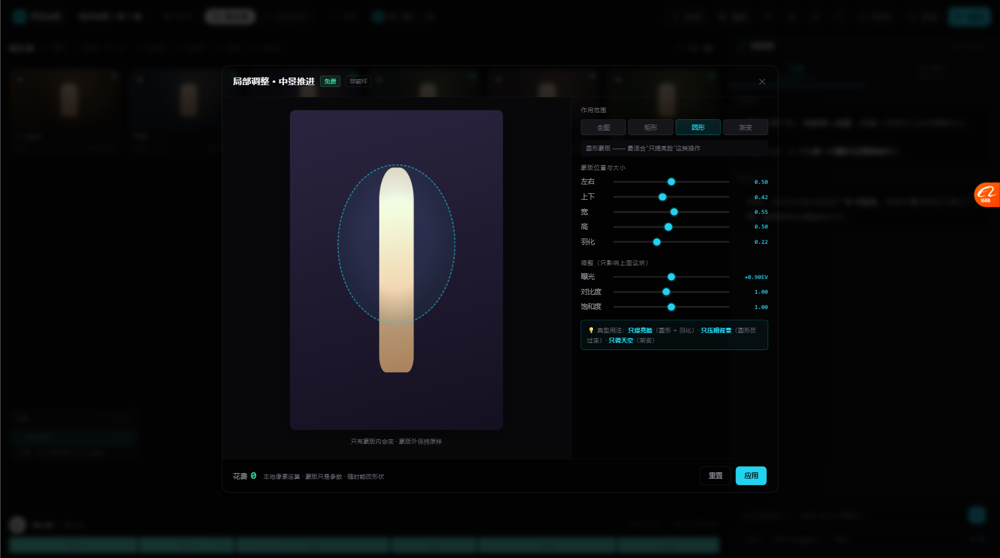

# 补完最后两项 P0：局部调整蒙版 + 图层混合模式（2026-10-19）

> 按像素蛋糕 / PS 平替对照，这两项是「专业后期最核心、我们完全没有」的。
> 做完这两项，图片编辑这块才真的能用。

---

# 一、局部调整（蒙版 / 渐变 / 径向）



## 1.1 解决什么问题

**之前只能整图调** —— 想「只提亮脸」「只压暗背景」「只调天空」全做不到。

PS 里这是最核心的能力之一（调整图层 + 蒙版）。

## 1.2 四种作用范围

```
作用范围   [全图] [矩形] [圆形✓] [渐变]
```

| 模式 | 适合什么 |
| --- | --- |
| **全图** | 整张统一调（默认） |
| **矩形** | 圈一块区域（比如只调产品） |
| **圆形** | 🔴 最适合「只提亮脸」 |
| **渐变** | 适合「只调天空上半部分」 |

## 1.3 能拖、能羽化

```
蒙版位置与大小
  左右    [──●──] 0.50
  上下    [──●──] 0.42
  宽      [──●──] 0.55
  高      [──●──] 0.50
  羽化    [──●──] 0.22
  角度    [──●──] 90°     ← 只有渐变模式有
```

**图片上的虚线就是蒙版边界，可以直接拖。**

## 1.4 参数只影响蒙版内

```
调整（只影响上面这块）
  曝光    [──●──] +0.90EV
  对比度  [──●──] 1.00
  饱和度  [──●──] 1.00
```

## 1.5 效果看得见

截图里：**圆形蒙版内的画面明显提亮了（+0.90EV），圆外完全没变。**

这就是局部调整的意义 —— 也是之前做不到的。

## 1.6 技术上怎么做的

```js
// 调整层用 CSS mask-image 控制作用范围
adj.style.maskImage = `radial-gradient(ellipse 27.5% 25% at 50% 42%,
  #000 0%, #000 78%, transparent 100%)`;
adj.style.filter = 'brightness(1.27) contrast(1) saturate(1)';
```

- **底层** = 原图
- **上层** = 同一张图 + filter，用 mask 只露出蒙版区域
- 羽化 = 渐变的过渡带宽度
- `maskImage: none` = 全图模式

**纯 CSS，零成本，不需要像素级处理。**

## 1.7 面板里的用法提示

```
💡 典型用法：只提亮脸（圆形 + 羽化）· 只压暗背景（圆形反过来）· 只调天空（渐变）
```

---

# 二、图层混合模式

## 2.1 解决什么问题

**之前有图层但只能「正常」叠加 —— 等于半个图层系统。**

PS 图层一半的价值在混合方式：正片叠底、滤色、叠加、柔光…

## 2.2 六种模式

选中某个层后，图层面板里出现：

```
透明度  [──●──] 100%
混合    [正片叠底 ▾]
        变暗：两个颜色相乘，适合压暗、上色
```

| 模式 | CSS | 干什么 |
| --- | --- | --- |
| **正常** | `normal` | 直接盖上去（默认） |
| **正片叠底** | `multiply` | 变暗：两色相乘，适合压暗、上色 |
| **滤色** | `screen` | 变亮：反过来相乘，加光、去黑底 |
| **叠加** | `overlay` | 暗的更暗、亮的更亮 —— 增强对比 |
| **柔光** | `soft-light` | 温和版叠加，调氛围不伤细节 |
| **颜色** | `color` | 只取色相饱和度，保留下面的明暗 |

**每种下面都有一句人话解释** —— 不用记名字也知道干什么。

## 2.3 选完立刻能在画布上看到

```js
ov.style.mixBlendMode = 'multiply';
```

当前镜头的缩略图上会叠一层按混合模式合成的效果。

## 2.4 实测

```
选项数 = 6
选 multiply → ovBlend = "multiply"，提示"变暗：两个颜色相乘，适合压暗、上色"
选 overlay  → ovBlend = "overlay"
```

---

# 三、这两项做完，图片编辑才算「能用」

## 3.1 之前的三处「半套」补了两处

| 半套 | 状态 |
| --- | --- |
| 有图层，没混合模式 | ✅ **补上了**（6 种） |
| 有精调，没预设 | ✅ **补上了**（21-presets.js） |
| 有批量出图，没批量改图 | ✅ **补上了**（22-batch.js） |

**三处全补完了。**

## 3.2 现在的图片编辑链路

```
① 生成 / 导入（RAW 16bit）
      ↓
② 本地精调（整图）：曝光 / 对比 / 饱和 / 色温 / 色阶 / 分通道曲线
      ↓
③ 局部调整（蒙版）：只提亮脸 / 只压暗背景 / 只调天空
      ↓
④ 图层 + 混合模式：多层叠加，正片叠底 / 滤色 / 叠加…
      ↓
⑤ 预设 + 批量应用：一套参数套 12 镜
      ↓
⑥ 导出（各层按序合成）
      ↓
⑦ 巡检（本地能修的免费，要调模型的告诉你要花多少）
```

**这条链路现在能走通了。**

---

# 四、文件变化

| 文件 | 变化 |
| --- | --- |
| `canvas/js/23-mask.js` | 🆕 局部调整（4 种蒙版 + 拖动 + 羽化） |
| `canvas/js/18-panels.js` | 图层加混合模式（6 种 + 人话解释 + 画布预览） |
| `canvas/index.html` | 引入 23，工具栏加局部调整按钮 |
| `canvas/css/05-panels.css` | 加蒙版/混合模式样式 |

---

# 五、实测

| 项 | 结果 |
| --- | --- |
| 局部调整面板打开 | ✅ 4 种模式 |
| 圆形蒙版生效 | ✅ `radial-gradient(...)` 生成 |
| **圆内变亮、圆外不变** | ✅ 截图可见 |
| 蒙版可拖动 | ✅ 手柄 + mousemove |
| 羽化可调 | ✅ |
| 渐变角度可调 | ✅ 仅渐变模式显示 |
| 混合模式 6 种 | ✅ |
| 切换生效 | ✅ multiply / overlay 都验证 |
| 每种有人话解释 | ✅ |
| 画布预览 | ✅ 缩略图叠加层 |

---

# 六、还没做的（对照检查里剩下的）

| 优先 | 缺什么 | 说明 |
| --- | --- | --- |
| 🟡 P1 | AI 超清 / 放大 | 输出分辨率上不去 |
| 🟡 P1 | HSL / 色彩分级 | 只调某个颜色 |
| 🟡 P1 | 降噪 + 锐化 + 镜头虚化 + 柔化阴影 | 都能本地做，免费，约 370 行 |
| 🟡 P1 | AI 追色（三模式） | 像素蛋糕那张决策表 |
| 🟢 P2 | 磨皮 / 瘦脸 / 祛瑕疵 | 需要专门模型 |
| ⬜ P3 | 镜头校正 / 透视 / 克隆图章 / 选区 | **明确不做**（不是我们场景） |

## P0 全部完成

对照检查里列的 4 项 P0：
1. ✅ 批量应用效果至其他图
2. ✅ 局部调整（蒙版/渐变/径向）
3. ✅ 预设（保存/复用精调参数）
4. ✅ 图层混合模式

**P0 清零了。**
