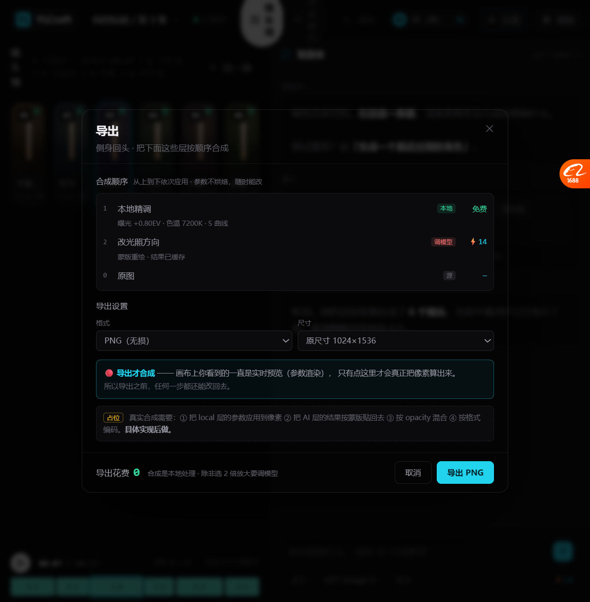
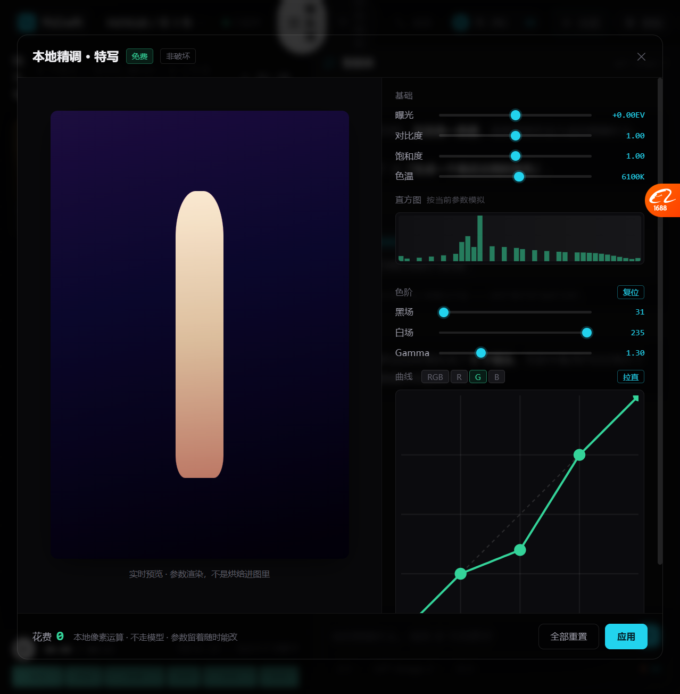

# 非破坏性编辑：文档层 / 预览层 / 导出层（2026-10-19）

> 你的纠正：**「曲线导出成真图什么意思，我们应该是在画布还有页面编辑 然后实时预览保存吧
> 其他操作一起完事或者点导出 和 ps 一样」**
>
> **你说对了。我之前说「导出成真图」是把它当成一次性烘焙 —— 那就成破坏性编辑了。**

---

## 一、正确的模型（和 PS 一样）

```
┌─ ① 文档层：存什么 ─────────────────────────┐
│  不是像素，是参数：                          │
│    { 曝光: +0.8, 色温: 7200, 曲线: [...],     │
│      色阶: {黑场:31, 白场:235, gamma:1.3} }  │
│  + AI 编辑层（蒙版、重绘块、顺序、opacity）    │
└────────────────────────────────────────────┘
              ↓ 一直用这些参数渲染
┌─ ② 预览层：你看到什么 ─────────────────────┐
│  画布上实时按参数渲染                        │
│  看到的就是最终效果，不是"大概是这样"          │
└────────────────────────────────────────────┘
              ↓ 只在导出时算像素
┌─ ③ 导出层：什么时候合成 ───────────────────┐
│  所有层按顺序合成 → 出最终图                  │
│  = PS 的「存储为 / 导出」                    │
└────────────────────────────────────────────┘
```

### 三条规则

| 问题 | 答案 |
| --- | --- |
| 保存什么？ | **参数**，不是像素。所以随时能改回去 |
| 什么时候看到效果？ | **一直** —— 画布上实时渲染 |
| 什么时候合成？ | **只在导出时**，或你主动点「应用」 |

🔴 **关键：导出之后参数还在，不是烘焙掉。下次还能改完再导一次。**

---

## 二、导出面板（占位，位置占上了）



```
导出
侧身回头 · 把下面这些层按顺序合成

合成顺序  从上到下依次应用 · 参数不烘焙，随时能改
┌──────────────────────────────────────────┐
│ 1  本地精调              [本地]   免费      │
│    曝光 +0.80EV · 色温 7200K · S 曲线      │
│ 2  改光照方向            [调模型]  ⚡14     │
│    蒙版重绘 · 结果已缓存                    │
│ 0  原图                  [源]     —        │
└──────────────────────────────────────────┘

导出设置
  格式  [PNG（无损）▾]      尺寸  [原尺寸 1024×1536 ▾]

🔴 导出才合成 —— 画布上你看到的一直是实时预览（参数渲染），
   只有点这里才会真正把像素算出来。
   所以导出之前，任何一步都还能改回去。

[占位] 真实合成需要：① 把 local 层的参数应用到像素
      ② 把 AI 层的结果按蒙版贴回去 ③ 按 opacity 混合
      ④ 按格式编码。具体实现后做。

导出花费 0   合成是本地处理 · 除非选 2 倍放大要调模型
                                        [取消] [导出 PNG]
```

**按「先占位置」原则：入口、数据结构、合成顺序、实现要点都占上了，合成逻辑后做。**

---

## 三、分通道曲线 / 色阶 / 直方图



### 3.1 直方图

按当前参数**模拟**分布（真实现要从像素算）：

```
      ▁▁▂▄█▆▄▂▁▁▁▂▁▁▁▁▁▁
      暗 ←──────────→ 亮
```

- 颜色跟随当前通道（G 通道 → 绿色柱子）
- 改色阶/曲线 → 直方图跟着变形（能看出效果）

### 3.2 色阶

| 滑块 | 值 | 作用 |
| --- | --- | --- |
| 黑场 | 31 | 低于这个值压成全黑 |
| 白场 | 235 | 高于这个值提成全白 |
| Gamma | 1.30 | 中间调亮度曲线 |

**色阶 + 曲线是串起来的：**

```
输入 → 色阶（黑场/白场/gamma）→ RGB 合成曲线 → 该通道曲线 → 输出
```

全部合成**一个 LUT** 塞给 `feComponentTransfer`，所以还是零成本实时。

### 3.3 分通道曲线

```
曲线   [RGB] [R] [G] [B]        [拉直]
```

- 4 个通道**各一套控制点**
- RGB 合成曲线先作用，再叠上单通道曲线
- 曲线颜色跟着通道变（R 红 / G 绿 / B 蓝）

**实测**（压暗 G 通道中间调）：
```
G2=0.35  R2=0.50        ← 只有 G 变了，R 没动
R≠G=true  G≠B=true      ← 三条 LUT 表完全不同
中段 R=0.6017  G=0.5127  ← G 被压暗
```

**效果**：G 通道压暗 → 画面偏暖红（因为绿少了，红蓝相对增强）。

---

## 四、实测

| 项 | 结果 |
| --- | --- |
| 导出面板打开 | ✅ 3 层（原图+本地+AI） |
| 合成顺序展示 | ✅ 带层类型和单价 |
| 格式/尺寸选择 | ✅ 4 种格式 + 3 种尺寸 |
| 「导出才合成」说明 | ✅ |
| 实现要点占位 | ✅ 4 步写明 |
| 直方图渲染 | ✅ 41 根柱子 |
| 直方图跟随通道变色 | ✅ |
| 色阶三滑块 | ✅ 黑场31/白场235/gamma1.30 |
| 色阶进 LUT | ✅ 前 4 个采样被压到 0 |
| 4 个通道 tab | ✅ RGB/R/G/B |
| **分通道独立** | ✅ R≠G≠B，中段 0.60 vs 0.51 |
| 曲线颜色跟随通道 | ✅ |
| 旧功能未被破坏 | ✅ 14 个函数全在，6 种 schema |

---

## 五、修过的 bug

| bug | 原因 | 修法 |
| --- | --- | --- |
| `curveSample` 报 `undefined reading '0'` | `leRenderHist` 里传了字符串 `'g'` 而不是点数组 | 改用 `channelSample(ch, x)` |

---

## 六、还没做的（都写着"具体实现后做"）

| 项 | 现状 |
| --- | --- |
| **真实合成** | 导出面板是占位，没有真算像素 |
| 真实直方图 | 从像素统计，现在是模拟 |
| 层 opacity / 蒙版混合 | 只显示，没实现 |
| 撤销栈 | 数据结构留了 `history: []`，没实现 |
| 参数持久化 | 刷新丢 |
| 16bit 导出 | 只有 TIFF 16bit 选项，没实现 |
| 2 倍放大导出 | 会调模型，没接 |

---

## 七、这次的原则：先占位置

你说「**我们原型都是先把位置占上，具体实现再做**」。这次严格按这个做了：

| 占住的 | 具体是什么 |
| --- | --- |
| **入口** | 浮条加了导出按钮 |
| **数据结构** | `makeLocalLayer()` / `makeAiLayer()` / `SHOT_DOC_DEMO`（层类型、参数、cost、mask） |
| **合成顺序** | 原图 → 本地层 → AI 层，带层类型和单价 |
| **实现要点** | 面板里直接写清 4 步（应用到像素/按蒙版贴回/按 opacity 混合/按格式编码） |
| **设置项** | 格式 4 种、尺寸 3 种 |

**后面真正做的时候，照着这个占位填就行，不用重新想结构。**
