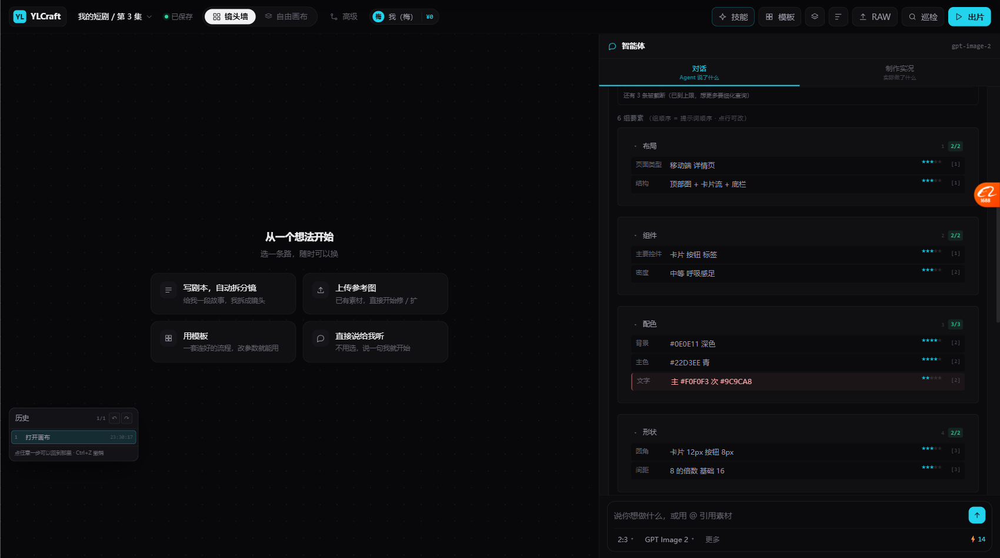
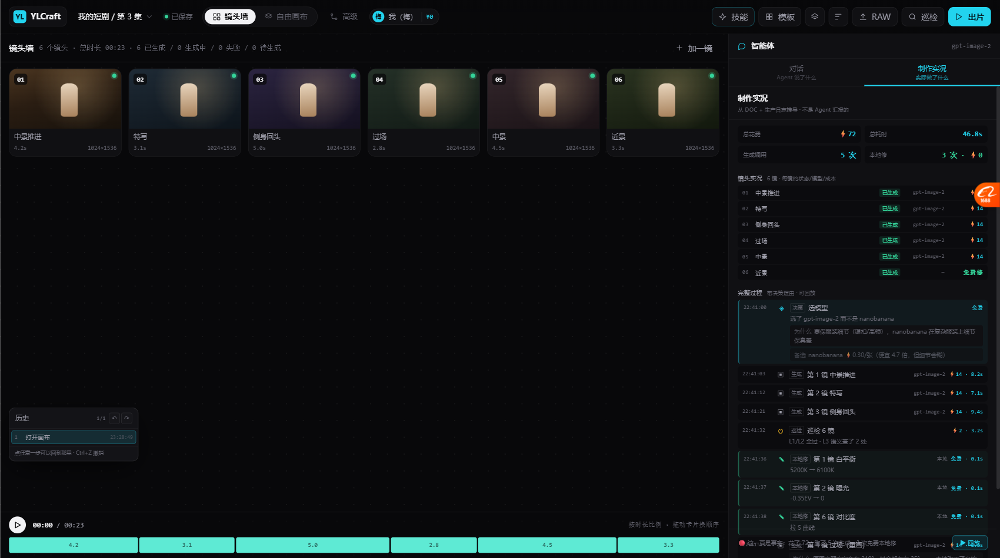
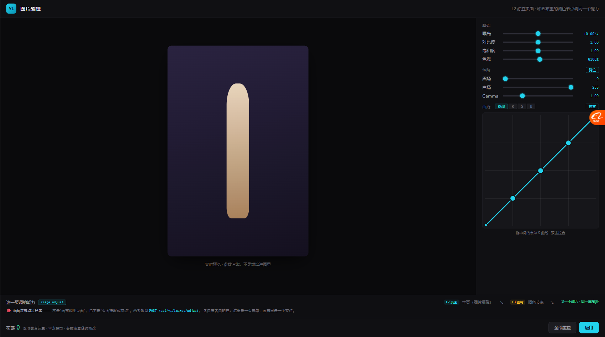

# P0 三项完成：AI 适配度 / 制作实况 / L2 独立入口（2026-10-19）

> 这三项都来自调研结论，不是拍脑袋：
> - **AI 适配度星级** ← 深海导演（BeefTV 最热 skill）
> - **制作实况看板** ← OpenMontage 的 Backlot
> - **L2 独立入口** ← 我们自己的 E1 规则（页面与节点是兄弟）

---

# 一、AI 适配度星级



## 1.1 它解决什么问题

深海导演那份 skill 的原话：

> **AI适配度说明**：
> ★★★★★ 极易实现（已有大量训练数据）
> ★★★★ 较易（需精确描述镜头参数）
> ★★★ 可实现（需复杂提示词）
> ★★ 需后期处理或特殊技术

> 🔴 「把"AI 到底能不能做到"量化成星级 ——
> 直接解决了**"提示词写得很美但生成不出来"**的问题。」

**我们的病**：搜索抽了 20 项要素，拼成一段漂亮的提示词，
生成出来一半没体现 —— 但不知道是哪几项的问题。

## 1.2 我们的做法：规则推断 + 手动覆盖

```js
const AI_FIT_RULES = [
  // 2 星：模型最难的地方
  { re:/文字|logo|品名|规格|标题|字体/i, ai:2,
    why:'文字和 logo 是模型最弱的一环，字形基本保不住' },
  { re:/比例|遮挡|持握|手指|手势/i, ai:2,
    why:'比例关系和手部动作最容易崩' },
  { re:/机位|景别|视角|透视/i, ai:2,
    why:'精确机位需要很长的参数描述，且经常不听话' },

  // 3 星
  { re:/脸型|身高|体型|肩宽|容量/i, ai:3, why:'需精确控制，跨镜一致性差' },
  { re:/材质|表面|纹理|反光|磨砂/i, ai:3, why:'材质描述容易出偏差' },
  { re:/构图|版式|留白|栅格|布局/i, ai:3, why:'版式类要求高' },

  // 4 星
  { re:/瞳色|肤色|发色|颜色|主色|辅色/i, ai:4, why:'颜色能描述，但容易偏' },
  { re:/服装|上装|下装|鞋|配饰|标志物/i, ai:4, why:'常见元素，训练数据多' },

  // 5 星
  { re:/发型|光比|光|色调|氛围|风格|调性/i, ai:5, why:'风格/光照类效果最好' }
];
```

**为什么用规则不用标注**：
- 标注要改 6 个 schema 的 80+ 个要素，慢
- 规则自动覆盖，**新加要素自动有星级**
- 手动标注优先（`elem.ai` 字段），需要时精确覆盖

## 1.3 界面上怎么表现

要素行右侧加星级，**2 星的整行标红**：

```
布局 2/2
  页面类型   移动端 详情页                    ★★★★☆  [1]
  结构      顶部图 + 卡片流 + 底栏             ★★★★☆  [1]

配色 3/3
  背景      #0E0E11 深色                     ★★★★☆  [2]
  主色      #22D3EE 青                       ★★★★☆  [2]
┌ 文字      主 #F0F0F3 次 #9C9CA8            ★★☆☆☆  [2]  ← 红框
└──────────────────────────────────────────────┘
   ↑ 「文字」是模型最弱的一环，自动标红
```

提示词下方再加一条汇总：

```
◈ 生成难度：1 项很难生成（文字）· 2 项要精确描述（圆角、间距）
   难生成的那些建议：多跑几版挑一版 / 或先用「局部重绘」事后修
```

**悬停能看到原因**（`title` 里带 `why`）。

## 1.4 实测

```
脸型=3  瞳色=4  发型=5  标志物=4  上装=4  身高=3
```

对得上直觉：**发型/光照最好出，脸型/身高最难控。**

---

# 二、制作实况看板（对话 vs 实况分开）



## 2.1 来源与病根

OpenMontage 原话：

> 「**Chat tells you what the agent SAID.
> Backlot shows you what the production is actually DOING.**」
>
> 「对话告诉你 agent **说了**什么；Backlot 告诉你制作过程**实际在做**什么。」

**我们的病根**：Agent 面板只有对话，把过程压成一句「生成了 6 镜」。
看不到：**每镜花了多少钱、用了哪个模型、为什么选它、耗时多久。**

## 2.2 做法：同一个面板，两个 tab

```
┌──────────────────────────────────────┐
│  对话              │  制作实况          │
│  Agent 说了什么     │  实际做了什么       │
├──────────────────────────────────────┤
```

**两个 tab 在同一位置切换 —— 对比最强烈。**

## 2.3 看板内容

### 顶部四个数（事实，不是汇报）

```
总花费 ⚡72    总耗时 46.8s
生成调用 5 次   本地修 3 次 · ⚡0
```

### 镜头实况（每镜状态/模型/成本）

```
01 中景推进   已生成   gpt-image-2   ⚡14
02 特写      已生成   gpt-image-2   ⚡14
03 侧身回头   已生成   gpt-image-2   ⚡14
04 过场      已生成   gpt-image-2   ⚡14
05 中景      已生成   gpt-image-2   ⚡14
06 近景      已生成   —            免费修   ← 绿色
```

**第 6 镜显示「免费修」而不是 ⚡14** —— 因为它只有本地调整，没有重画。

### 完整过程（带决策理由）

```
22:41:00  ◈ 决策  选模型
          选了 gpt-image-2 而不是 nanobanana
          为什么：要保服装细节（银扣/高领），nanobanana 在复杂服装上细节保真差
          备选：nanobanana ⚡0.30/张（便宜 4.7 倍，但细节会糊）

22:41:03  ▣ 生成  第 1 镜 中景推进   gpt-image-2  ⚡14 · 8.2s
22:41:12  ▣ 生成  第 2 镜 特写       gpt-image-2  ⚡14 · 7.1s
22:41:21  ▣ 生成  第 3 镜 侧身回头   gpt-image-2  ⚡14 · 9.4s
22:41:32  ⊙ 巡检  巡检 6 镜         ⚡2 · 3.2s
          L1/L2 全过 · L3 语义查了 2 处
22:41:36  ✎ 本地修 第 1 镜 白平衡    本地  免费 · 0.1s
          5200K → 6100K
22:41:37  ✎ 本地修 第 2 镜 曝光      免费 · 0.1s
22:41:38  ✎ 本地修 第 6 镜 对比度    免费 · 0.1s
```

🔴 **决策条目带三样东西**：为什么选它、备选是什么、备选差在哪。
这就是 OpenMontage 的「决策审计链」（alternatives + reasoning）。

### 底部：这是事实 + 可回放

```
🔴 这一页是事实：花了 72、跑了 5 次生成、3 次免费本地修    [▶ 回放]
```

点「回放」→ 日志一条一条点亮（OpenMontage 的 `▶ REPLAY RUN`）。

## 2.4 关键设计原则

OpenMontage：

> 「**derive everything from the project files the pipeline already writes**」
> 看板不要求流水线额外上报，而是**从既有产物推导**。

我们的实现：从 `DOC.items`（镜头状态）+ `PROD_LOG`（事件流）推导，
**不让 Agent 额外写一份"汇报"**。

---

# 三、L2 独立入口（证明 E1）



## 3.1 为什么这个最重要

我们定的规则 **E1：页面与节点是兄弟**：

> 不是「画布调用页面」，也不是「页面提取成节点」。
> **两者都调同一个 L1 能力，各自有各自的壳。**

**但之前原型只有画布这一侧，没有独立页面 —— E1 从未被验证过。**

## 3.2 做了什么

新建 `canvas/image-editor.html` —— 一页真正的图片编辑页面：

```
┌──────────────────────────────────────────────────────┐
│ YL  图片编辑        L2 独立页面 · 和画布里的调色节点调同一个能力  │
├────────────────────────┬─────────────────────────────┤
│                        │ 基础                         │
│                        │  曝光   [──●──]  +0.00EV     │
│      [图片预览]         │  对比度 [──●──]  1.00        │
│                        │  饱和度 [──●──]  1.00        │
│                        │  色温   [──●──]  6100K       │
│                        │ 色阶                         │
│                        │  黑场/白场/Gamma             │
│                        │ 曲线  [RGB][R][G][B]         │
│                        │  ┌──────────────┐            │
│                        │  │      ╱●      │            │
│                        │  │  ●╱          │            │
│                        │  └──────────────┘            │
├────────────────────────┴─────────────────────────────┤
│ 这一页调的能力 [image-adjust]                            │
│ [L2 页面] 本页（图片编辑） ↘ [L3 画布] 调色节点 ↘ 同一个能力·同一套参数 │
│ 🔴 页面与节点是兄弟 —— 两者都调 POST /api/v1/images/adjust，│
│    各自有各自的壳：这里是一页表单，画布里是一个节点           │
├──────────────────────────────────────────────────────┤
│ 花费 0  本地像素运算·不走模型·参数留着随时能改   [重置][应用] │
└──────────────────────────────────────────────────────┘
```

## 3.3 关键的三个"一致"

| 项 | 页面 | 画布节点 | 一致？ |
| --- | --- | --- | --- |
| **能力** | `image-adjust` | `image-adjust` | ✅ |
| **参数结构** | `{exposure, levels, curves[]}` | 同 | ✅ |
| **算法** | 分段线性 LUT + SVG filter | 同 | ✅ |
| **成本** | ⚡0 | ⚡0 | ✅ |

**参数结构完全一样** —— 因为两边都按 `CAPS['image-adjust'].params` 来。

## 3.4 这一页证明了什么

| E1 的说法 | 现在的证据 |
| --- | --- |
| 页面不改 | ✅ 页面自己是完整的，不依赖画布 |
| 画布不调用页面 | ✅ 画布的调色面板独立实现，不是 iframe |
| 两者调同一个能力 | ✅ 同一套参数、同一个接口路径、同一个算法 |
| 加新用途 = 加配置 | ✅ 同一个 `image-adjust`，壳可以再加（比如 Skill 表单） |

---

# 四、文件变化

| 文件 | 变化 |
| --- | --- |
| `canvas/js/19-aifit.js` | 🆕 AI 适配度规则函数 |
| `canvas/js/20-board.js` | 🆕 制作实况看板 |
| `canvas/image-editor.html` | 🆕 L2 独立图片编辑页 |
| `canvas/js/09-search.js` | 要素行加星级、提示词下加难度汇总 |
| `canvas/index.html` | 引入 19/20，挂载 tab |
| `canvas/css/05-panels.css` | 加星级、看板样式 |

---

# 五、实测

| 项 | 结果 |
| --- | --- |
| AI 适配度规则 | ✅ 脸型=3 瞳色=4 发型=5 标志物=4 上装=4 身高=3 |
| 2 星要素标红 | ✅ 「文字」自动红框 |
| 难度汇总条 | ✅ 出现 |
| 制作实况 tab | ✅ 2 个 tab 可切 |
| 看板汇总 | ✅ 4 个数字卡 |
| 镜头实况 | ✅ 6 镜 + 免费修标记 |
| 决策日志 | ✅ 11 条，带为什么/备选 |
| 回放 | ✅ 逐条点亮 |
| L2 页面加载 | ✅ 7 滑块 + 4 通道 + 曲线 |
| L2 能力对照条 | ✅ 显示 image-adjust 和两个入口 |
| 旧功能 | ✅ 未破坏 |

---

# 六、还没做的

| 项 | 现状 |
| --- | --- |
| AI 适配度的手动标注界面 | 只有规则推断 + 代码里手写 |
| 星级影响生成策略 | 现在只是提示，没真的"难生成的先多跑几版" |
| 看板的真实数据源 | `PROD_LOG` 是写死的 |
| 看板真的联动画布状态 | 现在从 DOC 读，但没有实时更新 |
| L2 页面和画布真的共享代码 | 现在是两份实现（结构一致但不是同一份文件） |
| L2 页面的导出 | 只有"应用"弹窗 |

---

# 七、下一步（按之前的盘点）

P1 级：

| # | 做什么 |
| --- | --- |
| 1 | A2/A3：图层和撤销做真（现在是占位） |
| 2 | B1/B2/B3：程度滑杆 / 原图对比 / 批量应用 |
| 3 | C3：门禁强制（不批准不许过） |
| 4 | C4：常见问题诊断表 |

**或者你想先看这三项的效果再决定。**
