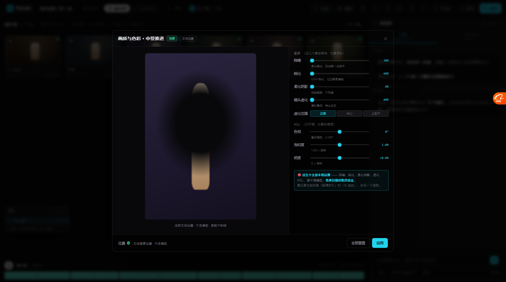
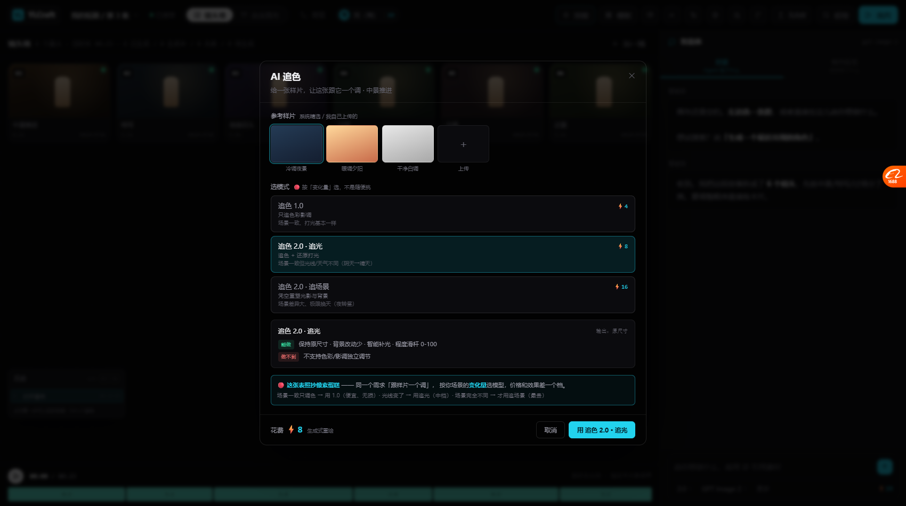

# P1 四项完成：画质四件套 + HSL + 超清放大 + AI 追色（2026-10-20）

> 这四项是对照检查里 P1 的全部。分两组：
> **免费的本地运算**（降噪/锐化/虚化/柔化阴影/HSL）vs **花钱的调模型**（超清放大/追色）。

---

# 一、画质与色彩（全本地，免费）



## 1.1 为什么单开一个面板

这五个都是「最容易做，也最常忘」的收尾处理。
放在精调面板里会让那个面板太长，所以单独一页。

## 1.2 五项 + 每个都有一句人话

```
画质（这几个最容易做，也最常忘）
  降噪      30%  柔化噪点，但会糊一点细节
  锐化      60%  USM 锐化，让边缘更清楚
  柔化阴影   0%  抬起暗部，不死黑
  镜头虚化  40%  模拟景深，突出主体

  虚化范围  [边缘✓] [中心] [上到下]

HSL（分开调，比整体调准）
  色相      0°   整体偏色，±180°
  饱和度  1.00   1.00 = 原样
  明度   +0.00   0 = 原样
```

**每项下面都有一句说明** —— 不用记参数名。

## 1.3 技术上怎么做的（全真实现）

用 **SVG filter 链**串起来：

```js
// ① 降噪：高斯小半径
<feGaussianBlur stdDeviation="0.36" result="denoised"/>

// ② 锐化：USM = 原图 + (原图 - 模糊) × 强度
<feGaussianBlur in="denoised" stdDeviation="1.6" result="blurred"/>
<feComposite in="denoised" in2="blurred" operator="arithmetic"
  k2="1.6" k3="-0.6"/>

// ③ 柔化阴影：feComponentTransfer 的 table 抬暗部
<feFuncR type="table" tableValues="0.022 0.25 0.5 0.75 1"/>

// ④ HSL：feColorMatrix 做饱和度矩阵 + hueRotate
<feColorMatrix type="hueRotate" values="30"/>
<feColorMatrix type="matrix" values="..."/>
```

**虚化**用 CSS `blur()` + 径向/线性 mask 控制范围：

```js
img.style.filter = 'url(#qFilter) blur(1.6px)';
img.style.maskImage = 'radial-gradient(ellipse 40% 32% at 50% 42%,
  transparent 0%, transparent 55%, #000 100%)';   // 中心清晰，边缘虚
```

## 1.4 截图能看出效果

**边缘明显虚化了，中心（人物）还是清晰的** —— 这就是镜头虚化的样子。

## 1.5 面板里也把「免费 vs 花钱」划清了

```
🔴 这五个全是本地运算 —— 降噪、锐化、柔化阴影、虚化、HSL，
   都不调模型，免费且随时能改回去。
   真正要花钱的是「超清放大」和「AI 追色」，在另一个面板。
```

---

# 二、AI 超清 / 放大（要调模型）

## 2.1 三档倍数，价格不同

```
放大倍数
┌────────┬────────┬────────┐
│   2×   │   3×   │   4×   │
│2048×3072│3072×4608│4096×6144│
│  ⚡6   │  ⚡10   │  ⚡16   │
└────────┴────────┴────────┘

☑ 人脸修复（放大后重新生成清晰五官）
```

## 2.2 说清为什么这个要花钱

```
🔴 为什么这个要花钱 —— 它不是"插值放大"（那样会糊），
   而是用模型重新生成细节。所以按输出像素数计费。
   4K 的 4× 比 2× 贵 2.7 倍，因为像素多 4 倍。
```

**并且给了个省钱顺序**：先做完全部免费的调整，再来放大最省钱。

---

# 三、AI 追色（三模式）—— 照抄像素蛋糕那张表



## 3.1 这是本轮最值得的一个

像素蛋糕的 AI 追色 2.0 给了三种模式，**按「变化量」选模型**。
我们讨论过这张表，现在完整实现了。

## 3.2 三种模式并排，按变化量递增

```
选模式  🔴 按「变化量」选，不是随便挑

┌─ 追色 1.0 ──────────────────────────── ⚡4 ─┐
│  只追色彩影调                                  │
│  场景一致、打光基本一样                         │
└────────────────────────────────────────────┘

┌─ 追色 2.0 · 追光 ───────────────────── ⚡8 ─┐  ← 选中
│  追色 + 还原打光                              │
│  场景一致但光线/天气不同（阴天→晴天）            │
└────────────────────────────────────────────┘

┌─ 追色 2.0 · 追场景 ─────────────────── ⚡16 ─┐
│  凭空重塑光影与背景                            │
│  场景差异大、极限换天（夜转昼）                  │
└────────────────────────────────────────────┘
```

## 3.3 选中后展开「能做 / 做不到」

```
追色 2.0 · 追光                    输出：原尺寸
[能做]   保持原尺寸 · 背景改动少 · 智能补光 · 程度滑杆 0-100
[做不到] 不支持色彩/影调独立调节
```

🔴 **「做不到」这一栏是关键** —— 不是我们选择不做，
**是模型本身的能力边界**。玩家得知道这个。

## 3.4 底部那张表照抄像素蛋糕

```
🔴 这张表照抄像素蛋糕 —— 同一个需求「跟样片一个调」，
   按你场景的变化量选模型，价格和效果差一个档。

   场景一致只调色 → 用 1.0（便宜、无损）
   光线变了 → 用追光（中档）
   场景完全不同 → 才用追场景（最贵）
```

## 3.5 选完之后 Agent 会说清"它做了什么、限制是什么"

```
用「追色 2.0 · 追光」追了色，花了 ⚡8。

它做的是：保持原尺寸、背景改动少、智能补光、程度滑杆 0-100。
限制是：不支持色彩/影调独立调节 —— 这是模型本身的能力边界，不是我选择不做。

这个会重算光照方向 —— 所以能"阴天变晴天"，但色彩和影调就不能单独调了。
```

---

# 四、现在「免费 / 花钱」的划分完整了

## 🔴 免费（本地像素运算）

| 能力 | 面板 |
| --- | --- |
| 裁剪 / 旋转 / 缩放 | 31 项能力 |
| 曝光 / 对比 / 饱和 / 色温 | 本地精调 |
| 色阶 / 分通道曲线 | 本地精调 |
| **降噪 / 锐化 / 柔化阴影 / 虚化** | 画质与色彩 🆕 |
| **HSL** | 画质与色彩 🆕 |
| 局部调整（蒙版） | 局部调整 |
| 图层混合模式 | 图层面板 |
| 预设 + 批量应用 | 预设/批量 |
| RAW 解码 | RAW 导入 |
| 导出合成 | 导出 |

## 💰 花钱（调模型）

| 能力 | 价格逻辑 |
| --- | --- |
| 生成 / 重画 | 按张 |
| 局部重绘 / 改光照 | **和重画同价** |
| **超清放大** | 按输出像素（2×⚡6 / 3×⚡10 / 4×⚡16）🆕 |
| **AI 追色** | 按模式（1.0 ⚡4 / 追光 ⚡8 / 追场景 ⚡16）🆕 |

**这条分界线现在贯穿所有面板。**

---

# 五、文件变化

| 文件 | 变化 |
| --- | --- |
| `canvas/js/24-quality.js` | 🆕 画质五件套（降噪/锐化/柔化阴影/虚化/HSL） |
| `canvas/js/25-enhance.js` | 🆕 超清放大 + AI 追色三模式 |
| `canvas/index.html` | 引入 24/25，工具栏加画质/追色入口 |
| `canvas/css/05-panels.css` | 加画质/追色样式 |

---

# 六、实测

| 项 | 结果 |
| --- | --- |
| 画质面板 7 个滑块 | ✅ |
| 降噪+锐化+虚化 filter 链 | ✅ `url(#qFilter) blur(1.6px)` |
| 虚化 mask（边缘虚化） | ✅ 截图可见 |
| HSL 三个滑块 | ✅ |
| 虚化范围三选一 | ✅ |
| 超清放大三档 | ✅ ⚡6/⚡10/⚡16 |
| 追色三模式 | ✅ ⚡4/⚡8/⚡16 |
| 模式详情（能做/做不到） | ✅ |
| 决策表说明 | ✅ |
| 免费/花钱分界 | ✅ 每个面板都标 |

---

# 七、对照检查的进度

## 已完成

| 等级 | 项数 | 内容 |
| --- | --- | --- |
| **P0** | 4 | 批量应用 · 局部调整 · 预设 · 混合模式 |
| **P1** | 4 | 降噪锐化虚化柔化阴影 · HSL · 超清放大 · AI 追色 |

**P0 + P1 全部完成。**

## 剩下

| 等级 | 缺什么 | 说明 |
| --- | --- | --- |
| 🟢 P2 | 磨皮 / 瘦脸 / 祛瑕疵 / 妆容 / 闭眼修复 | 需要专门模型（人脸关键点、分割） |
| ⬜ P3 | 镜头校正 / 透视 / 克隆图章 / 选区 / ERP / 联机拍摄 | **明确不做**（不是我们场景） |

**P2 是「人像基础美化」一整块** —— 需要专门模型，不是原型阶段能验证的。
