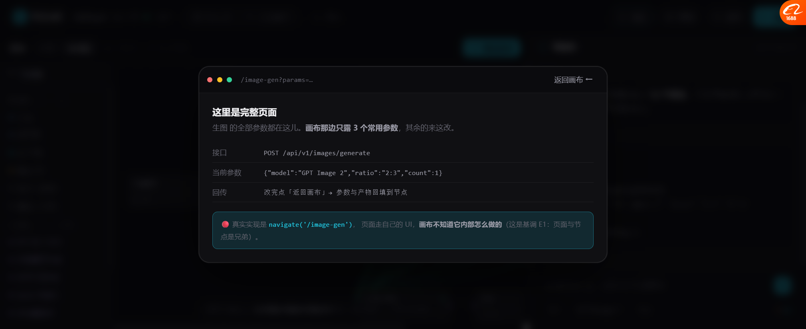
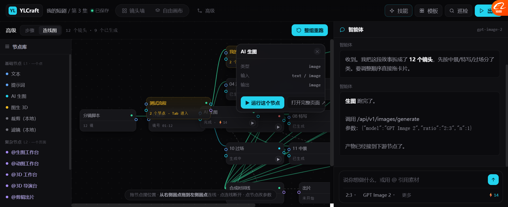

# P2 / P3 / P4 全部落地（2026-10-19）

> 三件事一次做完：
> - **P2** 打开完整页面（Houdini "解锁"）
> - **P3** 组重命名 + 存为流程复用
> - **P4** Skill / 复杂节点 / 基础节点 **共用一份 invoke**

---

# P4：统一 invoke（这是根子上的改动）

## 一、一份能力，多套外壳

```js
const CAPS = {
  'image-gen': {
    label: '生图',
    page: '/image-gen',                                  // 页面入口
    invoke: { method:'POST', path:'/api/v1/images/generate' },  // 🔴 真正的能力
    map: (inputs, params) => ({ prompt, refs, model, ratio, n }),
    params: { model:'GPT Image 2', ratio:'2:3', count:1 },      // 默认参数
    cost: 14
  },
  'motion-gif': { ... },   // 动图
  'model-3d':   { ... },   // 图生 3D
  'previs':     { ... },   // 3D 导演台
  'image-editor': { ... }, // 图片编辑
  'clip':       { ... },   // 剪辑出片
  'crop':  { page:null, local:true, invoke:{method:'LOCAL', path:'shared/image-ops#crop'} },
  'filter':{ page:null, local:true, invoke:{method:'LOCAL', path:'shared/image-ops#filter'} }
};
```

**节点和技能都只是"外壳"**：

| 外壳 | 长什么样 | 用的能力 |
| --- | --- | --- |
| 基础节点 `AI 生图` | 节点 + 2 个端口 | `cap:'image-gen'` |
| 复杂节点 `@生图工作台` | 节点 + 打开完整页面 | `cap:'image-gen'` |
| Skill `美妆海报` | 按钮 + 表单 | 同一个 `image-gen` |

**`LIB_DEFS` 里每个节点定义加一个 `cap` 字段就接上了** —— 这就是基调 P4「加新用途 = 加配置」。

## 二、运行统一走 `invokeCap`

```js
runNode(id) → 有 cap → invokeCap(cap, inputs, params)
             → 返回 { ok, path, payload, assets, cost, evidence }
```

**实测**：
```
节点「AI 生图」cap=image-gen
  新加的基础节点 → 运行中… → 完成 · ⚡14
  invoke payload = {"model":"GPT Image 2","ratio":"2:3","n":1}
  cost = 14
```

**Agent 汇报也换成了可验证的形式**（基调 I2 带证据）：

> **生图** 跑完了。
> 调用 `/api/v1/images/generate`
> 参数：`{"model":"GPT Image 2","ratio":"2:3","n":1}`
> 产物已经接到下游节点了。

**没有"已检查通过"这种空话，直接给接口和参数。**

---

# P2：打开完整页面（Houdini 解锁）



```
● ● ●  /image-gen?params=…                    返回画布 ←
─────────────────────────────────────────────────────
这里是完整页面
生图 的全部参数都在这儿。画布那边只露 3 个常用参数，其余的来这改。

接口      POST /api/v1/images/generate
当前参数  {"model":"GPT Image 2","ratio":"2:3","count":1}
回传      改完点「返回画布」→ 参数与产物回填到节点

ⓘ 真实实现是 navigate('/image-gen')，页面走自己的 UI，
  画布不知道它内部怎么做的（这是基调 E1：页面与节点是兄弟）。
```

## 三个设计点

| 做法 | 为什么 |
| --- | --- |
| 参数面板底部加 `打开完整页面 ↗` | 复杂节点无 parameter 焦虑的出口 |
| 面板里**列出接口和当前参数** | 用户知道"跳过去会带什么" |
| 底部明写 E1 | 提醒开发：**不要**让页面为了画布改自己 |

**本地能力没有页面**（裁剪/滤镜）：
点「打开完整页面」→ 提示「裁剪 是本地处理，没有独立页面（走 shared/image-ops）」

---

# P3：组重命名 + 存为流程复用



## 3.1 组重命名

选中组节点 → 顶栏出现：

```
组「我的流程」· Tab 进入   [重命名] [存为流程] [进入]
```

在组内部 → 顶栏出现：

```
在组「测试流程」内部   [重命名] [存为流程] [Tab 退出]
```

## 3.2 存为流程 → 出现在节点库里

```
节点库
├─ 基础节点
├─ 复杂节点
└─ 🔴 我的流程  1
      ● 测试流程  2        ← 点一下加回画布（作为一个可 Tab 展开的组节点）
```

**闭环了**：打组 → 命名 → 存为流程 → 以后从节点库拖出来用。

**这就是 Houdini 的"资产库"雏形** —— 你自己的组变成可复用的东西。

## 3.3 实测

```
打组 2 节点 → GROUPS 里 1 个
重命名「测试流程」
存为流程 → MY_FLOWS.length = 1
节点库出现列表项
useMyFlow() → 加回画布（作为组节点）
```

---

# 三件事的实测汇总

| 项 | 结果 |
| --- | --- |
| **P4** 节点带 `cap` 字段（9 处） | ✅ |
| **P4** `runNode` 走 `invokeCap` | ✅ 运行中… → 完成 · ⚡14 |
| **P4** invoke 返回 payload/cost/evidence | ✅ `{"model":"GPT Image 2",...}` |
| **P4** Agent 汇报带接口和参数 | ✅ |
| **P2** 「打开完整页面」按钮出现 | ✅ 有 cap 才出现 |
| **P2** 页面预览显示接口+参数+回传 | ✅ |
| **P2** 本地能力提示"没有独立页面" | ✅ |
| **P3** 重命名 | ✅ |
| **P3** 存为流程 → 节点库列表 | ✅ |
| **P3** 从我的流程加回画布 | ✅ 19 节点 |

---

# 还没做的

| 项 | 现状 |
| --- | --- |
| 真跳页面 | 原型用示意卡片代替 `navigate()` |
| 页面改完回填节点 | 只写了"会回填"，没实现 |
| 我的流程持久化 | 内存态，刷新就没 |
| 流程里的**参数** | 存了节点结构，没存节点上的参数值 |
| Skill 用 CAPS | Skill 还是自己的 `SKILLS` 表，没改成引 CAPS |
| 流程可编辑参数后保存 | 没做 |

---

# 下一步建议

| 优先 | 做什么 |
| --- | --- |
| P5 | **Skill 改成引 CAPS**（现在 Skill 和节点还是两套定义，这一步才真正"共用一份"） |
| P6 | **我的流程存参数值**（否则复用出来是空壳） |
| P7 | 按基调改**导航**（8 组 44 项 → 6 项：画布/项目/工作台/工具/资产/设置） |
| P8 | I3 常驻成本 chip、I2 接巡检 |
