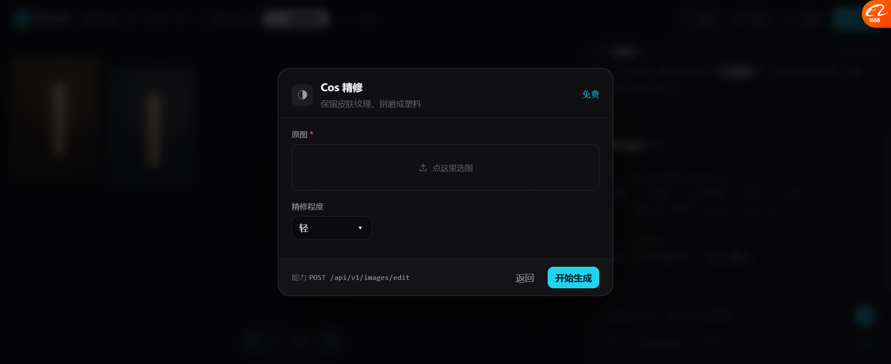

# P5：Skill 也引用 CAPS —— 一份能力，三种外壳彻底打通

> **改之前**：Skill 有自己的 `c:'⚡14'` 价格，节点有自己的 `cost:14`，
> 改价格要改两个地方，改完还可能对不上。
>
> **改之后**：Skill 里**一个价格都没写**，全部从 `CAPS` 读。
> **验证：改 CAPS 一处 → Skill 价格、节点价格、invoke 成本 三处同变。**

---

## 一、改了什么

### 之前：Skill 自带价格

```js
{ id:'poster', n:'美妆海报', c:'⚡14', ... }   // 🔴 价格写死在这
{ id:'coser',  n:'Cos 精修', c:'⚡3',  ... }   // 🔴 和 CAPS 各说各的
```

### 现在：只写 `cap`

```js
{ id:'poster', n:'美妆海报',
  cap:'image-gen',         // 🔴 指向能力
  fill:{kind:'upload', n:2},
  fields:[
    {k:'p', t:'image',  l:'商品 / 主体图', req:1, mapTo:'reference'},
    {k:'s', t:'select', l:'风格', opts:[...], mapTo:'model'},
    {k:'c', t:'text',   l:'文案', mapTo:'prompt'},
    {k:'r', t:'select', l:'尺寸', opts:['2:3','1:1','3:4'], mapTo:'ratio'}
  ]}
```

**价格、接口、默认参数、页面 —— 一个都不写。**

---

## 二、字段映射：`mapTo`

表单字段靠 `mapTo` 落到能力的 `inputs` / `params` 上：

```
表单字段            mapTo          能力
商品/主体图  ──→  reference  ──→  inputs.reference
风格         ──→  model      ──→  params.model
文案         ──→  prompt     ──→  inputs.prompt
尺寸         ──→  ratio      ──→  params.ratio
```

**判定规则**：`mapTo` 的值在 `cap.params` 里 → 进 `params`；否则 → 进 `inputs`。
**这个规则是自动的，加新字段不用改代码。**

---

## 三、价格的单一来源（实测）



Cos 精修走的是 `image-editor`（本地处理），所以自动显示**免费**，
底部还显示了真实接口 `POST /api/v1/images/edit`。

**关键验证**：

```js
CAPS['image-gen'].cost = 99;   // 改一处

skillCost(poster)  →  ⚡99      // ✅ 跟着变
CAPS['image-gen']  →  99        // ✅
invokeCap(...).cost → 99        // ✅ 跟着变
```

**改一处，三处同变。** 这就是单一来源。

---

## 四、现在跑技能走的是节点的同一条路

```js
function runSkill(id){
  const s = SKILLS.find(...);
  const cap = capOfSkill(s);
  const params = {...cap.params};        // 从能力取默认值
  const inputs = {};
  s.fields.forEach(f => 按 mapTo 填进 params 或 inputs);
  const r = invokeCap(s.cap, inputs, params);   // 🔴 和 runNode 完全同一条
}
```

**`runSkill` 和 `runNode` 的最后一步是同一句话。**

---

## 五、六类 Skill 对应的能力（实测输出）

| Skill | 能力接口 | 价格 |
| --- | --- | --- |
| 美妆海报 | `POST /api/v1/images/generate` | ⚡14 |
| 短剧分镜 | `POST /api/v1/images/generate` | ⚡14 |
| **Cos 精修** | `POST /api/v1/images/edit` | **免费**（本地） |
| 角色三视图 | `POST /api/v1/images/generate` | ⚡14 |
| 图转动图 | `POST /api/v1/images/motion-gif/compose` | ⚡14 |
| 图生 3D | `POST /api/v1/3d/generate-from-image` | ⚡8 |

**注意 Cos 精修和角色三视图的价格**：它们走不同的能力，价格自动不同，
**不需要在 Skill 定义里各写一遍。**

---

## 六、这带来的三件事

| 效果 | 说明 |
| --- | --- |
| **价格不可能对不上** | 只有一处定义 |
| **加新 Skill 几乎零成本** | 写 `cap` + `fields`，不写价格不写接口 |
| **能力改一次全线生效** | 改 `CAPS` 一处 |

**这就是基调 P4「加新用途 = 加配置」的最终形态。**

---

## 七、还没做的

| 项 | 现状 |
| --- | --- |
| 表单值真读进 invoke | 现在取的是字段第一项，没读用户填的 |
| 真必填校验 | 没拦 |
| Skill 用的能力**参数子集** | 有的 Skill 只需要 2 个参数，现在用了全部 |
| Skill 可自定义保存 | 没做 |
| `CAPS` 落库 | 现在是前端常量，真做要放后端配置 |

---

## 八、下一步

| 优先 | 做什么 |
| --- | --- |
| P6 | **我的流程存参数值**（复用出来是空壳） |
| P7 | 按基调改**导航**（8 组 44 项 → 6 项） |
| P8 | I3 常驻成本 chip、I2 接巡检 |
| P9 | 表单值真读进 invoke + 必填校验 |
