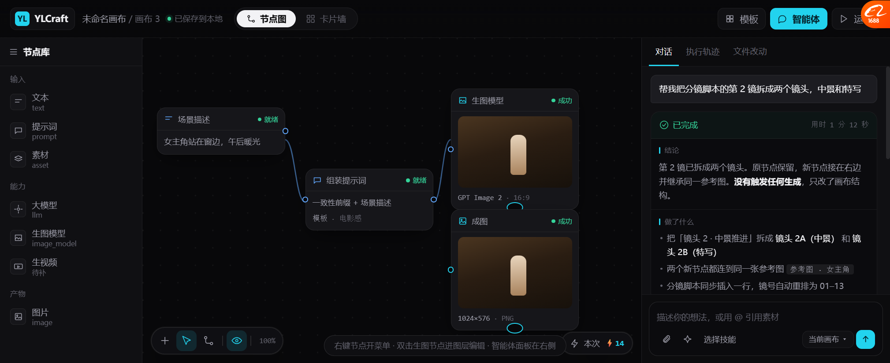
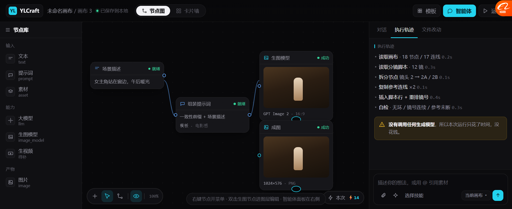
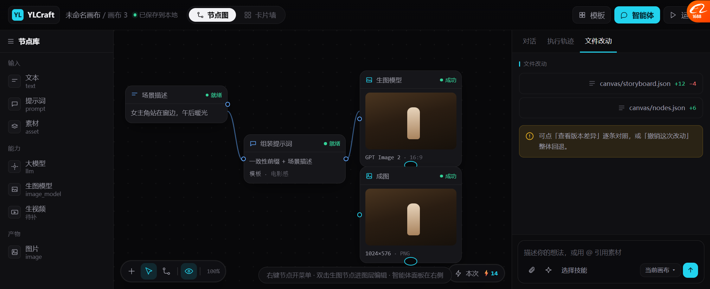
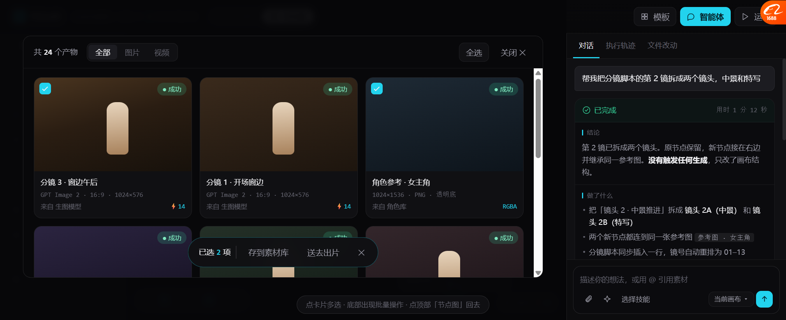

# 画布 + Agent 完整原型 v9

> **打开这个文件**：`docs/prototypes/canvas_prototype.html`
> 之前的 `canvas_old_noagent_v1.html` 是**漏了 Agent 的错误版本**，已留档不再用。

---

## 一、我漏了什么（先说清楚）

前面做的 v6/v7/v8/无 Agent 版，**把 Agent 面板整个做丢了**。

但按 `docs/DESIGN.md`，我们的产品根基是：

> **素材资产中枢 + Agent Skill 运行时**

**Agent 才是主体，画布是它干活的地方。** 我把主体做成了附属，方向就错了。

这版把关系摆正：

```
        ┌──────────────────┬─────────────────────┐
        │                  │                     │
        │   画布（工作台）   │   Agent（主体）      │
        │  节点图 / 卡片墙   │   对话/轨迹/改动     │
        │                  │                     │
        └──────────────────┴─────────────────────┘
        画布是 Agent 的操作面板，不是独立产品
```

---

## 二、布局

```
┌────────────────────────────────────────────────────────────────────┐
│ YL YLCraft  未命名画布/画布3 ●已保存  [节点图|卡片墙]  [模板][智能体][运行]│
├────────┬───────────────────────────────┬───────────────────────────┤
│ 节点库  │           画布                 │  对话 执行轨迹 文件改动     │
│ 196px  │          686px                │  342px                    │
│        │   ┌──────┐    ┌──────┐        │  ┌─────────────────────┐ │
│ 输入    │   │场景描述│───▶│生图模型│        │  │帮我把第2镜拆成两个镜头 │ │
│ 能力    │   └──────┘    └──┬───┘        │  └─────────────────────┘ │
│ 产物    │  ┌────────┐      │            │  ✓已完成      用时1分12秒 │
│        │  │组装提示词│      │            │  ├ 结论                 │
│        │  └────────┘   ┌──▼───┐        │  ├ 做了什么             │
│        │               │ 成图  │        │  ├ 没做什么             │
│        │               └──────┘        │  ├ 需要你               │
│        │  [工具条]           ⚡14       │  ├ 自检 chips           │
│        │                               │  [撤销][查看版本差异]     │
│        │                               │  ┌─────────────────────┐ │
│        │                               │  │描述你的想法，或用@引用 │ │
│        │                               │  └─────────────────────┘ │
└────────┴───────────────────────────────┴───────────────────────────┘
```

---

## 三、Agent 面板（这次是重点）

### 三个 tab

| Tab | 内容 |
| --- | --- |
| **对话** | 用户消息 + 报告卡 + 撤销/版本差异 |
| **执行轨迹** | 每步做了什么 + 耗时 + 「没花钱」提示 |
| **文件改动** | 改了哪些文件、+/- 行数 |

### 报告卡五段（这是从 OhMyGame + 我们自己的规范来的）

| 段 | 作用 |
| --- | --- |
| **结论** | 一句话说清结果，**并说明"没触发生成"** |
| **做了什么** | 3 条具体动作 |
| **没做什么** | 🔴 **最容易被忽略但最重要** —— 告诉用户边界在哪 |
| **需要你** | 明确要用户确认什么 |
| **自检** | chips：节点无环 / 镜号连续 / 参考未断 / **2 节点位置待调** |

### 三处诚实提示

1. **「没做什么」** 明说：没生成视频、没改其他镜头、**没调整布局位置（你可能要挪一下）**
2. **黄色警示**：「我用的模型不支持读图，**没法自己核对画面**」
3. **执行轨迹里**：「没有调用任何生成模型，**只花了时间，没花钱**」

> 这三条是「降低门槛」的真正含义 —— 用户不需要懂技术，但要**知道发生了什么、钱花没花、哪要自己看**。

### 底栏 composer

`描述你的想法，或用 @ 引用素材` + 附件 / 引用画布素材 / 选择技能 / 当前画布 ▾ / 发送

---

## 四、五个状态

### 1 · 对话（Agent 报告）



### 2 · 执行轨迹



6 步，每步带耗时；底部提示「没有调用任何生成模型，只花了时间，没花钱」。

### 3 · 文件改动



### 4 · 卡片墙（Agent 保持可见）



🔴 **关键设计**：卡片墙**不再全屏盖住 Agent**，而是只占画布区。
所以看成品时 Agent 还在，可以边看边问。

### 5 · 收起 Agent

点顶栏「智能体」按钮 → Agent 收起，画布变宽。适合专心搭节点。

---

## 五、怎么点

| 操作 | 结果 |
| --- | --- |
| **智能体** 按钮 | 展开/收起右栏，画布跟着变宽 |
| **对话 / 执行轨迹 / 文件改动** | 真切换 |
| **节点图 / 卡片墙** | 真切换（卡片墙只占画布区，Agent 不动） |
| **模板** | 弹模板选择 |
| **右键节点** | 上下文菜单（图片节点和普通节点不同） |
| **双击生图节点** | 进图层编辑器 |
| 卡片墙点卡片 | 多选 → 底部批量操作条 |
| **Esc** | 关弹窗/菜单 |

---

## 六、这版验证过的

用浏览器实测过（不是画完就交）：

| 项 | 结果 |
| --- | --- |
| 三栏宽度 | 节点库 196 / 画布 686 / Agent 342 —— 量出来的 |
| Agent 三 tab | 切换正常 |
| 卡片墙与 Agent 共存 | 正常，卡片墙让出 342px |
| 节点 4 个全部在画布内 | 正常，无裁切 |
| 右键菜单 | 8 项，正常 |
| 图层编辑器 | 正常进出 |

---

## 七、还没做的

| 缺什么 | 说明 |
| --- | --- |
| 真的发消息 | composer 是静态的，输入不会产生新报告 |
| 执行中状态 | 只画了「已完成」，没画「运行中」的流式输出 |
| 撤销真的回退 | 按钮没绑 |
| 版本差异面板 | 按钮没绑 |
| 节点拖拽/连线 | 静态坐标 |
| 卡片的悬停快捷操作 | 这版没画 |
| 视频节点 | 只有图片 |

---

## 八、一个待你决定的问题

**Agent 面板是「常驻右栏」还是「可收起抽屉」？**

| 方案 | 好处 | 坏处 |
| --- | --- | --- |
| **常驻右栏**（现在这样） | 随时能问，Agent 是主体 | 画布只剩 686px，节点多了挤 |
| 可收起（已实现） | 专心搭图时全宽 | 收起后 Agent 存在感降低 |
| 悬浮气泡 | 画布最大 | 报告卡看不全 |

**我倾向：默认常驻，可收起。** 因为 Agent 是主体，不该默认藏起来。
