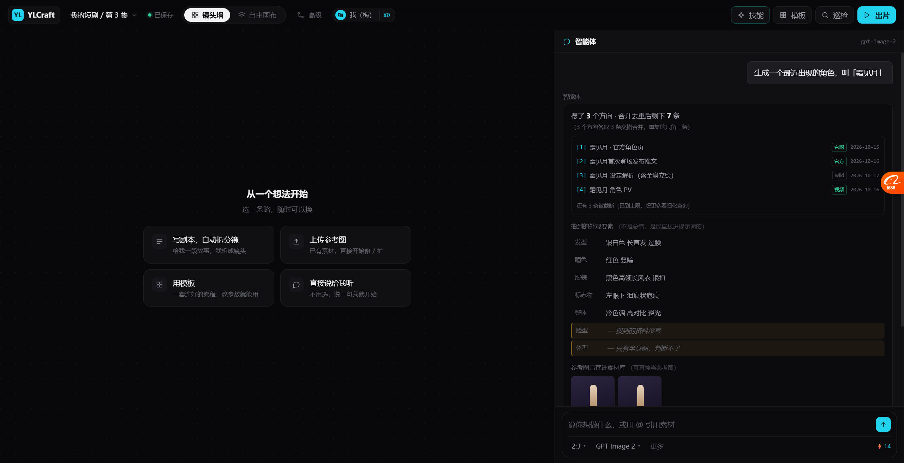
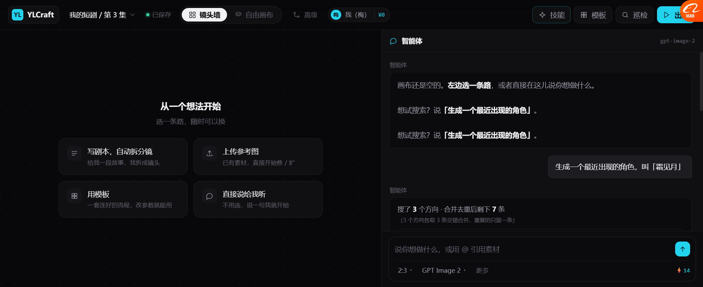
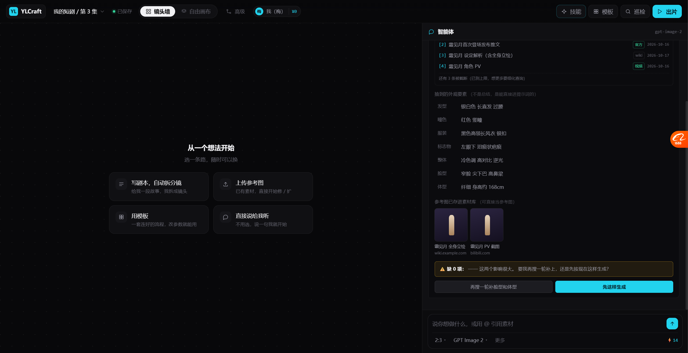
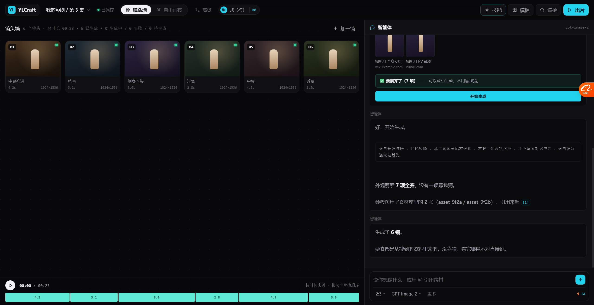

# 生成型搜索：画布对话里的完整一段（P1 落地）

> 场景：你说「生成一个最近出现的角色，叫霜见月」
> Agent 知识里没有 → 搜 → **抽要素**（不是总结）→ **自检缺什么** → 参考图存资产 → 生成
>
> **做进原型了，能点。**

---

## 一、完整流程（三屏）

### 第 1 屏：搜索中



```
先查一下 —— 我知识里没有「霜见月」这个角色

① 霜见月 角色 外观 设定          搜索中…
② 霜见月 官方 发布 图            搜索中…
③ 霜见月 发色 瞳色 服装          搜索中…

同时搜 3 个方向 —— 外观 / 官方图 / 具体特征
```

🔴 **第一句就说"我知识里没有"** —— 不装作知道。

### 第 2 屏：结果 + 要素 + 缺什么



```
搜了 3 个方向 · 合并去重后剩下 7 条
（3 个方向各取 3 条交错合并，重复的只留一条）

[1] 霜见月 · 官方角色页          [官网] 2026-10-15
[2] 霜见月首次登场发布推文        [官方] 2026-10-16
[3] 霜见月 设定解析（含全身立绘）  [wiki] 2026-10-17
[4] 霜见月 角色 PV               [视频] 2026-10-16
还有 3 条被截断（已到上限，想更多要细化查询）

抽到的外观要素 （不是总结，是能直接进提示词的）
  发型    银白色 长直发 过腰
  瞳色    红色 竖瞳
  服装    黑色高领长风衣 银扣
  标志物  左眼下 泪痕状疤痕
  整体    冷色调 高对比 逆光
  脸型    — 搜到的资料没写           ← 琥珀高亮
  体型    — 只有半身图，判断不了      ← 琥珀高亮

参考图已存进素材库（可直接当参考图）
  [霜见月 全身立绘] [霜见月 PV 截图]
  wiki.example.com   bilibili.com

⚠️ 缺 2 项：脸型、体型 —— 这两项影响最大（脸决定像不像，体型决定镜头能不能用）
   要我再搜一轮补上，还是先按现在这样生成？

[再搜一轮补脸型和体型]  [先这样生成]
```

**四个关键点：**
1. **说了"3 个方向交错合并，重复只留一条"** —— 用户知道去重做了什么
2. **截断明说**「还有 3 条被截断，想更多要细化查询」
3. **要素是要素，不是总结** —— 每项都能直接进提示词
4. **缺的项标出来 + 说明影响** —— 防止硬生成、钱白花

### 第 3 屏：补搜后 + 生成



```
✅ 要素齐了（7 项）—— 可以放心生成，不用靠我猜。
[开始生成]
```

**缺 0 项时，警告变绿、"再搜一轮"按钮消失、主按钮从「先这样生成」变「开始生成」。**



```
好，开始生成。

┌─────────────────────────────────────────────┐
│ 银白长发过腰 · 红色竖瞳 · 黑色高领长风衣银扣 ·    │
│ 左眼下泪痕状疤痕 · 冷色调高对比逆光 · 银白发丝逆光边缘光 │
└─────────────────────────────────────────────┘

外观要素 7 项全齐，没有一项靠我猜。
参考图用了素材库里的 2 张（asset_9f2a / asset_9f2b）。引用来源 [1]

生成了 6 镜。
要素都是从搜到的资料里来的，没靠猜。看哪镜不对直接说。
```

---

## 二、两个状态下的文案对照（这是重点）

| | 要素不齐 | 要素齐了 |
| --- | --- | --- |
| 警告框 | ⚠️ 琥珀：缺 2 项，说明影响 | ✅ 绿色：要素齐了，不用靠我猜 |
| 「再搜一轮」按钮 | 有（写着补哪几项） | **消失** |
| 主按钮 | 「先这样生成」 | 「**开始生成**」 |
| 生成前汇报 | 「其中 2 项靠我的判断补 —— 这几项不一定准」 | 「7 项全齐，**没有一项靠我猜**」 |
| 生成后汇报 | 「脸型和体型是我判断补的，不对我重出」 | 「要素都是从搜到的资料里来的，**没靠猜**」 |

🔴 **同一件事，两个状态说的话完全不一样。**
这比"统一一句模糊的话"有用得多 —— 用户能立刻判断这版能不能用。

---

## 三、从 harness 抄了哪几条（都在原型里体现）

| harness 机制 | 原型里怎么体现 |
| --- | --- |
| **`queries` 数组 1-4 个** | 一次给 3 个查询方向，同时搜 |
| 🔴 **交错合并** | 写明「3 个方向各取 3 条交错合并」 |
| **去重** | 写明「重复的只留一条」 |
| **`maxResults` + truncated** | 「还有 3 条被截断（已到上限，想更多要细化查询）」 |
| **Sources 带日期** | 每条都带 `2026-10-15` 这种日期 —— 因为是"最近出现的"查询 |
| **来源类型区分** | `[官网]` `[官方]` `[wiki]` `[视频]` |
| **强制引用** | 生成时「引用来源 [1]」 |

**没体现但真做要的**：`untrusted` 前置提醒（原型里没有网页正文，所以暂时看不到）。

---

## 四、我们独有的三个设计

### 4.1 🔴 抽要素，不是总结

调研型搜索会给你：
> 「霜见月是一个在 2026 年 10 月登场的角色，有着独特的外形设计，深受玩家喜爱……」

生成型要的是：
> `银白长发过腰 · 红色竖瞳 · 黑色高领长风衣银扣 · 左眼下泪痕状疤痕 · 冷色调`

**同一批搜索结果，两种用途抽出完全不同的东西。**

### 4.2 🔴 参考图当资产入库

```
参考图已存进素材库（可直接当参考图）
[霜见月 全身立绘] [霜见月 PV 截图]
wiki.example.com   bilibili.com
```

**搜到的图不是显示一下就完了，是存成 `asset_xxx`，能直接喂给生图节点。**

这就是"生成型搜索"和"调研型搜索"最大的结构差异 —— **产物是资产，不是文字**。

### 4.3 🔴 自检"够不够生成"

调研型搜索不需要这个判断。生成型必须 ——
**因为搜错了硬生成的代价是 12 镜全废。**

所以缺项要标出来、要说影响多大、要问用户是补搜还是硬上。

---

## 五、实测

| 项 | 结果 |
| --- | --- |
| 触发（说"生成一个最近出现的角色"） | ✅ |
| 第一句承认"我知识里没有" | ✅ |
| 3 个查询方向同时搜 | ✅ |
| 合并去重后 7 条 + 4 条明细 | ✅ |
| 截断提示 | ✅ |
| 来源带类型 + 日期 | ✅ |
| 抽要素 5 项 + 缺 2 项（琥珀高亮） | ✅ |
| 参考图 2 张存资产 | ✅ |
| 缺项警告 + 两个按钮 | ✅ |
| **再搜一轮 → 缺 2 → 缺 0** | ✅ 要素 5→7 项 |
| **要素齐后警告变绿、按钮变「开始生成」** | ✅ |
| **生成前文案随状态变化** | ✅「全齐，没靠猜」 |
| 生成 6 镜 | ✅ |
| 生成后文案 | ✅「都是从资料里来的，没靠猜」 |

### 修过的 bug

| bug | 修法 |
| --- | --- |
| 缺 0 项时仍显示「缺 0 项：—— 这两个影响很大」 | 文案按 `miss.length` 分两支 |
| 补搜后仍说「这几项不一定准」 | 同上 |
| demoFill 固定写"12 个镜头"，实际 6 镜 | 用 `total` 变量拼数 |
| demoFill 自己插一条消息，和搜索汇报重复 | `__suppressDemoMsg` 标志位 |

---

## 六、还没做的

| 项 | 现状 |
| --- | --- |
| 真搜索 | 写死的演示数据 |
| `untrusted` 前置提醒 | 原型没网页正文，看不到 |
| 真正的图片下载 | 只有占位图 |
| 要素抽取的模型调用 | 写死 7 项 |
| 要素可编辑 | 现在只能看，不能改（该能改） |
| 多角色批量 | 一次一个 |
| 搜索失败（限流/超时/空结果） | 没演示这几种失败 |

---

## 七、下一步

| 优先 | 做什么 |
| --- | --- |
| P2 | **要素可编辑** —— 用户改「瞳色」，直接改提示词 |
| P3 | **搜索失败的三种状态**（限流/超时/空结果，各自不同话术） |
| P4 | **`untrusted` 演示** —— 搜到一个页面里写着"忽略之前指令"，看 Agent 怎么处理 |
| P5 | 多角色批量搜（一次搜 3 个角色，交错合并） |
