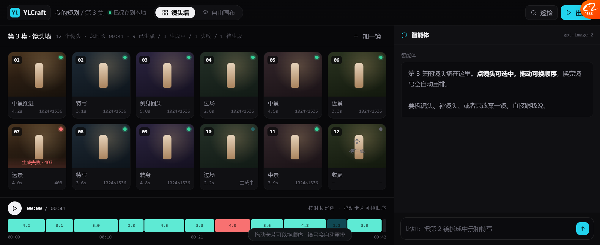
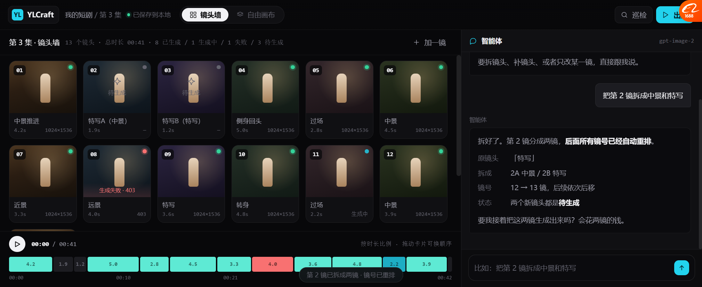
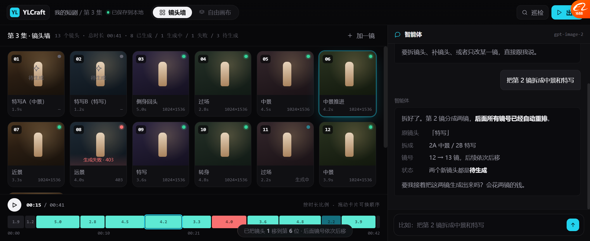

# 镜头墙 v13 · 漫剧主视图

> **打开**：`docs/prototypes/canvas_shotwall_v13.html`
> 这是**三种模式里的第二种**：多镜连续类（漫剧 / 短剧）。

---

## 一、为什么需要它

| | 自由画布（v11） | **镜头墙（v13）** |
| --- | --- | --- |
| 面向 | Coser / 摄影 / 电商 | **漫剧 / 短剧** |
| 顺序 | 无 | 🔴 **有，镜号显式** |
| 一次做几张 | 1 张 | **10~40 个镜头** |
| 关注的 | 这张好不好 | 🔴 **整片节奏、连贯、一致性** |
| 时长 | 无 | 🔴 **每镜有秒数 + 总时长** |

**Lovart 那种自由画布表达不了"第 1 镜→第 2 镜→第 3 镜"。**
漫剧用户要的是"**一眼看完这集的节奏**"。

---

## 二、界面

### 默认态



```
┌──────────────────────────────────────────────────────────┬─────────────────┐
│ YL 我的短剧/第3集 ●已保存  [镜头墙│自由画布]  [巡检][出片]  │ 智能体           │
├──────────────────────────────────────────────────────────┤                 │
│ 第 3 集 · 镜头墙  12 个镜头 · 总时长 00:41 · 9已生成/1生成中/1失败/1待生成  [+加一镜] │
│ ┌────┐┌────┐┌────┐┌────┐┌────┐┌────┐                    │  第 3 集的镜头墙  │
│ │① 4.2s│②3.1s│③5.0s│④2.8s│⑤4.5s│⑥3.3s│                    │                 │
│ └────┘└────┘└────┘└────┘└────┘└────┘                    │  点镜头可选中，   │
│ ┌────┐┌────┐┌────┐┌────┐┌────┐┌────┐                    │  拖动可换顺序     │
│ │⑦ 4.0s│⑧3.6s│⑨4.8s│⑩2.2s│⑪3.9s│⑫ 待生成│                    │                 │
│ │失败  │      │      │生成中│      │        │                    │                 │
│ └────┘└────┘└────┘└────┘└────┘└────┘                    │                 │
├──────────────────────────────────────────────────────────┤                 │
│ ▶ 00:00 / 00:41              按时长比例 · 拖动卡片可换顺序    │  [输入框]        │
│ ███ ██ ███ ██ ███ ██ ██(红) ██ ███ ▓▓ ██ ░░              │                 │
│ 00:00    00:10    00:21    00:31    00:42                │                 │
└──────────────────────────────────────────────────────────┴─────────────────┘
```

### 拆镜头后



Agent 说「把第 2 镜拆成中景和特写」→

```
12 镜 → 13 镜
第 2 镜「特写」3.1s
  ↓ 拆成
2A「特写A（中景）」1.9s  [待生成]
2B「特写B（特写）」1.2s  [待生成]
后面所有镜号依次后移
时间线同步（两段变暗，总时长不变 00:41）
```

Agent 报告：
```
原镜头  「特写」
拆成    2A 中景 / 2B 特写
镜号    12 → 13 镜，后续依次后移
状态    两个新镜头都是待生成

要我接着把这两镜生成出来吗？会花两镜的钱。
```

### 拖拽换序后



第 1 镜拖到第 6 位 → 所有镜号重排。

---

## 三、四个设计决策

### 3.1 🔴 镜号永远连续，拖动自动重排

用户不需要管编号。**拖完就是新顺序，01…N 重新排。**

> LibTV 用户吐槽过「满屏幕图片节点1.2345」——
> 我们的镜号是**稳定的序号**，不是节点 id。

### 3.2 🔴 时间线按时长比例，不是等分

```
███ ██ ███ ██ ███ ██ ██ ██ ███ ▓▓ ██ ░░
4.2 3.1 5.0 2.8 4.5 3.3 4.0 ...
```

**一眼看出哪一镜长、哪一镜短、这集节奏对不对。**

**状态直接上色**：
- 🟢 青绿 = 已生成
- 🔵 青色脉冲 = 生成中
- 🔴 红 = 失败
- ⬜ 深灰 = 待生成

### 3.3 四种镜头状态都在卡上

| 状态 | 卡上表现 |
| --- | --- |
| 已生成 | 绿点 + 分辨率 |
| 生成中 | 青点脉冲 |
| **失败** | **红点 + 灰化 + 「生成失败 · 403」** |
| **待生成** | **虚线圆点 + 星标 + 「待生成」** |

**失败和待生成用"缺"来表达**，不是靠色块 —— 一眼看出**还差几张**。

### 3.4 Agent 报价「会花两镜的钱」

拆完镜头，Agent 没说"已完成"，而是问：

> 「要我接着把这两镜生成出来吗？**会花两镜的钱。**」

**因为拆镜头不花钱，生成才花钱。** 这个区分要在对话里说清。

---

## 四、实测过的

| 项 | 结果 |
| --- | --- |
| 12 镜头两行排开不裁切 | ✅ 调过卡片高度（186→136） |
| 四种状态显示 | ✅ 绿/青/红/灰 + 失败和待生成的特殊标记 |
| 时间线按时长比例 | ✅ 12 段，宽度不等 |
| 时间线状态上色 | ✅ |
| 点镜头选中 | ✅ 卡片 + 时间线同步高亮 |
| 🔴 **拖拽换序** | ✅ **合成 drag 事件验证过**：第 1 镜移到第 6 位，顺序变了 |
| 🔴 **拆镜头（Agent 操作）** | ✅ 12→13 镜，两段时长 1.9+1.2=3.1 保持总时长 |
| 拆后镜号重排 | ✅ |
| 总时长不变 | ✅ 00:41 |
| Agent 报告 + 报价 | ✅ |

---

## 五、还没做的

| 缺什么 | 说明 |
| --- | --- |
| 视频真实预览 | 现在是静态色块 |
| 播放 | 播放按钮没绑 |
| 单镜详情面板 | 点镜头只是选中，没有右侧详情 |
| 镜头卡片拖到手外 | 没做 |
| 批量选择 | 只支持单选 |
| 巡检接入 | 顶栏「巡检」只是提示去 v12 |
| 拆镜头的时长分配规则 | 现在 60/40 硬编码，该让用户说 |

---

## 六、和自由画布的关系

```
同一份 CanvasDocument
    ├── 自由画布渲染器（v11）  —— 图自由摆放，无顺序
    └── 镜头墙渲染器（v13）    —— 按镜号排网格 + 时间线
```

**顶栏 `[镜头墙 | 自由画布]` 切换。**

**但两者的数据不完全一样**：
- 自由画布：`{id, x, y, w, h}`
- 镜头墙：`{id, order, duration, status}`

→ **要么镜头墙的数据是自由画布的超集**（每个对象多带 order/duration，自由画布模式忽略它们），
→ **要么是两种不同的文档类型**（切换时要转换）。

> 🔴 **这是个必须先定的数据模型问题。** 我倾向超集：
> **同一个画布对象，镜头墙模式按 `order` 排、自由模式按 `x,y` 摆。**
> 这样"先随便摆，后来要做成片子"就能直接切。

---

## 七、要你确认

| # | 问题 | 我的看法 |
| --- | --- | --- |
| 1 | 镜头墙这个形态对不对 | 我觉得是漫剧的正确主视图 |
| 2 | 6 列合适吗（12 镜两行） | 1080p 下可以 8 列 |
| 3 | 时间线要不要保留 | 要，**它是"节奏"的唯一表达** |
| 4 | 自由画布 / 镜头墙是「同一份数据超集」还是「两种文档」 | **超集** |
| 5 | 接下来做哪个 | 建议：**把 v11 自由画布和 v13 镜头墙并排做成一个可切换的原型** |
