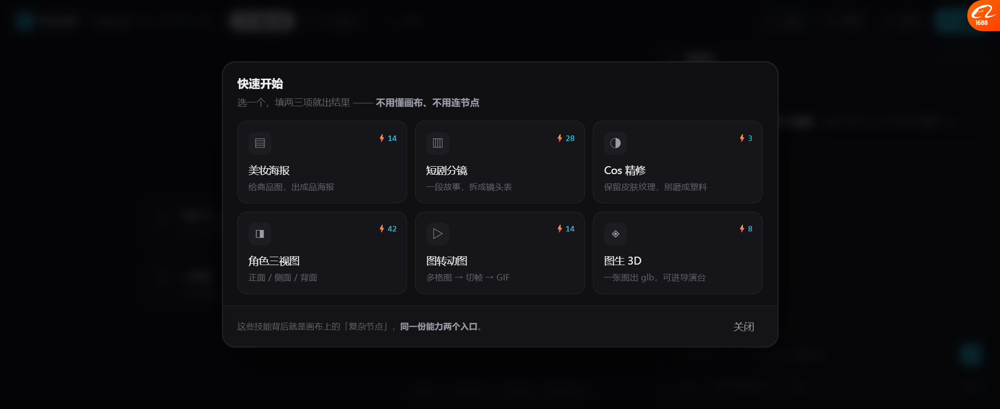
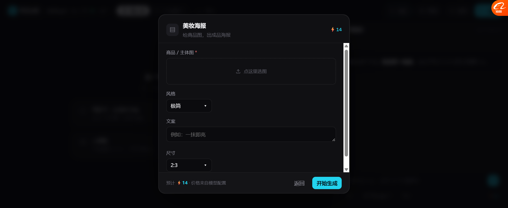

# Skill 表单入口（决策 4 落地）

> **P0 完成**：给"不想看节点的人"做了一条不需要懂画布的路。
> Lovart 路线 —— 用户看到的是一个按钮，点开是表单，**连节点概念都没有**。

---

## 一、两个入口，同一份能力

```
              同一个后端能力
                    ▲
        ┌───────────┴───────────┐
        │                       │
   ┌────┴─────┐          ┌──────┴──────┐
   │ Skill 表单│          │  画布节点    │
   │ 按钮→表单 │          │ 端口→连线    │
   │  →产物    │          │  →流程      │
   └──────────┘          └─────────────┘
      不用懂画布            要控细节的人
```

---

## 二、技能面板



```
快速开始
选一个，填两三项就出结果 —— 不用懂画布、不用连节点

┌─ ▤ 美妆海报 ⚡14 ─┐ ┌─ ▥ 短剧分镜 ⚡28 ─┐ ┌─ ◑ Cos 精修 ⚡3 ─┐
│ 给商品图，出成品海报│ │ 一段故事，拆成镜头表│ │ 保留皮肤纹理     │
└─────────────────┘ └─────────────────┘ └────────────────┘
┌─ ◨ 角色三视图 ⚡42─┐ ┌─ ▷ 图转动图 ⚡14 ─┐ ┌─ ◈ 图生 3D ⚡8 ─┐
│ 正面/侧面/背面    │ │ 多格图→切帧→GIF  │ │ 一张图出 glb    │
└─────────────────┘ └─────────────────┘ └────────────────┘

这些技能背后就是画布上的「复杂节点」，同一份能力两个入口。
```

**6 个技能，覆盖 6 类人群**：

| 技能 | 谁用 | 价格 |
| --- | --- | --- |
| 美妆海报 | 电商 / 设计 | ⚡14 |
| 短剧分镜 | 漫剧 / 短剧 | ⚡28 |
| Cos 精修 | Coser / 摄影 | ⚡3 |
| 角色三视图 | 漫剧（一致性） | ⚡42 |
| 图转动图 | 短视频 | ⚡14 |
| 图生 3D | 漫剧（预演） | ⚡8 |

---

## 三、Skill 表单



```
┌─ ▤ 美妆海报              ⚡14 ┐
│ 给商品图，出成品海报           │
├──────────────────────────────┤
│ 商品 / 主体图 *                │
│ ┌─ 点这里选图 ────────────┐   │
│ │                        │   │
│ └────────────────────────┘   │
│                              │
│ 风格                          │
│ [极简 ▾]                     │
│                              │
│ 文案                          │
│ [例如：一抹即亮]               │
│                              │
│ 尺寸                          │
│ [2:3 ▾]                      │
├──────────────────────────────┤
│ 预计 ⚡14 · 价格来自模型配置     │
│              [返回] [开始生成] │
└──────────────────────────────┘
```

### 字段设计

| 类型 | 用在哪 | 说明 |
| --- | --- | --- |
| **image** | 商品图、原图、多格图 | 虚线框「点这里选图」 |
| **select** | 风格、尺寸、格数、精度 | 点一下循环切换（原型简化） |
| **text / textarea** | 故事、文案、角色描述 | 带 placeholder 举例 |

**每个技能只有 2~4 个字段** —— 这是"填两三项就出结果"的保证。

---

## 四、实测

| 项 | 结果 |
| --- | --- |
| 技能面板 6 个卡片 | ✅ |
| 每张卡片带价格 | ✅ |
| 点卡片进表单 | ✅ |
| 美妆海报 = 4 个字段 | ✅ |
| 短剧分镜 = 3 个字段 | ✅ |
| 字段类型（图/选/文本） | ✅ |
| 底部「预计 ⚡N · 价格来自模型配置」 | ✅ |
| 「开始生成」→ 关面板 + 出结果 | ✅ **短剧分镜 → 12 镜，自动切镜头墙** |
| 空态第 4 个入口改成「技能」 | ✅ |
| 顶栏「技能」按钮 | ✅ |

---

## 五、这三条入口现在都齐了

| 入口 | 用户看到 | 状态 |
| --- | --- | --- |
| **Skill 表单** | 按钮 → 表单 → 产物 | ✅ **这轮做完** |
| 画布·基础节点 | 节点 + 端口 | ✅ 已有 |
| 画布·复杂节点 | 节点（露 3 参数）→ 点开是页面 | ✅ 已有 |

**这就是基调 P1「门槛优先于能力」的具体落地** ——
不想学节点的人有 Shortcut，想控细节的人有节点图，两边都不牺牲。

---

## 六、还没做的

| 项 | 现状 |
| --- | --- |
| 表单填写校验 | 必填项没拦（空着也能点生成） |
| select 真下拉 | 现在是点击循环切换 |
| 图片上传 | 只 toast |
| 生成真跑 | `demoFill` 造数据 |
| 技能和复杂节点**共用 invoke** | 只是概念上共用，代码还没抽 |
| 技能可自定义 / 保存 | 没做 |

---

## 七、下一步

| 优先 | 做什么 |
| --- | --- |
| P1 | **模板版本提示**（决策 3）—— 模板卡片标版本 + 「有新版」提示 |
| P2 | 决策 1 的「打开完整页面」跳转接上 |
| P3 | 组的重命名 + 保存复用 |
| P4 | 把 Skill 和复杂节点的 `invoke` 真正抽成一份 |
