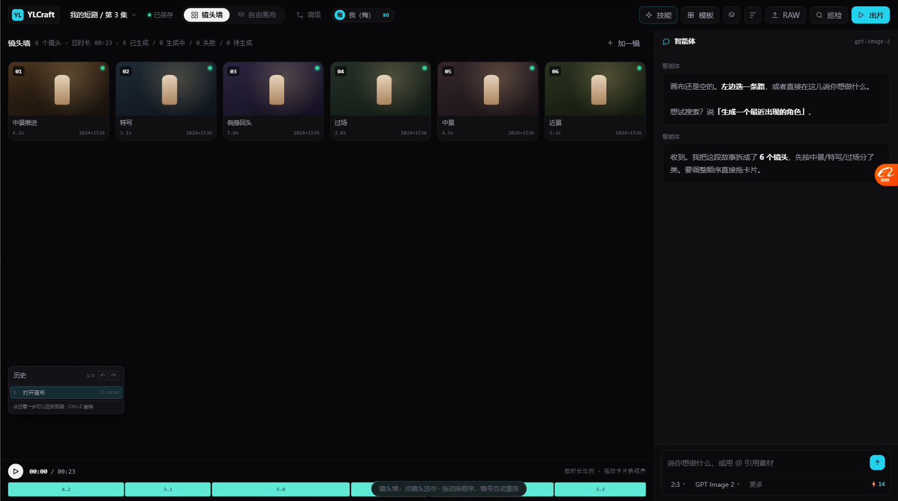

# 原型已拆分（2026-10-19）

> 单文件 6023 行 / 260 KB → **24 个文件，最大 570 行。**
> 提交：`6976996a`

---

## 一、拆成什么样

```
docs/prototypes/canvas/
├── index.html                240 行   骨架 + 挂载（保留 ?embed=1）
├── css/
│   ├── 01-base.css            54 行   变量 / 重置 / 通用
│   ├── 02-canvas.css         214 行   顶栏 / 镜头墙 / 自由画布
│   ├── 03-graph.css          185 行   连线图 / 节点库 / 参数面板 / 模板
│   ├── 04-search.css          59 行   搜索面板基础
│   └── 05-panels.css         734 行   巡检 / 精调 / 图层 / 历史 / 词库 / 导出 / RAW / 浮条
└── js/
    ├── 01-data.js             37 行   DOC 文档数据
    ├── 02-canvas.js          535 行   模式切换 / 镜头墙 / 自由画布 / 打组执行 / 连线图
    ├── 03-groups.js          127 行   用户打组（Tab 进出）
    ├── 04-caps.js            157 行   invoke / CAPS 16 项能力
    ├── 05-account.js         426 行   用户隔离 / 积分 / 流程 / 参数面板 / 运行
    ├── 06-imageops.js        198 行   31 项图片能力 / 右键菜单
    ├── 07-agent.js           473 行   Agent 对话 / 知识库引用 / Skill 表单 / 模板版本
    ├── 08-events.js           88 行   全局事件 / embed 适配
    ├── 09-search.js          570 行   搜索链路 / 6 种 schema / 要素编辑
    ├── 10-failures.js        335 行   搜索失败三态 / 注入防护 / 自动判断
    ├── 11-floatbar.js         97 行   点图浮条 7 项
    ├── 12-inspect.js         182 行   巡检（本地免费 vs 调模型）
    ├── 13-localedit.js       296 行   本地精调（曲线 / 曝光 / 色温）
    ├── 14-raw.js             154 行   RAW 导入流程
    ├── 15-chain.js           139 行   主链路状态联动
    ├── 16-export.js          168 行   三层非破坏导出
    ├── 17-channels.js        314 行   分通道曲线 / 色阶 / 直方图
    └── 18-panels.js          290 行   图层面板 / 撤销历史 / 提示词库
```

**最大的文件 570 行** —— 一眼能看完。

---

## 二、拆分方式（低风险）

**按原文件的行范围切片，保持原有顺序** —— 不重排、不改内容、只搬家。

| 步骤 | 做法 |
| --- | --- |
| 1 | 备份原文件（`.bak`，git 已忽略） |
| 2 | 定位 `<style>` / `<script>` 边界和 20+ 个分区注释 |
| 3 | 按行号切 CSS 5 段、JS 18 段 |
| 4 | 生成 index.html（骨架 + 按顺序引入） |
| 5 | **验证：18 个函数全在、CAPS 16、schema 6、各面板能开** |
| 6 | 旧文件改跳转页，壳的 iframe 改指新路径 |

**为什么保持原顺序**：`const` / `let` 不提升，重排会有提升顺序错误。按原顺序切 = 零风险。

---

## 三、验证结果（零功能损失）

| 项 | 结果 |
| --- | --- |
| 18 个核心函数 | ✅ 全在 |
| CAPS 能力数 | ✅ 16 |
| SUBJECT_SCHEMAS | ✅ 6 |
| IMG_OPS 组数 | ✅ 6 |
| 镜头墙渲染 | ✅ 6 镜 |
| 本地精调 | ✅ 7 个滑块 + 曲线 |
| 巡检 | ✅ 6 项 |
| 导出 | ✅ 3 层 |
| RAW 导入 | ✅ 面板正常 |
| 提示词库 | ✅ 3 条 |
| 图层面板 | ✅ |
| 撤销历史 | ✅ |
| 平台壳 iframe | ✅ `canvas/index.html?embed=1` 加载成功 |
| 视觉 | ✅ 截图确认无差异 |



---

## 四、兼容处理

| 情况 | 处理 |
| --- | --- |
| `platform_shell_v16.html` 的 iframe | 改成 `canvas/index.html` |
| 别处引用 `canvas_unified_v14.html` | **改成跳转页**，自动跳 `canvas/index.html`，不会死链 |
| `?embed=1` 参数 | ✅ 保留（bodyPart 处理正确） |
| 原文件备份 | `.bak`，`.gitignore` 已排除 |

---

## 五、这次踩的坑

### 坑 1：PowerShell 脚本中文全变乱码

写 `_split.ps1` 时用了中文注释，**Windows PowerShell 5.1 按 ANSI 读 .ps1**，
中文全变乱码 → 引号配对失败 → 整个脚本 ParserError。

**修法：脚本里只用 ASCII。** 产物文件里的中文不受影响（用 `WriteAllText` + UTF8 显式编码）。

### 坑 2：生成 HTML 时重复了两个标签

`bodyPart` 从 `</style>` 后面开始，包含了原文件的 `</head>`；`tailPart` 包含原 `</script>`。
结果是 `</head>` 出现两次、`</script>` 多一个。

**修法**：手动 edit 掉重复的两处，然后验证 iframe 加载成功。

**教训：拼接 HTML 时，边界要写清楚"包含/不包含哪个标签"，最好打完立刻看头尾 25 行。**

---

## 六、现在改代码是什么体验

| 改什么 | 动哪个文件 |
| --- | --- |
| 画布布局 / 镜头墙 | `css/02-canvas.css` + `js/02-canvas.js` |
| 搜索链路 | `js/09-search.js` |
| 曲线 / 色阶 | `js/13-localedit.js` + `js/17-channels.js` |
| 巡检 | `js/12-inspect.js` |
| 图层面板 / 历史 | `js/18-panels.js` |
| 加一个新能力 | `js/04-caps.js` 里加一个 CAPS 条目 |

**不用再在 6000 行里找。**

---

## 七、下一步

拆分完成，可以继续做 **P0 三项**（约 950 行）：

| # | 做什么 | 落在哪个文件 |
| --- | --- | --- |
| 1 | **L2 独立入口**（图片编辑页） | 新建 `canvas-single/index.html` 或复用组件 |
| 2 | **对话 vs 制作实况分开** | `js/07-agent.js` + 新 `js/19-board.js` |
| 3 | **AI 适配度星级** | `js/09-search.js`（要素表加一列） |
