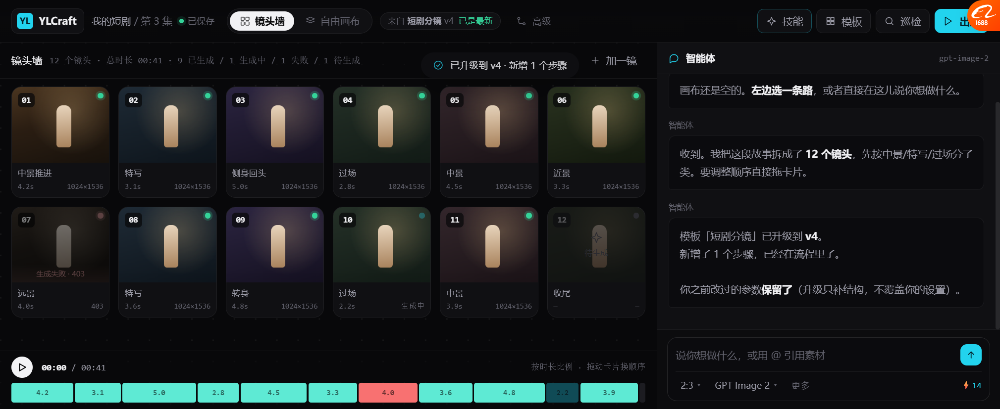
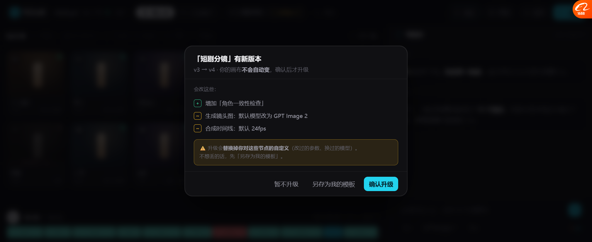

# 模板版本：默认快照 + 手动升级（决策 3 落地）

> **P1 完成**：模板升级不再"悄悄改坏我的画布"。
> 定案：**默认快照，手动升级，升级前先看 diff。**

---

## 一、为什么不能"改了全变"

n8n 的 Sub-workflow 是「改了子流程，所有引用处全变」。

| 后果 | 说明 |
| --- | --- |
| 模板作者改了一处 | 🔴 所有用了这个模板的画布**同时变** |
| 作者改坏了 | 所有人的片子一起坏，而且**不知道是谁改的** |
| 我想保留自己调的参数 | 被覆盖，无处申诉 |

**按基调 P1「门槛优先」+ 基调 I2「带证据」—— 用户必须能看见"要改什么"再决定。**

---

## 二、三层提示

### 第 1 层：模板卡片标版本

```
┌─ □—□—□—□—□ ─────────────┐
│ 短剧分镜  v4  NEW         │   ← 有新版
│ 5 步 · 用过 210 次         │
└──────────────────────────┘
```

- 每张卡片右上角标 `v4`
- 有新版打 `NEW` 角标（琥珀色）
- 底部信息栏追加「这个模板刚更新过」

### 第 2 层：顶栏常驻「来自哪个模板 / 什么版本」



```
YL YLCraft │ 我的短剧 / 第 3 集 │ ●已保存 │ [镜头墙|自由画布] │ 来自 短剧分镜 v4 · 已是最新 │ 高级 ...
```

| 状态 | 显示 |
| --- | --- |
| 用旧版 | `来自 短剧分镜 v3` + 琥珀按钮 **`有新版 v4`** |
| 已最新 | `来自 短剧分镜 v4` + 绿色 **`已是最新`** |
| 空白画布 | 不显示 |

🔴 **关键：这个条一直在，用户永远知道自己用的是哪一版。**

### 第 3 层：升级确认面板（带 diff）



```
「短剧分镜」有新版本
v3 → v4 · 你的画布不会自动变，确认后才升级

会改这些：
  [+] 增加「角色一致性检查」
  [~] 生成镜头图：默认模型改为 GPT Image 2
  [~] 合成时间线：默认 24fps

⚠️ 升级会替换掉你对这些节点的自定义（改过的参数、换过的模型）。
   不想丢的话，先「另存为我的模板」。

        [暂不升级]  [另存为我的模板]  [确认升级]
```

**三个设计点：**

| 做法 | 依据 |
| --- | --- |
| **diff 用 `+ ~ −` 三个符号** | 比纯文字列表一眼看清"加/改/删" |
| **明确写"你的画布不会自动变"** | 消解第一反应（"它会不会偷偷改我东西"） |
| **给"另存为我的模板"这个出口** | 不是二选一（升级 or 放弃），有第三条路 |

---

## 三、升级后的 Agent 汇报

**不贴 chip，说人话（基调 I1）：**

> 模板「短剧分镜」已升级到 **v4**。
> 新增了 1 个步骤，已经在流程里了。
>
> 你之前改过的参数**保留了**（升级只补结构，不覆盖你的设置）。

**注意最后那句** —— 它回答了用户真正担心的事。

---

## 四、实测

| 项 | 结果 |
| --- | --- |
| 模板卡片标版本（6 张） | ✅ |
| 有新版打 NEW 角标（3 张） | ✅ |
| 选中时底部提示"刚更新过" | ✅ |
| 用模板后顶栏出现版本条 | ✅ `来自 短剧分镜 v3 · 有新版 v4` |
| 点「有新版」出确认面板 | ✅ 3 条 diff |
| diff 符号 `+ ~` 上色 | ✅ 绿/琥珀 |
| 升级后版本条更新 | ✅ `来自 短剧分镜 v4 · 已是最新` |
| 升级后 Agent 汇报 | ✅ 3 条消息，含"参数保留了" |

---

## 五、数据模型（真做要的）

```ts
// 模板定义
interface Template {
  id: string;
  name: string;
  version: number;             // 当前最新版
  changelog: Array<{
    type: 'add' | 'change' | 'remove';
    text: string;
  }>;
  graph: CanvasGraph;
}

// 画布记录自己来自哪个模板的哪一版（快照）
interface CanvasDocument {
  template_ref?: {
    template_id: string;
    version: number;           // 🔴 用的是哪一版
  };
}
```

**打开画布时的逻辑：**
```
if (template.latest > doc.template_ref.version) → 顶栏挂「有新版」
点升级 → 后端算出 diff → 展示 → 用户确认 → 应用
```

**后端要提供一个 diff 接口**（原型里是写死的 changelog）：
`GET /api/v1/templates/{id}/diff?from=3&to=4`
→ 返回 `{ nodes_added, nodes_removed, params_changed, conflicts }`

🔴 **真正难的是 `conflicts`**：用户改过的参数 vs 模板新默认值，谁赢？
建议：**用户改过的赢**，但在 diff 里标出来让用户知道。

---

## 六、还没做的

| 项 | 现状 |
| --- | --- |
| 真 diff | 原型写死 changelog |
| 冲突检测 | 没做（`conflicts`） |
| 「另存为我的模板」 | 只 toast |
| 版本历史回看 | 没做（只能前进） |
| 撤销升级 | 没做 |

---

## 七、下一步

| 优先 | 做什么 |
| --- | --- |
| P2 | 决策 1 的「打开完整页面」跳转接上 |
| P3 | 组的重命名 + 保存复用 |
| P4 | Skill 和复杂节点的 `invoke` 真抽成一份 |
