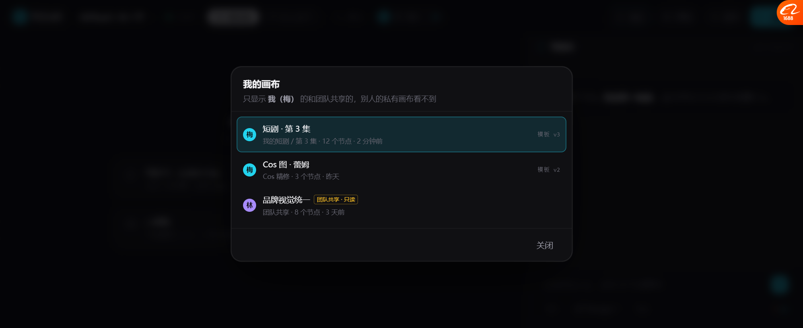
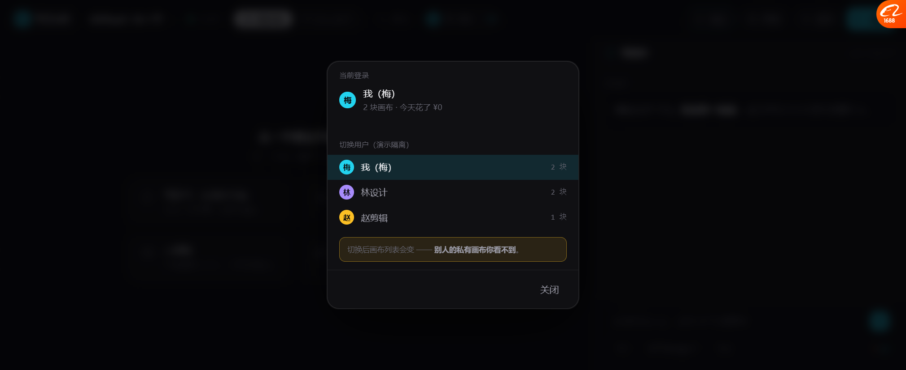

# 用户维度 · 画布隔离 · 积分（原型阶段）

> 三条都只做**原型**，不碰代码。但先把代码现状说清楚，因为它决定了真做时要补什么。

---

## 一、先看代码现状（这是真缺口）

| 项 | 现状 | 判断 |
| --- | --- | --- |
| `CanvasDocument` 有 `owner` 吗 | 🔴 **没有**。字段是 `id / title / description / project_id / document_json / created_at / updated_at` | **缺口**，只有 `project_id` 能间接映射到人 |
| `agent.py` 有 user 吗 | 有 `user_id: str = "default"` | 是占位，单用户 |
| 资产有 owner 吗 | `assets.py` / `asset_hub.py` 有 `user_id` 痕迹 | 部分有 |
| 积分/credits | 代码里**没有**积分体系 | 自用阶段本来就不需要 |

**所以「现在应该有用户维度了」是对的 —— 代码里画布层确实还没有。**

---

## 二、画布隔离（原型已做）



```
我的画布
只显示 我（梅） 的和团队共享的，别人的私有画布看不到

●梅  短剧 · 第 3 集     我的短剧/第3集 · 12 个节点 · 2 分钟前   模板 v3
●梅  Cos 图 · 蕾姆      Cos精修 · 3 个节点 · 昨天              模板 v2
●林  品牌视觉统一 [团队共享·只读]  团队共享 · 8 个节点 · 3 天前
```

### 三条隔离规则

| 规则 | 行为 |
| --- | --- |
| **可见** = 我的 + 团队共享的 | 别人的私有画布**根本不出现** |
| **可编辑** 仅限自己的 | 团队共享的是**只读**，标签明写 |
| **切用户 → 当前画布必须重选** | 不能留着一个不属于你的画布开着 |

**实测**：
```
作为梅:   mine=2  visible=3   （总数 5）
林设计:   mine=2  visible=2
越权访问别人的私有画布 → 被拦，当前画布不变 ✅
```

---

## 三、用户切换（原型演示用）



```
当前登录
●梅  我（梅）
     2 块画布 · 今天花了 ¥0

切换用户（演示隔离）
●梅  我（梅）      2 块
●林  林设计        2 块
●赵  赵剪辑        1 块

ⓘ 切换后画布列表会变 —— 别人的私有画布你看不到。
```

**为什么要在原型里做这个**：不切换用户，就演示不出隔离。
真产品里这是登录态，不是可点切换的。

---

## 四、积分：只和配置模型的费用有关

### 你的要求

> 积分目前因为都是自用，只和配置模型的费用有关。

**所以没有"套餐额度/充值/余额"，只有"这次花了多少、今天花了多少"。**

### 价格表（示例，真值从 `ai_connector` 配置读）

```js
const PRICE_BOOK = {
  'gpt-image-2': { n:'GPT Image 2', per:'张', cny:1.40 },
  'nanobanana':  { n:'NanoBanana',  per:'张', cny:0.30 },
  'tripo-sr':    { n:'TripoSR',     per:'次', cny:0.00, note:'本地跑，只吃电费' },
  'local-op':    { n:'本地处理',     per:'次', cny:0.00, note:'不调模型' }
};
```

### 实测结果

| 操作 | 结果 |
| --- | --- |
| 4 张 GPT Image 2 | **¥5.60** |
| 4 张 NanoBanana | **¥1.20**（同一个能力，换模型便宜 4.7 倍） |
| TripoSR 图生 3D | **¥0**（本地跑） |
| 本地裁剪 | **¥0** |
| 未知模型 | 🔴 **拒绝**：`ok:false` · "模型没有配价格" |
| 今日合计 | ¥6.80 |
| 顶栏 chip | `梅 · 我（梅） · ¥6.80` |

### 三个设计决定

| 决定 | 理由 |
| --- | --- |
| **不给"积分"，直接给人民币** | 自用阶段，用户看到 ¥ 比 ⚡ 更真实 |
| 🔴 **没配价格的模型直接拒绝** | 不让它"悄悄按 0 算"，那会变成免费额度漏洞 |
| 顶栏常驻今日花费 | 基调 I3「价格永远可见」 |

**注意**：之前原型里按钮上的 `⚡14` 是**示意**。
真做时 `⚡` 应换成 `¥`，且数值从 `PRICE_BOOK` 算出来 —— 现在两套并存（`CAPS.cost` 是示意，`PRICE_BOOK` 是真算）。

---

## 五、P6：我的流程存参数（顺手做完）

**之前的问题**：只存了节点结构，复用出来参数全是空的。

**现在**：`saveGroupAsFlow` 存 `params: { [nodeId]: { inline, cap, kind, ins, outs, st, sub } }`。

**实测**：
```
用户把 g0 参数改成 { model:'NanoBanana', ratio:'16:9' }
  → 打组 → 存为流程
  → 存下来: {"model":"NanoBanana","ratio":"16:9"}   ✅
  → 从节点库拖回来
  → 复用后: {"model":"NanoBanana","ratio":"16:9"}   ✅ 完全一致
```

---

## 六、实测汇总

| 项 | 结果 |
| --- | --- |
| 顶栏用户 chip（带今日花费） | ✅ |
| 画布名可点 → 画布列表 | ✅ |
| 列表只显示自己的 + 团队共享 | ✅ 3/5 |
| 团队共享标「只读」 | ✅ |
| 切用户 → 列表跟着变 | ✅ 梅 3 块 / 林 2 块 |
| 越权访问别人的私有画布 | ✅ 被拦 |
| 积分按模型算 | ✅ ¥5.60 / ¥1.20 / ¥0 |
| 没配价格的模型拒绝 | ✅ |
| 今日合计 | ✅ |
| **P6 流程存参数** | ✅ 改过的参数完整保留 |

---

## 七、真做时后端要补什么

| # | 要补的 | 说明 |
| --- | --- | --- |
| 1 | 🔴 `CanvasDocument.owner_id` | 加字段 + 索引；现在只有 `project_id` |
| 2 | 所有画布查询强制带 `owner_id` | 不能靠前端过滤，**必须是 SQL 条件** |
| 3 | 团队共享表 `canvas_share(canvas_id, user_id, role)` | `role: viewer \| editor` |
| 4 | `ai_connector` 补 `price_per_unit` + `unit` | 现在只有 `price_per_call`，按张/秒算不了 |
| 5 | 花费流水表 `spend_log(user_id, canvas_id, model, qty, amount, at)` | 自用也要留痕 |
| 6 | 🔴 调用前校验"这个模型有没有配价格" | 没配就报错，不能按 0 算 |

---

## 八、还没做的

| 项 | 现状 |
| --- | --- |
| ⚡ 和 ¥ 两套价并存 | `CAPS.cost` 是示意，`PRICE_BOOK` 是真算，没统一 |
| 花费按画布归集 | 只算总数，没算"这块画布花了多少" |
| 团队共享的编辑权限 | 现在只有 viewer |
| 分享给别人 | 没做 |
| 换用户后其他状态清理 | 只清了 GROUPS/GRAPH，MY_FLOWS 还在 |
