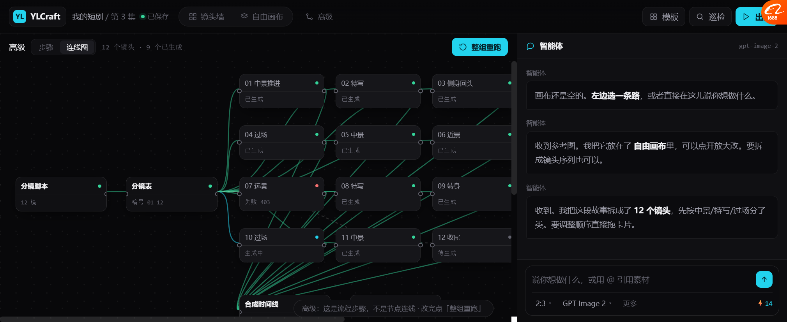
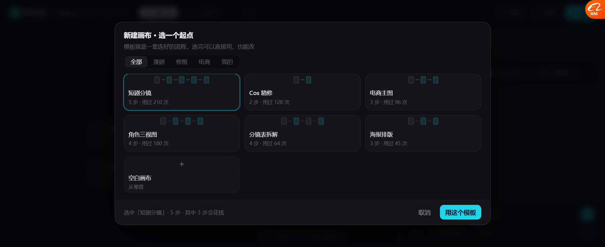
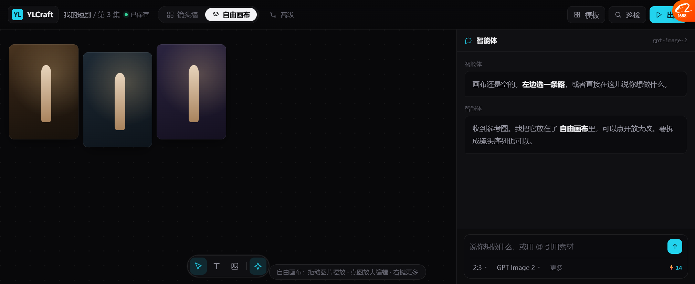
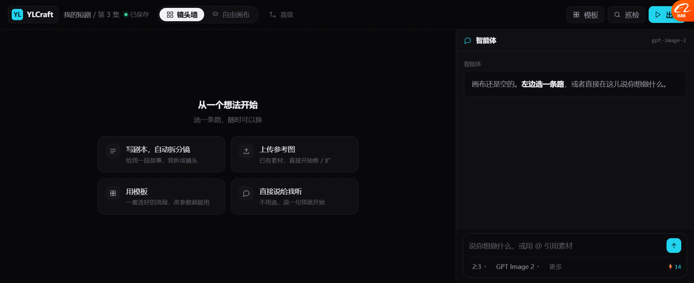
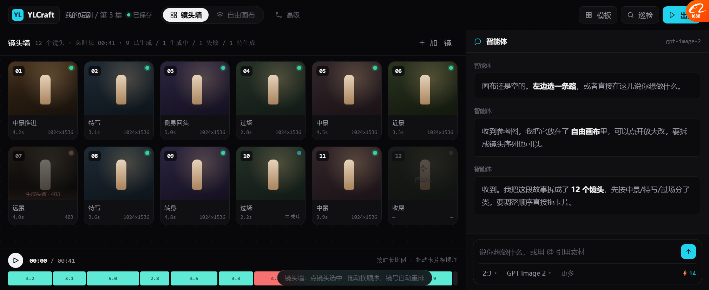
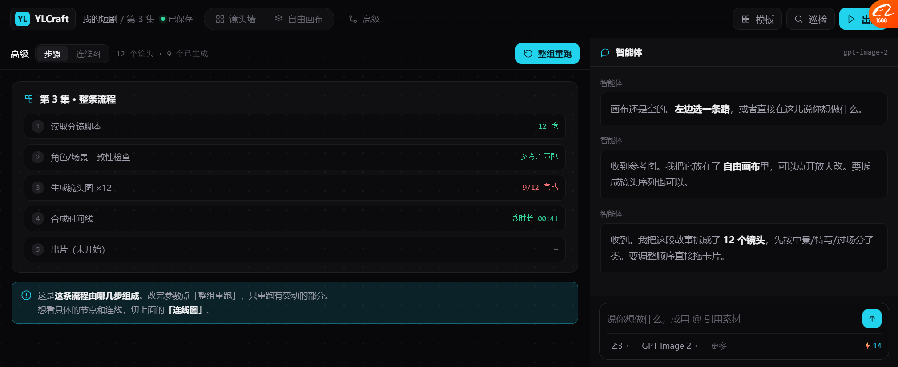

# 统一原型 v14（含 v14.2 修正）

> **打开**：`docs/prototypes/canvas_unified_v14.html`
> 一个文件，三个模式，三区布局。**以后只看这个。**

---

## 一、这一轮修的两个问题

### ① 自由画布拖不动（真 bug，已修）

**原因**：`pointerdown` 里调了 `renderFree()`。

```js
pointerdown → selId = s.id → renderFree()   // ← 把正在拖的 DOM 重建了
pointermove → 拖的是一个已经不在页面上的旧元素
```

**修法**：pointerdown 里**只改 class，不重建 DOM**。

```js
selId = s.id;
freecv.querySelectorAll('.item').forEach(x => x.classList.toggle('sel', x.dataset.id === s.id));
```

**验证**（合成 pointer 事件）：
```
before = 16px,26px  →  after = 106px,86px   ✅ 真的移动了
```

### ② 连线模式没了（我砍过头，已加回）

之前把「高级」做成了「打组执行」，等于**把节点连线彻底删了**。

**修法**：「高级」下面拆两个子视图：

```
高级  [步骤] [连线图]
```

| 子视图 | 给谁看 | 内容 |
| --- | --- | --- |
| **步骤**（默认） | 普通用户 | 5 步流程 + 整组重跑 |
| **连线图** | 想改流程的人 | 16 节点 + 26 条边 + 端口 |

**这样两个诉求都满足**：默认不吓人，但要的时候在。

---

## 二、连线图长什么样



```
分镜脚本(12镜) ──→ 分镜表(镜号01-12) ──┬──→ 01 中景推进 ✅
                                      ├──→ 02 特写 ✅
                                      ├──→ ...
                                      ├──→ 07 远景 ❌ 失败403（红线）
                                      ├──→ 10 过场 🔵 生成中
                                      └──→ 12 收尾 ⚪ 待生成
                                              ↓
                                        合成时间线 ──→ 出片
```

- **16 个节点**（2 个阶段 + 12 生成 + 合成 + 出片）
- **26 条边**，按状态上色：绿=成功、青=运行中、红=失败、灰虚线=待生成
- 3 列 × 4 行排布，**不用滚动就能看全**
- 节点有**输入/输出端口**

---

## 三、模板弹窗（这次新做的）



```
新建画布 · 选一个起点
模板就是一套连好的流程，选完可以直接用，也能改

[全部][漫剧][修图][电商][我的]

┌─ □—□—□—□—□ ─┐ ┌─ □—□ ─┐  ┌─ □—□—□ ─┐
│ 短剧分镜       │ │ Cos 精修 │  │ 电商主图  │
│ 5 步 · 用过210次│ │ 2步·128次│  │ 3步·96次 │
└───────────────┘ └─────────┘  └─────────┘
┌─ □—□—□—□ ─┐  ┌─ □—□—□—□ ─┐ ┌─ □—□—□ ─┐
│ 角色三视图   │  │ 分镜表拆解  │ │ 海报排版  │
│ 4步·用过180次│  │ 4步·64次   │ │ 3步·45次 │
└────────────┘  └────────────┘ └─────────┘
┌─ + 空白画布 ─┐

选中「短剧分镜」· 5 步 · 其中 3 步会花钱      [取消] [用这个模板]
```

### 设计要点

| 做法 | 依据 |
| --- | --- |
| 卡片里画**小节点图** | 一眼看出**结构**，不只看名字 |
| 标 **步数 + 使用次数** | Lovart 技能卡 |
| 底部标 **"其中 3 步会花钱"** | 成本透明 |
| **分类 chips** | ArtCraft 资产浏览器的分类导航 |

### 🔴 选完会按模板给合理产出量

| 模板 | 步数 | 选完得到 |
| --- | --- | --- |
| Cos 精修 | 2 步 | **3 张图**（自由画布） |
| 电商主图 | 3 步 | **3 张图**（自由画布） |
| 海报排版 | 3 步 | **2 张图**（自由画布） |
| **短剧分镜** | 5 步 | **12 个镜头**（镜头墙） |
| 分镜表拆解 | 4 步 | 12 个镜头 |
| 角色三视图 | 4 步 | 3 张图 |

**修过一个不合逻辑的地方**：原来 2 步的「Cos 精修」也生成 12 个镜头 ——
现在按模板类型给量，修图类就 3 张，剧集类才 12 镜。



---

## 四、完整状态

### 空态（4 个入口）



### 镜头墙



### 高级 · 步骤



### 高级 · 连线图


---

## 五、实测过的（这轮）

| 项 | 结果 |
| --- | --- |
| 🔴 **自由画布拖动** | ✅ **修好了**，合成 pointer 事件验证 16,26→106,86 |
| 🔴 **连线图** | ✅ 16 节点 / 26 边，状态上色，不用滚动 |
| 步骤/连线切换 | ✅ |
| 🔴 **模板弹窗** | ✅ 6 个模板 + 空白 |
| 用「Cos 精修」 | ✅ → 3 张，切到自由画布 |
| 用「短剧分镜」 | ✅ → 12 镜，切到镜头墙 |
| 模板产出量按类型 | ✅ 修过（原来全 12） |
| 整组重跑 | ✅ 9/12 → 11/12 |
| 三模式切换不丢数据 | ✅ 同一份 DOC |

---

## 六、还没做的

| 缺什么 | 说明 |
| --- | --- |
| 巡检接入 | 顶栏「巡检」还是 toast，要接 v12 |
| 出片 | 只 toast |
| 时间线播放 | 按钮没绑 |
| 连线图的节点拖拽 | 静态坐标 |
| 模板分类筛选 | chips 点了没反应 |
| 真存盘 | 内存态 |

---

## 七、要你定的

| # | 问题 | 我的看法 |
| --- | --- | --- |
| 1 | 「高级 = 步骤 / 连线图」两个子视图够不够 | 够，默认步骤，要的时候切连线 |
| 2 | 模板产出量这个规则（修图3张/剧集12镜）对不对 | 是示例值，实际该由模板配置 |
| 3 | 下一个接：**巡检** / 出片 / 时间线播放 | 巡检（它已经做完了） |
