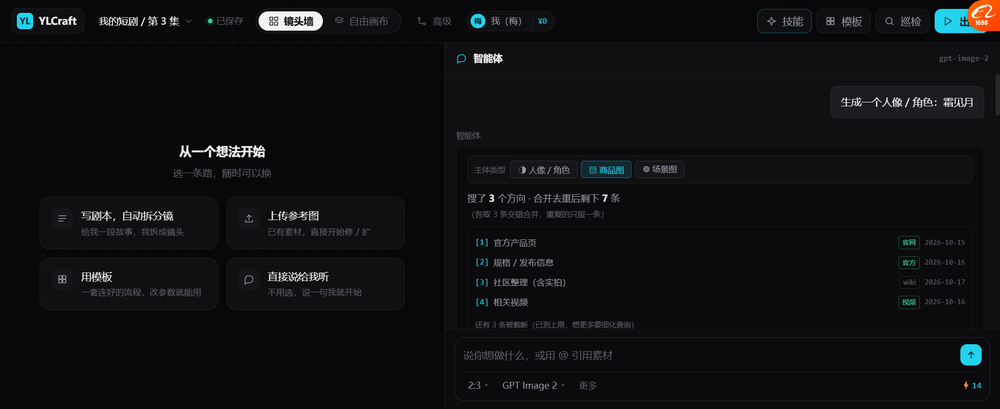
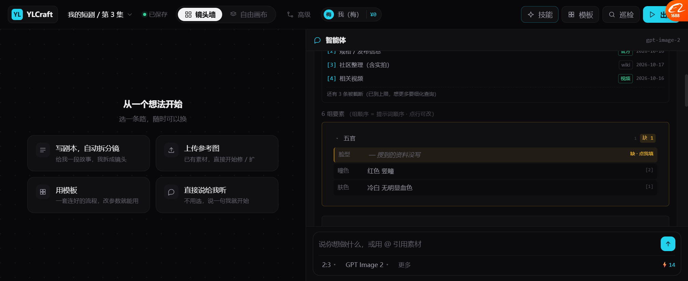
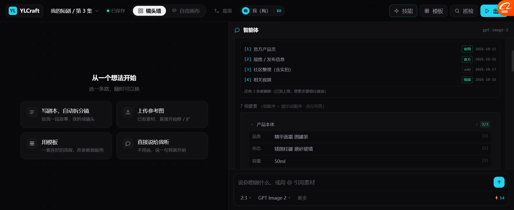

# 要素分组是「人像专用」的吗？商品图呢？

> 你问：**「这个分组是生成人像时候用的吗 商品图呢」**
>
> **你问到了我设计里的一个真实漏洞。**
> 我之前写的「五官 / 发型 / 服装 / 配饰 / 风格」—— **那是人像专用的。**
> 商品图根本不是这套。已经改成可切换的了。

---

## 一、先承认：我之前只设计了人像

原来的 code：

```js
elements:[
  { k:'发型', ... }, { k:'瞳色', ... }, { k:'服装', ... },
  { k:'标志物', ... }, { k:'整体', ... }, { k:'脸型', ... }, { k:'体型', ... }
]
```

**写死的 7 项，全是人身上的东西。**

商品图要搜的是「瓶身材质、logo 位置、容量、背景台面」——
**拿人像的 schema 去搜商品，一项都搜不到。**

---

## 二、现在改成：主体类型 → 不同 schema



```
┌──────────────────────────────────────────────────┐
│ 主体类型  [◑ 人像/角色] [▤ 商品图] [◍ 场景图]      │
└──────────────────────────────────────────────────┘
```

切一下，**整个要素表换掉** —— 组名、字段、搜索查询、缺项判断标准全变。

---

## 三、三套 schema 对照

### 3.1 人像 / 角色（6 组）



| # | 组 | 包含字段 |
| --- | --- | --- |
| 1 | **五官** | 脸型、瞳色、肤色 |
| 2 | **发型** | 发型、发色 |
| 3 | **服装** | 上装、下装、鞋 |
| 4 | **配饰** | 耳饰、标志物 |
| 5 | **体型** | 身高、体型 |
| 6 | **风格** | 色调、光比 |

**搜什么**：`霜见月 角色 外观 设定` / `霜见月 官方 发布 图` / `霜见月 发色 瞳色 服装`

### 3.2 商品图（7 组）



| # | 组 | 包含字段 |
| --- | --- | --- |
| 1 | **产品本体** | 品类、形态、容量 |
| 2 | **材质** | 瓶身材质、盖材质、表面处理 |
| 3 | **颜色** | 主色、辅色 |
| 4 | **标识** | logo 位置、品名文字、规格文字 |
| 5 | **场景** | 背景、台面 |
| 6 | **光照** | 主光、辅助光、反射 |
| 7 | **风格** | 调性、色调 |

**搜什么**：`凝光面霜 官方 产品图` / `凝光面霜 包装 规格` / `凝光面霜 成分 卖点`

### 3.3 场景图（6 组）

| # | 组 | 包含字段 |
| --- | --- | --- |
| 1 | **空间** | 场所类型、年代、尺度 |
| 2 | **天候** | 天气、时段 |
| 3 | **光照** | 主光源、色温 |
| 4 | **材质** | 地面、墙面 |
| 5 | **细节** | 标志物 |
| 6 | **视角** | 机位、景别 |

**搜什么**：`雨夜 老街 实景` / `雨夜 街道 霓虹 摄影` / `老巷 雨夜 光线`

---

## 四、🔴 不只是组名不同 —— 三条关键差异

### 4.1 「影响最大」的项完全不同

```js
character: { critical:['脸型','瞳色','上装'],   criticalWhy:'脸决定像不像，服装决定对不对得上版本' }
product:   { critical:['品类','容量','logo位置','品名文字'],
             criticalWhy:'形状错=不是这个产品，文字错=不能上架' }
scene:     { critical:['场所类型','时段','主光源'], criticalWhy:'场所和光错了整张氛围就废' }
```

**这个差异很要命：**

| 缺什么 | 人像 | 商品 |
| --- | --- | --- |
| 缺「脸型」 | 会不太像，但能用 | — |
| 缺「瞳色」 | 可能变个人 | — |
| **缺「容量」** | — | 🔴 **规格标错，电商图直接不能上架** |
| **缺「logo 位置」** | — | 🔴 **品牌标识错位，等于假货图** |
| 缺「耳饰」 | 无所谓 | — |
| 缺「台面」 | — | 可以换成悬浮，影响小 |

**所以提示文案也不该一样：**
- 人像缺关键项：「脸决定像不像」
- 商品缺关键项：「**形状错=不是这个产品，文字错=不能上架**」

### 4.2 商品图对参考图的依赖更强

| | 人像 | 商品 |
| --- | --- | --- |
| 参考图 | 有帮助 | 🔴 **几乎必须有**（官方产品图） |
| 为什么 | 保证风格一致 | **包装细节不能凭空编**（瓶型、字体、颜色） |
| 编的后果 | 不太像 | **图上写着错的品牌名，不能用** |

**商品图还多一个硬约束：文字必须保留。**
「凝光」两个字的位置和字体，生成时不能变 —— 这是纯文字模型很难保证的，
所以商品图更依赖**参考图 + 局部重绘**，而不是纯文生图。

### 4.3 一致性的要求不一样

| | 人像 | 商品 |
| --- | --- | --- |
| 一致性对象 | 角色的**脸和气质** | 产品的**形状和标识** |
| 容错 | 换个角度脸会有点变，可接受 | **任何角度都必须一模一样** |
| 解法 | 角色三视图 / 参考图锁定 | **必须用官方多角度图**，没图就别做多角度 |

---

## 五、实现方式（可扩展）

```js
const SUBJECT_SCHEMAS = {
  character: {
    n:'人像 / 角色', ic:'◑',
    groups: [
      { k:'face', t:'五官', order:1, fields:['脸型','瞳色','肤色'] },
      ...
    ],
    elements: { '脸型':{v:'— 搜不到',ok:0}, '瞳色':{v:'红色 竖瞳',ok:1,src:'2'}, ... },
    promptTail: '银白发丝逆光边缘光, 高清细节',
    critical: ['脸型','瞳色','上装'],
    criticalWhy: '脸决定像不像，服装决定对不对得上版本'
  },
  product: { ... },
  scene:   { ... }
};
```

**加一种新主体类型 = 加一个对象。** 不改任何渲染逻辑。

🔴 **这就是基调 P4「加新用途 = 加配置」在要素层的一次落地。**

---

## 六、还能加哪些主体类型

| 类型 | 组大概是 | 谁用 |
| --- | --- | --- |
| **人像/角色** | 五官/发型/服装/配饰/体型/风格 | 漫剧、Coser |
| **商品图** | 本体/材质/颜色/标识/场景/光照/风格 | 电商 |
| **场景图** | 空间/天候/光照/材质/细节/视角 | 漫剧背景 |
| 🔲 **海报/平面** | 主体/文案区/配色/版式/留白/字体 | 设计、电商 |
| 🔲 **UI/界面** | 组件/配色/间距/圆角/图标风格 | 应用图 |
| 🔲 **食物** | 菜品/摆盘/餐具/台面/热气/光线 | 餐饮 |
| 🔲 **建筑/室内** | 类型/风格/材质/开窗/光照/视角 | 房地产 |

**前三个已经做了。后四个是备选** —— 加一个就是一个对象。

---

## 七、实测

| 项 | 结果 |
| --- | --- |
| 主体类型切换器（3 个） | ✅ |
| 切「人像」→ 6 组（五官/发型/服装/配饰/体型/风格） | ✅ |
| 切「商品图」→ 7 组（本体/材质/颜色/标识/场景/光照/风格） | ✅ |
| 切「场景图」→ 6 组（空间/天候/光照/材质/细节/视角） | ✅ |
| 组标题带序号 + 缺项计数 | ✅ `五官 [1] 缺 1` |
| 组可折叠 | ✅ 点标题 |
| 缺项标琥珀 + 「缺·点我填」 | ✅ |
| 组顺序 = 提示词顺序 | ✅ |
| 「影响最大」按类型不同 | ✅ |
| 切类型后查询也变 | ✅ |

### 修过的 bug

| bug | 原因 |
| --- | --- |
| `setSubject is not defined` | 重构时 `let editingElem` / `let addingElem` 重复声明 → `SyntaxError` 整块脚本挂掉 |
| 重复的 `buildPrompt` | 替换时旧的没删干净 |

---

## 八、还没做的

| 项 | 现状 |
| --- | --- |
| 「海报 / UI / 食物 / 室内」schema | 只有前三个 |
| 商品图的「文字必须保留」约束 | 没做（要靠局部重绘，不是纯生成） |
| 商品图多角度一致性 | 没做（需要官方多角度图） |
| 类型自动判断 | 现在手动切。应该由 Agent 从你这句话里判断 |
| 类型混合（人 + 商品同时） | 没做（比如"模特拿产品"，需要两套 schema 合并） |
