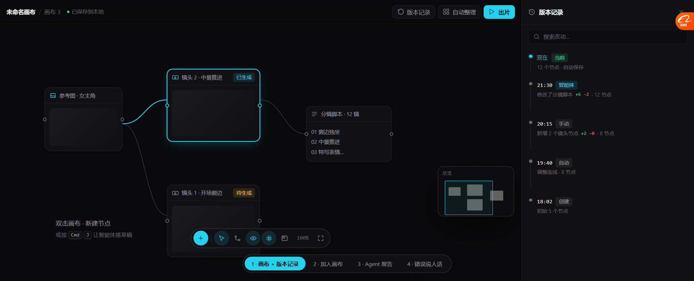
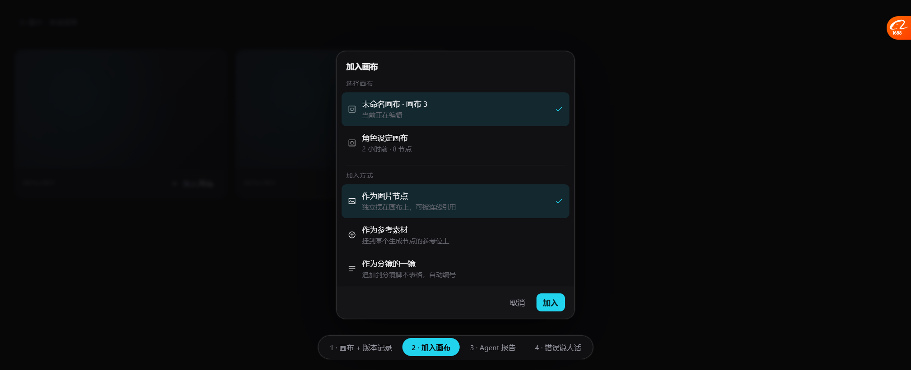
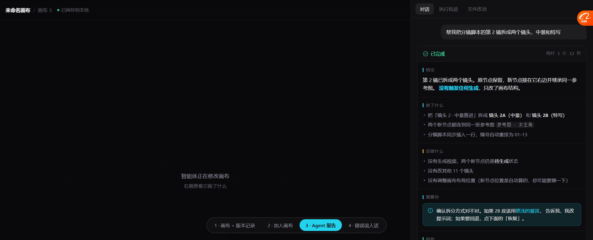
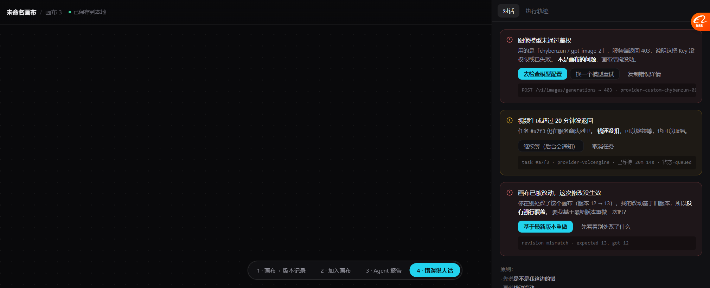

# 原型 vs 现状：差距对照（2026-10-18）

> 原型：`docs/prototypes/canvas_agent_prototype.html`（4 屏，可交互）
> 截图：`docs/prototypes/01~04_*.png`
> 对照对象：`frontend/src/pages/canvas/index.tsx`（7,487 行）、
> `frontend/src/pages/agent/index.tsx`（4,458 行）、`image-gen` / `video-gen` / `assets`

---

## 屏 1 · 画布 + 版本记录

### 逐项对照

| 原型里的元素 | 现状 | 差距 | 改哪 |
| --- | --- | --- | --- |
| 顶栏 `未命名画布 / 画布 3` | ⚠️ 有画布名，**没有多画布切换** | 中 | `canvas/index.tsx` 顶栏 |
| `已保存到本地` | ⚠️ 有"已保存"，**没写"本地"** | 小 | 同上，改文案 |
| `版本记录` 按钮 | ❌ **没有** | **大** | 新增 |
| 版本面板（时间/谁改的/±行数/查看/恢复） | ❌ **没有** | **大** | 新增组件 |
| `自动整理` 按钮 | ❌ 没有（`autoLayout` 命中 0） | 中 | 新增 |
| `出片` 按钮 | ❌ 没有 | 大 | 后续阶段 |
| 小地图 | ❌ 只有 1 处提及，等于没有 | 中 | 新增组件 |
| `隐藏连线` 按钮 | ❌ 没有（`edgeVisible` 命中 0） | 小 | 工具栏 |
| `网格吸附` 按钮 | ✅ **有**（snap 命中 14） | — | — |
| 底部工具条（+ / 选择 / 连线 / 缩放） | ✅ 有 | — | — |
| 节点 + 端口 + 连线 | ✅ **比原型更强**（有 relation 类型、端口校验、循环检测） | 0 | — |
| 空态提示 `双击画布 · 新建节点` | ✅ 有类似 | 小 | 文案 |

### 结论

**画布内核我们比原型强**（关系类型、端口校验、循环检测），
**缺的是"外围工具"**：版本记录、小地图、自动整理、隐藏连线。

---

## 屏 2 · 加入画布

### 逐项对照

| 原型里的元素 | 现状 | 差距 | 改哪 |
| --- | --- | --- | --- |
| 产物卡片上的 `加入画布` 按钮 | ❌ **没有** | **大** | `image-gen` / `video-gen` / `assets` 三处 |
| 选画布（当前 + 其他） | ❌ 没有画布选择概念 | 大 | 新增 |
| 加入方式三选一（节点/参考/分镜） | ❌ 没有 | **大** | 新增 |
| 后端统一入口 | ❌ 没有 | 大 | 新增 `intake_service` |
| 素材库已有"选中多张" | ✅ 有（`AssetGrid` 有 Checkbox + Dropdown） | — | 可复用它的批量选择 |

### 结论

**这是纯新增**，但**素材库的多选 + 下拉菜单已经有现成的**（`AssetGrid.tsx:205`），
可以照它的模式做，不用从零写。

---

## 屏 3 · Agent 报告

### 逐项对照

| 原型里的元素 | 现状 | 差距 | 改哪 |
| --- | --- | --- | --- |
| 四段式（结论 / 做了什么 / **没做什么** / 需要你） | ❌ **没有** | **大** | 提示词 + 渲染 |
| `没做什么` 单独一段 | ❌ **完全没有这个概念** | **大** | 提示词 |
| `自检` 状态标签（节点无环 / 镜号连续 / 位置待调整） | ❌ 没有 | 中 | 新增 |
| `更改了 N 个文件 +18 −4` | ⚠️ 有 step 输出，**但没有汇总成一行** | 中 | 渲染层 |
| 能力边界提示（"我读不了图"） | ❌ 没有 | 中 | 提示词 |
| 用时 `1 分 12 秒` | ✅ 有（`工作了 X 分 Y 秒`） | — | — |
| 步骤折叠（匹配 Skill / 模型响应 / 消耗模型） | ✅ 有（`step_type` 映射，L282-283） | — | 可扩展成四段 |
| 工具结果可读展示 | ❌ 被 `summarizeToolResult` 压成「返回字段：url、local_path…」（L303-315） | **大** | 重写渲染 |
| 输入框 `描述你的想法，或用 @ 引用素材` | ❌ 没有 `@`（`ChatRequest` 无字段） | **大** | 前后端 |
| 附件按钮 | ❌ 没有 | 大 | composer |
| `选择技能` 按钮 | ❌ 技能只能在配置层绑 | 中 | composer |
| `当前画布` scope 选择器 | ⚠️ 有「通用助手」下拉，**没有 scope** | 中 | composer |
| 面板可拖宽 | ❌ 没有 | 小 | 布局 |

### 结论

**我们的 Agent 配置强、对话弱。**
`step_type` 的中文映射（L282-283）是好底子，**可以扩成四段式渲染**，
不用推倒重来。

---

## 屏 4 · 错误说人话

### 逐项对照

| 原型里的元素 | 现状 | 差距 | 改哪 |
| --- | --- | --- | --- |
| 一句话说清是什么错 | ⚠️ `buildStepFailureAdvice`（L317）会给建议，但**原始错误还是照原样显示** | 中 | 重写 |
| 先说"是不是我这边的错" | ❌ 没有 | 大 | 提示词 + 渲染 |
| 说清"钱动没动" | ❌ **完全没有** | **大** | 新增 |
| 每条错误带能点的下一步 | ❌ 没有 | 大 | 新增 |
| 技术细节折叠在最后 | ❌ **实测甩过 SQL 给用户** | **大** | 新增 |
| 三条典型错误分类（鉴权 / 超时 / 版本冲突） | ❌ 没有分类 | 大 | 新增 |

### 结论

**这是当前最"坏"的一块**——不是缺功能，是**显示方式伤害用户**。

---

## 汇总：按投入产出排序

| 顺序 | 事项 | 新增/改造 | 依赖 | 预计改动量 |
| --- | --- | --- | --- | --- |
| **1** | 错误说人话（屏 4） | 改造渲染 + 提示词 | 无 | 小（1 个文件） |
| **2** | Agent 报告四段式（屏 3 上半） | 提示词 + 渲染 | 无 | 中（1-2 个文件） |
| **3** | 画布版本记录（屏 1 右侧面板） | 新增表 + API + 组件 | 无 | 大（5-6 个文件） |
| **4** | 加入画布（屏 2） | 新增服务 + 组件 + 3 处挂载 | 需先有版本记录（否则加进去没法回滚） | 大 |
| **5** | 工具结果可读渲染 | 重写 `summarizeToolResult` | 无 | 中 |
| **6** | composer 补齐（@/附件/技能/scope） | 前后端 | 无 | 大 |
| **7** | 小地图 / 自动整理 / 隐藏连线 | 新增组件 | 无 | 中 |

---

## 我建议的动手顺序

**先做 1 和 2（都是改显示，不改结构），再做 3，再做 4。**

理由：
- **1、2 是"现在就在伤害用户"的**，而且改动小、风险低
- **3 是"防止丢东西"**，需要建表，慢一点
- **4 依赖 3**——加入画布之后如果没有版本记录，加错了没法回

---

## 待你确认

| # | 问题 | 我的建议 |
| --- | --- | --- |
| 1 | 原型这 4 屏的方向对不对 | 对的话我按 1→2→3→4 做 |
| 2 | 视觉风格（Deep 深海主题 + 青色单一强调色） | 沿用现有主题，不引入新色 |
| 3 | 版本记录面板放右侧抽屉 vs 底部时间线 | 右侧抽屉（不挡画布） |
| 4 | 加入方式的三个选项够不够 | 先做这三个，后面按需加 |
