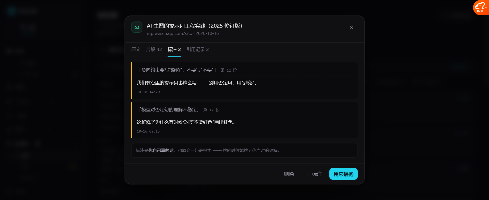
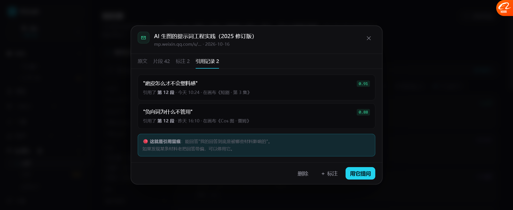

# 条目详情：标注 + 引用留痕（P3）

> 之前这两个 tab 只是标签，点不动也没内容。现在都有真内容了。
> **重点是「引用记录」—— 它补上了我一直说的"引用留痕"。**

---

## 一、四个可切换的 tab

```
┌─ ✉ AI 生图的提示词工程实践（2025 修订版） ──── ✕ ┐
│  mp.weixin.qq.com/s/… · 2026-10-16              │
├────────────────────────────────────────────────┤
│  原文   片段 42   标注 2   引用记录 2            │
├────────────────────────────────────────────────┤
│  （当前 tab 的内容）                              │
├────────────────────────────────────────────────┤
│                      删除   ＋标注   [用它提问]   │
└────────────────────────────────────────────────┘
```

**tab 上直接显示数量**（片段 42 / 标注 2 / 引用记录 2）——
不用点进去就知道这条材料有没有人用过。

---

## 二、标注



```
┃ 「负向约束要写"避免"，不要写"不要"」  第 12 段
┃
┃ 我们节点里的提示词也这么写 —— 别用否定句，用"避免"。
┃
┃ 10-18 14:20

┃ 「模型对否定句的理解不稳定」  第 12 段
┃
┃ 这解释了为什么有时候会把"不要红色"画出红色。
┃
┃ 10-16 09:15

ⓘ 标注是你自己写的话，和原文一起进检索 —— 搜的时候能搜到你当时的理解。
```

### 三个设计点

| 设计 | 为什么 |
| --- | --- |
| **标注锚定到具体段落**（第 12 段） | 以后检索到这段，会一起显示你的标注 |
| **引用原文 + 自己写的话分开显示** | 一眼分清哪是材料、哪是我的想法 |
| 🔴 **标注也进检索** | 搜的时候能搜到"我当时怎么理解的" |

**第三条最关键**：知识库不只是存别人的东西，**也存你对它的理解**。

---

## 三、引用记录（引用留痕）



```
"磨皮怎么才不会塑料感"                          0.91
引用了 第 12 段 · 今天 10:24 · 在画布《短剧 · 第 3 集》

"负向词为什么不管用"                            0.88
引用了 第 12 段 · 昨天 16:10 · 在画布《Cos 图 · 蕾姆》

ⓘ 🔴 这就是引用留痕：能回答"我的回答到底是被哪些材料影响的"。
   如果发现某条材料老把回答带偏，可以停用它。
```

### 每条记录回答四个问题

| 问题 | 字段 |
| --- | --- |
| **谁问的什么** | `"磨皮怎么才不会塑料感"` |
| **引用了哪一段** | 第 12 段 |
| **什么时候** | 今天 10:24 |
| **在哪块画布** | 《短剧 · 第 3 集》 |
| **有多相关** | 0.91 |

---

## 四、🔴 为什么引用留痕这么重要

没有留痕的时候，你只知道「Agent 回答得挺好 / 不太对」。
**有了留痕，你能反查原因。**

| 场景 | 没留痕 | 有留痕 |
| --- | --- | --- |
| 回答变差了 | 不知道为啥 | 看到它引用了那条半年前收的旧文章 |
| 回答突然很准 | 不知道为什么 | 看到它引用了你自己写的经验 |
| 某条材料有问题 | 无法定位 | 它的引用记录最多，停用它即可 |

**这是知识库能被"治理"的前提。**
不然材料越收越多，你根本不知道哪条在起作用、哪条在拖后腿。

对照基调 I2「检查必须带证据」——
**引用留痕是"证据"这件事在知识库这一侧的对应物。**

---

## 五、实测

| 项 | 结果 |
| --- | --- |
| 4 个 tab 可切换 | ✅ |
| tab 显示数量（片段42/标注2/引用2） | ✅ |
| 原文 tab | ✅ 可读 + 提示可划词标注 |
| 片段 tab | ✅ 5 段 + 向量维度 + **被引用过的段落标出来** |
| 标注 tab | ✅ 2 条，带原文引用 + 我的笔记 + 时间 |
| 引用记录 tab | ✅ 2 条，带问题 + 分数 + 第几段 + 时间 + 画布 |
| 空状态（无标注/无引用） | ✅ 都有解释文案 |

---

## 六、片段 tab 的一个细节

```
1  （段落 1）
2  （段落 2）
...
12 （段落 12） 被引用过        ← 标出来
```

**被引用过的段落直接在片段列表里标出来。**
这样看片段的时候就知道"这段是真被用过的，不是摆设"。

---

## 七、还没做的

| 项 | 现状 |
| --- | --- |
| 划词添加标注 | 只 toast，没做真实选区 |
| 标注编辑/删除 | 只能看 |
| 引用记录点进去看当时那段对话 | 没做 |
| 停用某条材料 | 没做（文案里提到了） |
| 标注参与检索 | 概念上说了，没实现 |
| 片段点击展开全文 | 没做 |

---

## 八、下一步

| 优先 | 做什么 |
| --- | --- |
| P4 | Context chips 可移除（"这条别用"）+ 引用留痕打通到画布 |
| P5 | 间隔重复：错题按遗忘曲线排复习 |
| P6 | 划词标注（真实选区 + 弹窗输入） |
| P7 | 材料停用/启用（带"这条老把回答带偏"的判断依据） |
