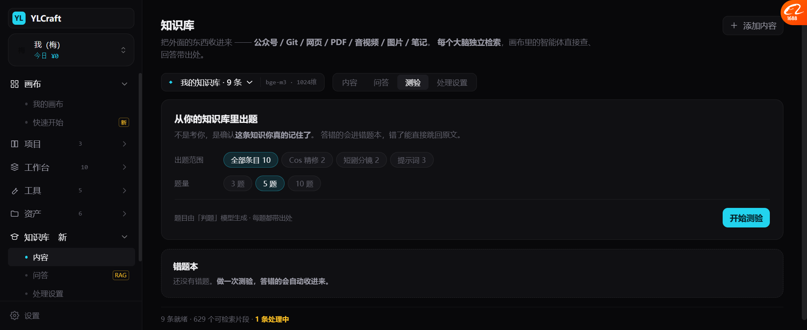
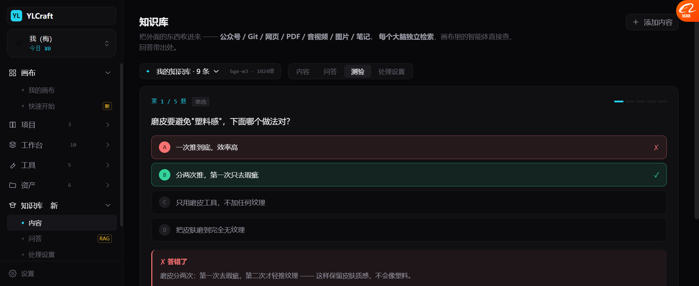
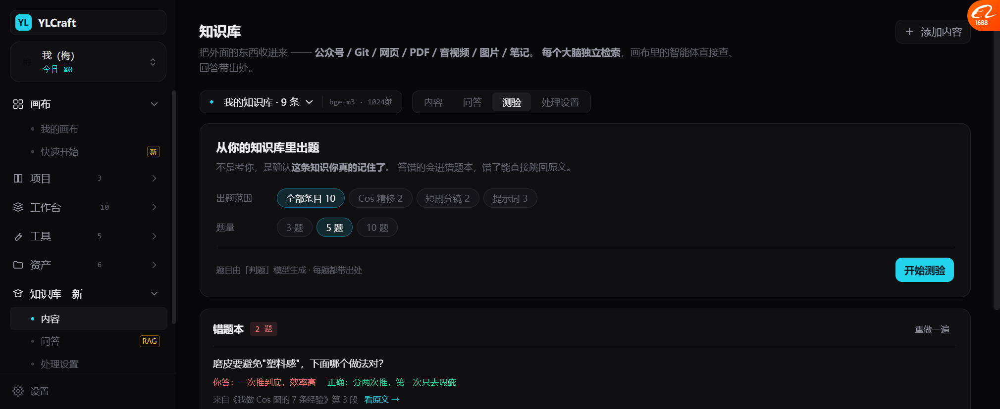

# 测验 · 错题本（P2，抄墨渊）

> 墨渊有 `quiz generation` / `wrong-answer review` / `judge` 模型绑定。
> 我按它的结构做，但加了一条我们独有的：**每题都带出处，错了能直接跳回原文。**

---

## 一、定位（写在界面上）

```
从你的知识库里出题
不是考你，是确认这条知识你真的记住了。
答错的会进错题本，错了能直接跳回原文。
```

🔴 **"不是考你"这句是关键。**
如果包装成考试，用户会有压力，不想点。
包装成"确认你记没记住"，它就是个**自检工具**。

---

## 二、出题前



```
从你的知识库里出题
不是考你，是确认这条知识你真的记住了。

出题范围   [全部条目 10]  Cos 精修 2  短剧分镜 2  提示词 3
题量       [3 题]  [5 题]  [10 题]

题目由「判题」模型生成 · 每题都带出处        [开始测验]

────────────────────────────────────
错题本
还没有错题。做一次测验，答错的会自动收进来。
```

| 设计 | 说明 |
| --- | --- |
| **出题范围可选** | 按收藏夹/主题出题，不是只能全库 |
| **题量可选** | 3 / 5 / 10 |
| **标明"由判题模型生成"** | 和「处理设置」里的判题绑定对应 |

---

## 三、答题中



```
第 1 / 5 题   单选                      ▬ ─ ─ ─ ─

磨皮要避免"塑料感"，下面哪个做法对？

┌ A  一次推到底，效率高                              ✗ ┐   ← 红
├ B  分两次推，第一次只去瑕疵                        ✓ ┤   ← 绿
├ C  只用磨皮工具，不加任何纹理                        ┘
└ D  把皮肤磨到完全无纹理                              ┘

┏ ✗ 答错了 ━━━━━━━━━━━━━━━━━━━━━━━━━━━━━━━━━━━━┓
┃ 磨皮分两次：第一次去瑕疵，第二次才轻推纹理 —— 这样  ┃
┃ 保留皮肤质感，不会像塑料。                          ┃
┃                                                ┃
┃ 来自《我做 Cos 图的 7 条经验》第 3 段  看原文 →     ┃
┗━━━━━━━━━━━━━━━━━━━━━━━━━━━━━━━━━━━━━━━━━━━━━┛

已收进错题本                              [下一题 →]
```

**四个细节：**

| 细节 | 作用 |
| --- | --- |
| 顶部 `▬ ─ ─ ─ ─` 进度条 | 知道还有几题，不会突然结束 |
| 答错标红 ✗ / 正确标绿 ✓ | 两个都给，不只标错 |
| **解析 + 出处 + 「看原文 →」** | 🔴 错了能立刻回到那一段 |
| 底部「已收进错题本」 | 明确告诉用户会进哪里 |

---

## 四、错题本



```
错题本  2 题                                 [重做一遍]

磨皮要避免"塑料感"，下面哪个做法对？
你答：一次推到底，效率高    正确：分两次推，第一次只去瑕疵
来自《我做 Cos 图的 7 条经验》第 3 段  看原文 →
...（第 2 题）
```

**每道错题都带完整信息**：
- 原题
- **你答的**（红）+ **正确的**（绿）
- **出处**（哪篇、第几段）
- **能跳回原文**

🔴 **这是和墨渊那套最大的不同** —— 墨渊的错题本记"错了"，我们的错题本还能**追到为什么会错**。

---

## 五、和知识库其他部分的闭环

```
知识库（材料）
   │ 生成题目
   ▼
测验 ──答错──→ 错题本
   │              │
   │ 答对          │ 看原文
   ▼              ▼
确认掌握      回到第 N 段重新读
                  │
                  └──→ 再测一次
```

**这个闭环才让"知识库"不只是仓库，而是能训练的东西。**

---

## 六、实测

| 项 | 结果 |
| --- | --- |
| 测验 tab | ✅ 第 4 个 tab |
| 出题前：范围 4 选 1 + 题量 3 选 1 | ✅ |
| 开始测验 → 第 1/5 题 | ✅ 4 个选项 |
| 选错 → 判定 bad + 红/绿双标 | ✅ |
| 解析 + 出处 + 看原文 | ✅ |
| 答对 → 判定 ok | ✅ |
| 下一题 → 进度推进 | ✅ |
| 走完后 → 错题本收集到 2 题 | ✅ |
| 错题带"你答/正确/出处/看原文" | ✅ |
| 「重做一遍」 | ✅ |

---

## 七、还没做的

| 项 | 现状 |
| --- | --- |
| 真出题 | 5 道写死的题 |
| 判题模型真调用 | 只有绑定项，没实现 |
| 间隔重复（什么时候该复习） | 没做（墨渊有"错题复习"） |
| 题目难度分级 | 没做 |
| 填空/多选 | 只做了单选和判断 |
| 错题本持久化 | 刷新就丢 |
| 答题统计（哪类知识最弱） | 没做（墨渊有分析面板） |

---

## 八、下一步

| 优先 | 做什么 |
| --- | --- |
| P3 | 条目详情补「标注」和「引用记录」的真实内容 |
| P4 | Context chips 可移除 + 引用留痕 |
| P5 | 间隔重复：错题按遗忘曲线排下次复习时间 |
| P6 | 答题统计进「分析面板」 |
