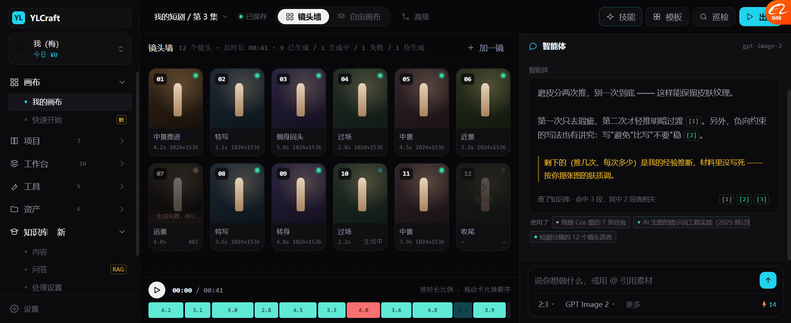
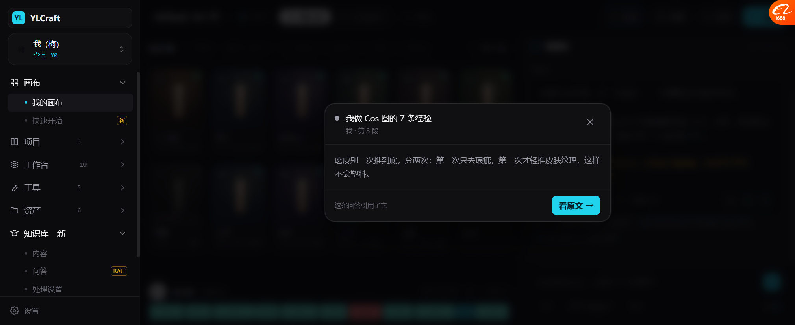

# 知识库接进画布：回答带编号出处（P1，2026-10-19）

> 这一步把两个子系统连起来了：
> **知识库**（收集材料）→ **画布 Agent**（用材料回答，说得出出处）。

---

## 一、效果



在画布右边的对话框问「磨皮怎么才不会塑料感」，Agent 的回答：

```
磨皮分两次推，别一次到底 —— 这样能保留皮肤纹理。

第一次只去瑕疵，第二次才轻推明暗过渡 [1]。另外，负向约束
的写法也有讲究：写"避免"比写"不要"稳 [2]。

┃ 剩下的（推几次、每次多少）是我的经验推断，材料里没写死
┃ —— 按你那张图的肤质调。          ← 琥珀色左边框

───────────────────────────────────────
查了知识库 · 命中 3 段，其中 2 段高相关    [1][2][3]

使用了 ●我做 Cos 图的 7 条经验  ●AI 生图的提示词工程实践  ●短剧分镜的 12 个镜头语言
```

---

## 二、四个设计点

### 2.1 🔴 引用编号可点

点 `[1]` → 弹出那一段的原文：



```
● 我做 Cos 图的 7 条经验
  我 · 第 3 段
────────────────────────────────
磨皮别一次推到底，分两次：第一次只去瑕疵，第二次才轻推
皮肤纹理，这样不会塑料。
────────────────────────────────
这条回答引用了它            [看原文 →]
```

**不点也能知道来自哪篇、第几段**（编号带 tooltip），点了能看到上下文。

### 2.2 🔴 「我的推断」必须和「材料里的」分开

```
┃ 剩下的（推几次、每次多少）是我的经验推断，材料里没写死
```

**琥珀色左边框单独一段。**

这是 AI Copilot UI 模式里那条 **"No source" 要明说**：
> 模型自己想的 ≠ 材料里有的。混在一起，用户就没法判断可信度。

对照我们的基调 I1「讲设计不讲验证」和 I2「检查带证据」——
**这两条放在一起，就是"说清哪些是证据、哪些是判断"。**

### 2.3 区分来源类型

| 类型 | 颜色 | 例子 |
| --- | --- | --- |
| 公众号 | 绿 `#34d399` | AI 生图的提示词工程实践 |
| 我的笔记 | 灰 `#9c9ca8` | 我做 Cos 图的 7 条经验 |
| 网页 | 青 `#22d3ee` | Anthropic 工程博客 |
| Git | 紫 `#a78bfa` | ComfyUI-Impact-Pack |

**一眼看出这条依据是"权威来源"还是"我自己写的"。**

### 2.4 Context chips：这次用了哪些知识

底部「使用了 ●我做 Cos 图的 7 条经验 ●AI 生图的提示词工程实践 …」

对应 UI 模式里的 **Context chips — "Using: X, Y"，可见且可移除**。
**用户永远知道模型看了什么。**

---

## 三、还标了相关度

```
查了知识库 · 命中 3 段，其中 2 段高相关
```

**没有说"命中 3 段"就完事**，而是承认其中 1 段不够相关。

对照知识库问答视图里那条 0.74 的虚线框 —— 同一个原则两处一致。

---

## 四、触发逻辑（原型简化）

```js
const KB_TRIGGER = /磨皮|打光|光位|提示词|怎么写|镜头|分镜|参考|知识库|之前那篇|材料/;

send() → 命中 KB_TRIGGER → kbAnswer() → 带编号的回答 + chips
      → 否则走原来的拆镜头/换顺序逻辑
```

**真实现时不该靠关键词匹配** —— 应该是 Agent 自己判断"这个问题要不要查知识库"，
对应 Toonflow 的 `kb_search` 工具调用。

---

## 五、实测

| 项 | 结果 |
| --- | --- |
| 问「磨皮怎么才不会塑料感」触发知识库 | ✅ |
| 回答带 `[1][2]` 编号引用 | ✅ 5 处 |
| 🔴 「我的推断」琥珀色分开标 | ✅ |
| 底部「命中 3 段，其中 2 段高相关」 | ✅ |
| Context chips（用了哪些知识） | ✅ 3 个 |
| 点 `[1]` 弹出片段原文 | ✅ 带出处 + 第几段 |
| 引用颜色按来源类型区分 | ✅ |

---

## 六、还没做的

| 项 | 现状 |
| --- | --- |
| 真实检索 | 写死的 3 条命中 |
| Agent 自主决定要不要查 | 现在是关键词匹配 |
| 「看原文」跳转 | toast |
| 引用留痕（哪个回答引用了哪条） | 没存 |
| chips 可移除（"别用这条"） | 只展示 |
| 无出处时的完整话术 | 只有一句示例 |

---

## 七、这一步的意义

| 之前 | 现在 |
| --- | --- |
| 知识库是一个独立页面 | **知识库能影响画布里的回答** |
| Agent 回答像"它什么都知道" | **说得出第几段、哪篇、什么来源** |
| 分不清哪些是材料、哪些是模型编的 | **琥珀色单独标出来** |

**这一步做完，"知识库"才不是个摆设 —— 它真的在改 Agent 的输出。**

---

## 八、下一步

| 优先 | 做什么 |
| --- | --- |
| P2 | 测验 / 错题本视图（墨渊有现成的） |
| P3 | 条目详情补「标注」和「引用记录」 |
| P4 | chips 可移除 + 引用留痕 |
| P5 | Agent 自主决定查不查知识库（工具调用，不是关键词） |
