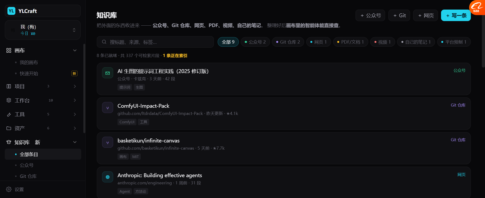
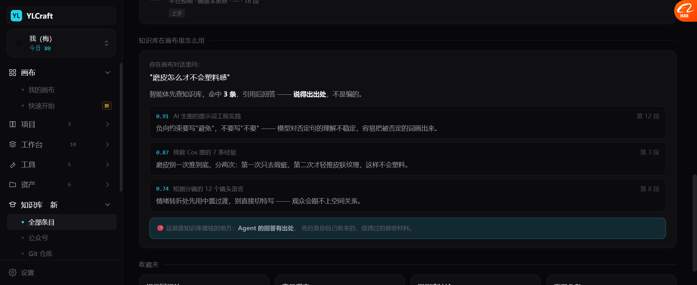

# 知识库（不是我上一版理解的"平台教程"）

> **你纠正得对。**
> 我把「学习」做成了**平台使用教程**。你要的是 **外部知识库** ——
> 公众号、Git 地址、网页、PDF、视频、自己的笔记，**收进来、整理好、能被 Agent 查**。
> 平台教程只是其中一类**预制内容**。
>
> 已改。

---

## 一、先说好消息：底层能力我们有

| 能力 | 代码位置 | 状态 |
| --- | --- | --- |
| **pgvector 向量检索** | `db/models/asset_hub.py:16,118`（`Vector(...)`） | ✅ 已在用 |
| **嵌入模型配置** | `ai_connector.py`：`embedding_type` / `embedding_dimension` / `normalize_embeddings` | ✅ 已有 |
| 中文分词检索 | `scripts/chinese_search.py` | ✅ 已有 |
| 网页抓取 | `api/v1/crawler.py`（20 处） | ✅ 已有 |
| 浏览器登录态抓取 | `browser_profile_cache.py` | ✅ 已有 |

**所以知识库不是从零建，是把已有的搬过来 + 加"收藏"这一层。**

---

## 二、重新定义后的「知识库」



```
知识库
把外面的东西收进来 —— 公众号、Git 仓库、网页、PDF、视频、自己的笔记。
整理好后 画布里的智能体能直接查。

[＋公众号] [＋Git] [＋网页] [＋写一条]

🔍 搜标题、来源、标签…
[全部 9] [●公众号 2] [●Git 2] [●网页 1] [●PDF 1] [●视频 1] [●笔记 1] [●平台预制 1]

8 条已就绪 · 337 个可检索片段 · 1 条正在索引

┌─ ✉ AI 生图的提示词工程实践（2025 修订版）    [公众号] ─┐
│  公众号 · 卡兹克 · 3 天前 · 42 段                     │
│  [提示词] [生图]                                     │
├─ ⑂ ComfyUI-Impact-Pack               [Git 仓库] ────┤
│  github.com/ltdrdata/... · 昨天更新 · ★4.1k          │
├─ ⑂ basketikun/infinite-canvas        [Git 仓库] ────┤
│  github.com/basketikun/... · 5 天前 · ★7.7k          │
├─ ◍ Anthropic: Building effective agents  [网页] ────┤
│  anthropic.com/engineering · 1 周前 · 31 段          │
└──────────────────────────────────────────────────┘
```

### 来源类型

| 类型 | 图标色 | 例子 |
| --- | --- | --- |
| **公众号** | 绿 | 卡兹克、影视工业网 |
| **Git 仓库** | 紫 | ComfyUI-Impact-Pack、basketikun/infinite-canvas |
| **网页** | 青 | Anthropic 工程博客 |
| **PDF/文档** | 琥珀 | 电影镜头设计 |
| **视频** | 红 | B 站发布演示 |
| **自己的笔记** | 灰 | 我做 Cos 图的 7 条经验 |
| 🔴 **平台预制** | 青 | **平台使用指南**（就是上一版做的那些） |

**平台教程降级成"其中一类"，标了 `自带`。**

---

## 三、🔴 知识库真正的用处：Agent 回答有出处



```
你在画布对话里问：
"磨皮怎么才不会塑料感"

智能体先查知识库，命中 3 条，引用后回答 —— 说得出出处，不是编的。

0.91  AI 生图的提示词工程实践                    第 12 段
      负向约束要写"避免"，不要写"不要" —— 模型对否定句的
      理解不稳定，容易把被否定的词画出来。

0.87  我做 Cos 图的 7 条经验                      第 3 段
      磨皮别一次推到底，分两次：第一次只去瑕疵，第二次才
      轻推皮肤纹理，这样不会塑料。

0.74  短剧分镜的 12 个镜头语言                    第 8 段
      情绪转折处先用中景过渡，别直接切特写 —— 观众会跟不
      上空间关系。

🔴 这就是知识库值钱的地方：Agent 的回答有出处，
   而且是你自己收来的、信得过的那些材料。
```

**每一条都带：相似度分数 + 来自哪篇 + 第几段。**

对照基调 I2「检查必须带证据」—— 知识库引用是同一个原则：
**不说"我记得"，说"来自第 12 段，相似度 0.91"。**

---

## 四、和别家怎么比

| 平台/产品 | 知识库做法 | 我们用哪条 |
| --- | --- | --- |
| **Notion / 飞书** | 先收集再整理，全文 + AI 问答 | ✅ 收集 + 检索 |
| **Obsidian** | 本地 md，双向链接 | 🟡 以后可加"链接相关条目" |
| **Claude Projects** | 上传文件作为上下文 | ✅ 同一思路 |
| **Cursor** | `@codebase` 语义检索 | ✅ `@知识库` 引用 |
| 🔴 **Lovart** | **记忆 + 自进化技能** | ✅ 你的知识库 = Agent 的长期记忆 |

**一句话：知识库 = Agent 的长期记忆 + 你的可信来源。**

---

## 五、它和画布的连接方式

```
知识库（外部材料）
      │ 检索（pgvector）
      ▼
画布里的智能体
      │ 引用
      ▼
产出（图 / 分镜 / 剧本）
```

**三种引用场景：**

| 场景 | 怎么用 |
| --- | --- |
| **聊天时** `@知识库` | 问"我们之前收的那篇讲打光的怎么说" |
| **生成时** 自动检索 | 生成前先查知识库，把相关规则拼进提示词 |
| **节点里** `@知识库检索` 节点 | 流程里显式加一步"查资料" |

---

## 六、实测

| 项 | 结果 |
| --- | --- |
| 导航「学习」→「知识库」 | ✅ 9 个子项 |
| 来源 7 类（含平台预制） | ✅ |
| 9 条示例条目 | ✅ |
| 按来源筛选（chips 带数量） | ✅ |
| 搜索框过滤 | ✅ |
| 索引中状态（视频那条） | ✅ 琥珀标记 |
| 条目详情弹窗 | ✅ |
| Agent 检索演示 3 条命中 | ✅ 带分数 + 出处 |
| 收藏夹 4 个 | ✅ |

---

## 七、还没做的

| 项 | 现状 |
| --- | --- |
| 真实抓取 | 公众号/Git/网页的抓取器没接（`crawler.py` 有基础） |
| 切片 + 向量化 | 用 pgvector 能做，没接 |
| 真检索 | 演示数据 |
| 收藏夹增删 | 只展示 |
| 知识库 → 画布引用 | 只画了三条路径，没实现 |
| 定时更新（Git 仓库跟踪） | 没做 |
| 权限（谁能看哪条） | 没做（要接上次的用户维度） |

---

## 八、后端要补什么

| # | 要补的 | 说明 |
| --- | --- | --- |
| 1 | `kb_source` 表 | `id, user_id, kind, url, title, fetched_at, status` |
| 2 | `kb_chunk` 表 | `id, source_id, ord, text, embedding vector(N)` |
| 3 | 抓取器 | 公众号（浏览器登录态）/ Git（README+代码）/ 网页（readability）/ PDF |
| 4 | 切片策略 | 按段落 + 长度，重叠 10% |
| 5 | 检索接口 | `POST /kb/search {query, k}` → 返回 chunk + 分数 + source |
| 6 | Agent 工具 | `kb_search` 加进 Toonflow 那 18 个画布工具旁边 |
| 7 | 🔴 **引用留痕** | 哪个回答引用了哪条（不然没法验证） |

**第 7 条容易被忽略，但它决定了"可追溯"这件事能不能成立。**
