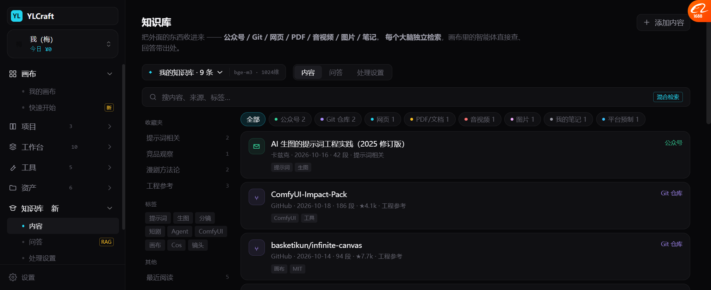
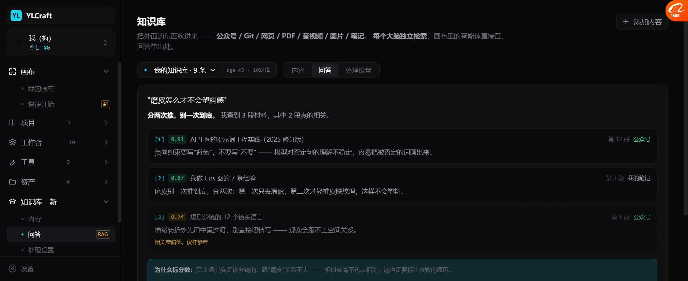
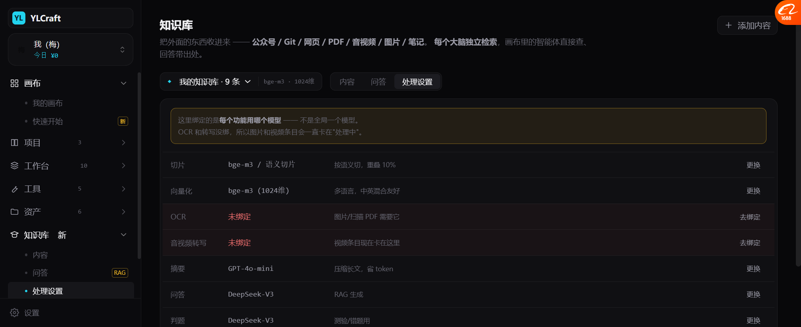

# 知识库 v2：抄墨渊 + 现代 KB 设计（2026-10-19）

> 来源：[cnb.cool/yiliu/moyuan](https://cnb.cool/yiliu/moyuan)（我自己的项目，可直接抄）
> + 现代 AI 知识库 / Copilot UI 模式调研
>
> **上一版我漏了三个关键东西**：多个大脑、功能绑定、处理状态。这版补上了。

---

## 一、墨渊有什么（README 实读）

> "Moyuan is a **local multimodal personal knowledge-base** application. It manages
> text, files, images, PDFs, Word/Excel documents, audio, video, and web pages in one workspace,
> then supports **semantic search, RAG Q&A, notes, quizzes, analytics, backup, and provider configuration**."

| 能力域 | 具体能力 |
| --- | --- |
| **多模态采集** | 文本笔记、文件上传、**文件夹导入**、网页 URL 抓取、图片、PDF、DOCX、XLSX、音频、视频 |
| **内容处理** | 语义切片、嵌入、**OCR**、**音视频转写**、网页正文提取、可选网页/视频截图 |
| 🔴 **工作区** | **多个大脑（multiple brains）**、分类、标签、收藏夹、**回收站**、每个大脑独立配置 |
| **检索与 AI** | 🔴 **混合检索**、图片检索、🔴 **RAG 问答带来源**、摘要、**测验生成**、**错题复习**、提示词模板 |
| **阅读与预览** | 内容详情、PDF/图/音/视 **viewer**、提取文本编辑、**片段列表**、**标注**、文档结构元数据 |
| **数据操作** | 存储设置、分析面板、日志、手动备份、导出、恢复、维护 |
| 🔴 **Provider 管理** | OpenAI 兼容、**加密 API key**、连接测试、🔴 **功能绑定**（摘要/嵌入/切片/测验/判题/OCR/转写/QA 各绑各的模型） |

**技术栈**：FastAPI + SQLAlchemy async + asyncpg + Alembic + **pgvector** + React + TS + Vite + Tailwind

**和我们撞车的地方**：同期技术栈、同样 pgvector —— **可以直接抄后端设计。**

---

## 二、上一版漏了什么（这版补上）

| 漏的 | 为什么重要 |
| --- | --- |
| 🔴 **多个大脑** | 不同主题的库要分开检索。混在一起，"漫剧研究"和"代码参考"会互相污染 |
| 🔴 **功能绑定** | 不是全局一个模型。OCR 用哪个、转写用哪个、问答用哪个，各管各的 |
| 🔴 **处理状态机** | 采集 ≠ 可用。视频要转写、图片要 OCR，**卡住时要能看出来卡在哪** |
| 回收站 | 删了能找回 |
| 测验/错题 | 知识库不只是查，还能考察自己会不会 |
| 混合检索 | 纯向量对专有名词（"ComfyUI-Impact-Pack"）很差，要配关键词 |

---

## 三、三个视图



### 视图 1：内容

```
知识库
把外面的东西收进来 —— 公众号 / Git / 网页 / PDF / 音视频 / 图片 / 笔记。
每个大脑独立检索，画布里的智能体直接查、回答带出处。

[◆ 我的知识库 · 9 条 ▾]  [bge-m3 · 1024维]   [内容|问答|处理设置]

🔍 搜内容、来源、标签…                          [混合检索]

收藏夹              全部 │●公众号2 │●Git2 │●网页1 │●PDF1 │●音视频1 │●图片1 │●笔记1 │●平台1
  提示词相关    2   ┌─ AI 生图的提示词工程实践（2025 修订版）  [公众号] ─┐
  竞品观察      1   │  卡兹克 · 2026-10-16 · 42 段 · 提示词相关        │
  漫剧方法论    2   │  [提示词] [生图]                                 │
  工程参考      3   ├─ ComfyUI-Impact-Pack                    [Git 仓库]─┤
标签                │  GitHub · 186 段 · ★4.1k · 工程参考              │
  #提示词 #生图     └─────────────────────────────────────────────┘
  #分镜 #短剧
  #Agent #ComfyUI
其他
  最近阅读      5
  回收站        2
```

**四个新东西**：
1. **大脑切换器**（带维度信息 `bge-m3 · 1024维`）
2. **混合检索** 标签常驻在搜索框右侧
3. **左栏三层**：收藏夹 / 标签 / 其他（最近阅读、回收站）
4. **未读小圆点**（青点）

---

### 视图 2：问答（RAG 带出处）



```
"磨皮怎么才不会塑料感"

分两次推，别一次到底。我查到 3 段材料，其中 2 段真的相关。

[1] 0.91  AI 生图的提示词工程实践          第 12 段  [公众号]
    负向约束要写"避免"，不要写"不要" —— 模型对否定句的理解
    不稳定，容易把被否定的词画出来。

[2] 0.87  我做 Cos 图的 7 条经验            第 3 段  [我的笔记]
    磨皮别一次推到底，分两次：第一次只去瑕疵，第二次才轻推
    皮肤纹理，这样不会塑料。

[3] 0.74  短剧分镜的 12 个镜头语言          第 8 段  [公众号]
    情绪转折处先用中景过渡，别直接切特写 —— 观众会跟不上空间关系。
    相关度偏低，仅作参考

ⓘ 为什么标分数：第 3 条其实是讲分镜的，跟"磨皮"关系不大 ——
  相似度高不代表相关，这也是要标注分数的原因。
```

🔴 **这版最关键的改进：承认"相似度高 ≠ 相关"。**

第 3 条相似度 0.74，标了**虚线框 + "相关度偏低，仅作参考"**。
回答里也明说「3 段材料，其中 **2 段真的相关**」。

**这是 RAG 最容易被骗的地方** —— 检索到 3 条不等于 3 条都有用。
对照基调 I2「检查要带证据」，也要带**证据的强度**。

---

### 视图 3：处理设置（功能绑定）



```
ⓘ 这里绑定的是每个功能用哪个模型 —— 不是全局一个模型。
  OCR 和转写没绑，所以图片和视频条目会一直卡在"处理中"。

切片        bge-m3 / 语义切片      按语义切，重叠 10%        [更换]
向量化      bge-m3 (1024维)       多语言，中英混合友好        [更换]
OCR        未绑定                 图片/扫描 PDF 需要它        [去绑定]   ← 红
音视频转写  未绑定                 视频条目现在卡在这里        [去绑定]   ← 红
摘要        GPT-4o-mini          压缩长文，省 token         [更换]
问答        DeepSeek-V3          RAG 生成                  [更换]
判题        DeepSeek-V3          测验/错题用                [更换]

向量模型换掉要重建索引，代价是这条大脑的所有条目重新算一遍。
```

🔴 **这解决了上一版一个说不通的地方**：
上一版有条目一直"索引中"，但**没解释为什么**。现在直接指出来 ——
「OCR 和转写没绑，所以卡住」。**卡点在设置里，一点就能修。**

---

## 四、现代 KB / Copilot UI 模式（调研）

参考 [AI & copilot UI patterns](https://github.com/truongnat/aix/blob/main/content/skills/design-system-pro/references/ai-copilot-ui-patterns-deep-dive.md)：

| 模式 | 我们怎么用 |
| --- | --- |
| **Inline citations** —— 上标或 chip 链接到来源面板 | `[1]` 编号 + 点开跳原文第 N 段 |
| **区分来源类型** —— web / 内部文档 / 用户上传 | 7 类图标 + 颜色（公众号绿/Git 紫/网络青…） |
| 🔴 **"No source"** —— 模型泛泛而谈时要**标不确定性** | 「这是我的推断，不是材料里的」 |
| **Last updated** —— RAG 文档要显示检索时间或版本 | 每条带 `2026-10-16` |
| **Context chips** —— "Using: X, Y" 可见且可移除 | 画布里提问时显示"使用了哪些知识" |
| **Empty state** —— 3~6 个具体起手提示 | 空库给「试试加：公众号链接 / Git 地址 / 你的笔记」 |
| **Multi-step** —— "Step 2 of 3" | 采集 → 切片 → 嵌入，显示第几步 |

**最值得抄的一条：`"No source"` 要明说。**
模型自己想的 ≠ 材料里有的。这两件事混在一起，用户就没法判断可信度。

---

## 五、实测

| 项 | 结果 |
| --- | --- |
| 3 个大脑切换 | ✅ |
| 大脑显示嵌入模型 + 维度 | ✅ `bge-m3 · 1024维` |
| 三视图切换（内容/问答/处理设置） | ✅ |
| 内容：10 条 + 8 类筛选 | ✅ |
| 左栏：4 收藏夹 + 9 标签 + 最近阅读/回收站 | ✅ |
| 混合检索标记常驻 | ✅ |
| 问答：3 条命中带分数和出处 | ✅ |
| 🔴 低相关度标虚线 + 提示 | ✅ 0.74 那条 |
| 处理设置：7 项功能绑定 | ✅ |
| 🔴 未绑定的标红 + 解释后果 | ✅ OCR / 转写 |
| 条目详情（原文/片段/标注/引用记录） | ✅ |
| 添加内容 5 种来源 | ✅ |

---

## 六、还没做的

| 项 | 现状 |
| --- | --- |
| 真抓取 | 5 种来源都只 toast |
| 真切片 + 向量化 | 演示数据 |
| 图片/音视频处理 | 只有状态，没有转写/OCR 演示 |
| 测验 / 错题本 | 墨渊有，这版没做视图 |
| 分析面板 / 日志 / 备份 | 墨渊有，这版没做 |
| 知识库 → 画布引用 | 画了路径，没实现 |
| 回收站交互 | 只有入口 |
| 标注功能 | tab 在，内容空 |

---

## 七、建议的抄法

**墨渊是 Python + FastAPI + SQLAlchemy async + pgvector，我们是同一套。**
所以不是"参考"，是**可以搬模块**：

| 墨渊的模块 | 我们能直接用吗 |
| --- | --- |
| 多模态采集（网页/PDF/DOCX/音视频） | ✅ 直接搬 |
| 语义切片 + 嵌入 pipeline | ✅ 直接搬 |
| 混合检索（向量 + 关键词） | ✅ 直接搬 |
| RAG 带来源 | ✅ 直接搬 |
| Provider 功能绑定 + 加密 key | ✅ 直接搬（我们 `ai_connector` 已有 base） |
| 多大脑 / 标签 / 收藏夹 | ✅ 直接搬 |
| 测验 / 错题 / 分析 | 🟡 和画布关系不大，可以后接 |

**要改的只有两处：**
1. **挂到平台导航的「知识库」下**（墨渊是独立应用，我们是子系统）
2. **加一条 `user_id` 维度**（墨渊是本地单用户，我们要多用户隔离 —— 和上次说的一样）

---

## 八、下一步

| 优先 | 做什么 |
| --- | --- |
| P1 | 把知识库接进画布：`@知识库` 引用 + 回答带 `[1][2]` 编号 |
| P2 | 测验 / 错题本视图（墨渊有现成的） |
| P3 | 条目详情补「标注」和「引用记录」的真实内容 |
| P4 | 补上「无出处时明说」的提示样式 |
