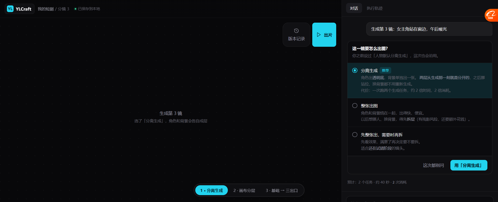
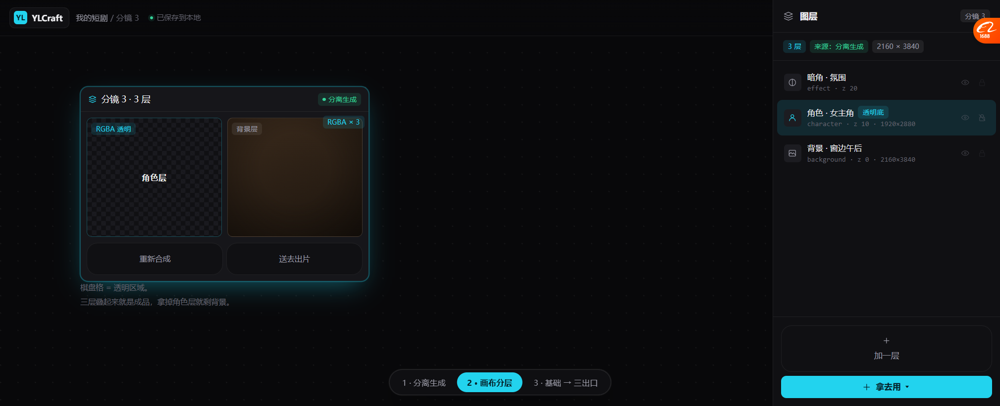
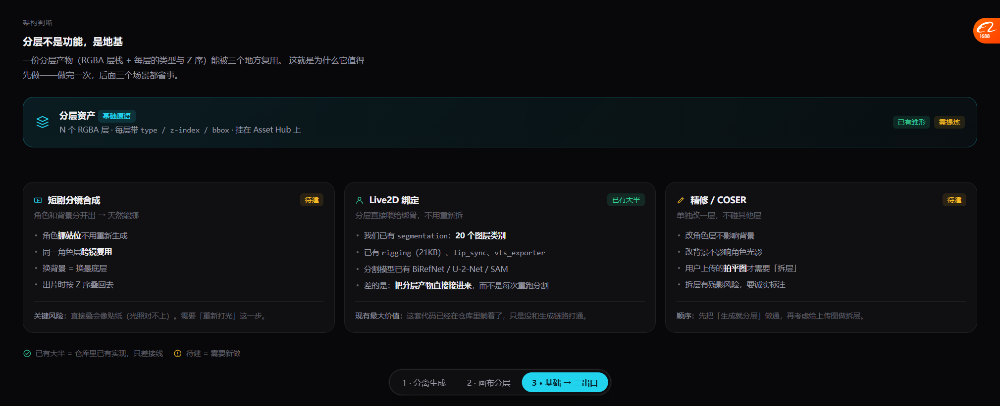

# 分层资产设计（v3 原型说明）

> 原型：`docs/prototypes/canvas_agent_prototype_v3_layered.html`（3 屏可点）
> 截图：`docs/prototypes/v3/01~03_*.png`
> **这一版只做设计，不碰代码。**

---

## 一、先把顺序摆正

我之前滑到"改代码"去了，收回。正确顺序是：

```
1. 设计原型（本文）           ← 现在在这
2. 定基础原语的契约
3. 做通「生成就分层」这一条
4. 再接下游：短剧合成 / Live2D / 精修
```

**你说得对：分层不是某个功能，是地基。做完一次，三个场景都省事。**

---

## 二、🔴 我们其实已经有一半了

这是这轮最意外的发现——**分层的基础设施在仓库里躺着，只是困在 Live2D 里。**

`backend/app/services/live2d/` 下 10 个模块：

| 模块 | 大小 | 作用 |
| --- | --- | --- |
| `segmentation.py` | 16.1 KB | 🔴 **20 个图层类别 + Z 序**，BiRefNet / U-2-Net / SAM 三选一，**注释写着「推荐 Coser 场景」** |
| `rigging.py` | 21.2 KB | 基于分割结果做五官运动控制 |
| `rembg.py` | 9.2 KB | 抠图 |
| `lip_sync.py` | 6.9 KB | 口型同步 |
| `motion_presets.py` | 9.5 KB | 动作预设 |
| `vts_exporter.py` | 11.9 KB | **导出到 VTube Studio** |
| `api_client.py` / `batch_queue.py` / `style_transfer.py` | — | API 模式 / 批量 / 风格迁移 |

**已有的图层模型（`LayerInfo`）**：
```python
name: str          # "hair_front" / "eye_left"
mask: Image        # 蒙版
category: str      # "hair" / "face" / "body"
bbox: (x, y, w, h)
confidence: float
```

**已有的 20 个类别（带 Z 序）**：
```
body_back(0) → body(1) → clothes_back(2) → clothes(3)
→ hair_back(4) → hair_middle(5) → hair_front(6)
→ face(10) → eye_white(11) → eye_pupil(12) → eye_highlight(13)
→ eyebrow(14) → nose(15) → mouth(16)
→ hat(20) → accessory(21) → hand(25)
```

> **这意味着：Live2D 那条线的"分层 + 绑骨 + 导出"已经打通了。**
> **缺的是：让"生成"也能产出这种结构，而不是只能靠分割。**

---

## 三、三屏原型

### 屏 1 · 分离生成（`01_split_generate.png`）



**对话里生成时，先问一句「这一镜要怎么出图」：**

| 选项 | 含义 | 代价 |
| --- | --- | --- |
| **分离生成**（推荐） | 角色出**透明底**，背景单独出，**两层从生成那刻就分开** | 2 个任务 / 约 40 秒 / 2 次消耗 |
| 整张出图 | 烧在一起，快、便宜 | 以后想挪人要**拆层**（有残影风险 + 额外花钱） |
| 先整张出，需要时再拆 | 试错阶段用 | 看效果再决定 |

**三个细节：**
1. **记住偏好**：「你之前设过『人物默认分离生成』，这次也会沿用」+「这次都别问」
2. **代价写清楚**：`2 个任务 · 约 40 秒 · 2 次消耗` —— 不藏
3. **三个选项对应三种心态**：我要改 / 我只要快 / 我还在试

### 屏 2 · 画布上的分层产物（`02_canvas_layers.png`）



**节点头部**：`分镜 3 · 3 层` + `● 分离生成` + `RGBA × 3`
**节点体内**：左卡片是**角色层（棋盘格 = 透明底）**，右卡片是**背景层**
**节点底部**：`重新合成` / `送去出片`

**右侧图层面板**：

```
图层                              分镜 3
[3 层] [来源：分离生成] [2160 × 3840]
──────────────────────────────────
👁 🔒  暗角 · 氛围
       effect · z 20
👁 🔒  角色 · 女主角  [透明底]
       character · z 10 · 1920×2880
👁 🔒  背景 · 窗边午后
       background · z 0 · 2160×3840
──────────────────────────────────
        [+ 加一层]
        [+ 拿去用 ▾]
```

**四个关键设计：**

| # | 设计 | 为什么 |
| --- | --- | --- |
| 1 | 🔴 **每层标 `type · z · 尺寸`** | 一眼知道这层是什么、在哪一层、多大 |
| 2 | 🔴 **标「来源：分离生成」** | 和「拆层来的」区分开 —— **拆层有残影，生成分层没有** |
| 3 | **每层有 👁 / 🔒** | 关掉角色层就剩背景，这是最直观的验证方式 |
| 4 | 🔴 **`拿去用 ▾` 而不是 `导出`** | 分层产物不是终点，是**给下游用的** |

### 屏 3 · 基础 → 三个出口（`03_foundation_outlets.png`）



**这一屏是给决策看的，不是给用户看的。** 它说明为什么分层值得先做。

```
            ┌──────────────────────────────────┐
            │  分层资产  [基础原语]              │
            │  N 个 RGBA 层 · type/z/bbox       │
            │  挂在 Asset Hub 上                 │
            └──────────────────────────────────┘
                          │
        ┌─────────────────┼─────────────────┐
        ▼                 ▼                 ▼
   短剧分镜合成      Live2D 绑定        精修 / COSER
   [待建]            [已有大半]         [待建]
```

| 出口 | 状态 | 差什么 |
| --- | --- | --- |
| **短剧分镜合成** | 待建 | 分离生成 + 重打光（直接叠会像贴纸） |
| **Live2D 绑定** | **已有大半** | 把分层产物**直接接进来**，而不是每次重跑分割 |
| **精修 / COSER** | 待建 | 用户上传的拍平图才需要「拆层」，有残影风险 |

---

## 四、基础原语的契约（要定的东西）

**这是下一步要拍板的核心。** 我建议的最小契约：

```
LayeredAsset
├── source: 'separate' | 'decomposed' | 'segmented'
│     separate    = 生成时就分层（无残影）
│     decomposed  = 从拍平图拆出来（有残影风险）
│     segmented   = 分割模型产出的蒙版层（Live2D 用）
├── width / height
├── layers: [
│     {
│       id
│       role: 'character' | 'background' | 'text' | 'prop' | 'effect'
│       name: '角色 · 女主角'
│       z: 10
│       asset_id        # 指向 Asset Hub 里的 RGBA PNG
│       bbox
│       visible / locked
│     }
│   ]
└── composite_asset_id   # 叠起来的成品（缓存用）
```

**三个要点：**
1. **`source` 是必须的** —— 决定 UI 上要不要提示"可能有残影"
2. **每层是 Asset Hub 的一个真资产**，不是内嵌 blob —— 这样能被别的项目复用
3. **`role` 用我们的词**（character/background/text/prop/effect），不用 Live2D 那套（hair_front/eye_left）—— 但**可以并存**：Live2D 用的是细分部件，短剧用的是大块

---

## 五、这份设计没解决的（诚实列出）

| 问题 | 状态 |
| --- | --- |
| 🔴 **直接叠会像贴纸**（光照对不上） | **没解决**。需要"重新打光"这一步，原型里没画 |
| 两个 role 体系怎么统一（大块 vs 细分部件） | 只提了"可并存"，没设计映射 |
| 分层产物怎么进 Live2D 的 rigging | 没设计 |
| 分离生成时"角色大小/位置"怎么和背景对齐 | 没设计（这是真难点） |
| 对话里怎么临时覆盖偏好 | 只画了"这次都别问" |

---

## 六、下一步建议

**不要直接做分离生成**。建议顺序：

1. **先定契约**（第四节那个结构 + `source` 三态）
2. **再做一条最小闭环**：一镜 → 分离生成 → 画布上两层 → 能关掉角色层看背景
3. **然后补重打光**（否则叠起来像贴纸，用户第一眼就会骂）
4. **最后接下游**（Live2D 是最容易的，因为那边已经通了）

**理由**：第 3 步不补，前两步做了也没用 —— 贴纸感会毁掉整个体验。
