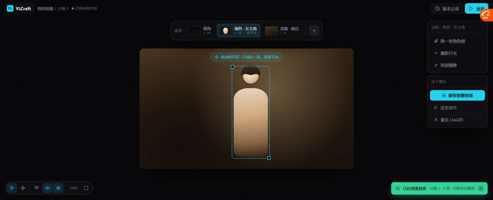

# 分层画布原型 v4（按你的描述重做）

> 原型：`docs/prototypes/canvas_layers_v4.html`
> 截图：`docs/prototypes/v4/01_canvas_layers.png`
> **上一版 v3 做错了**：我把分层做成了"一个卡片里塞两张缩略图"，那不是画布。

---

## 一、上一版错在哪

| v3 我做的 | 你要的 |
| --- | --- |
| 一个"分层节点"，里面两张小图并排 | **就是画布**，图直接在上面 |
| 图层面板在右侧，和画布是两回事 | **上面显示分层**，点了就能切 |
| 只能看，不能动 | **能拖拽**，拖一层只动那一层 |
| 底部"拿去用 ▾" | **点保存到素材库**，然后使用 |

**本质上我把"分层"当成了一个数据结构展示，而你要的是一个可操作的工作面。**

---

## 二、v4 现在的样子



### 从上到下

```
┌──────────────────────────────────────────────────────────────┐
│ YL YLCraft  我的短剧 / 分镜 3  ●已保存到本地   [版本记录][出片] │
├──────────────────────────────────────────────────────────────┤
│         ┌─────────────────────────────────────────┐          │
│         │ 图层 │[暗角][角色·女主角★][背景·窗边]│[+]│          │
│         └─────────────────────────────────────────┘          │
│                                                              │
│      ┌────────────────────────────────────────────┐  ┌─────┐ │
│      │ ⊕ 拖动角色层 · 只动这一层，背景不动          │  │当前 │ │
│      │                                            │  │角色 │ │
│      │            ┌ ─ ─ ─ ─ ─ ┐                  │  │     │ │
│      │            │  角色（选中）│                  │  │换图 │ │
│      │            │  👤        │                  │  │打光 │ │
│      │            └ ─ ─ ─ ─ ─ ┘                  │  │精修 │ │
│      │                                            │  ├─────┤ │
│      │              分镜 3 · 16:9 · 2160×1215 · 3 层│  │这个 │ │
│      └────────────────────────────────────────────┘  │镜头 │ │
│                                                      │[保存]│ │
│  [▷][✥]│[层][👁][#]  100%  [⛶]                       │出片 │ │
│                                                      │Live2D│ │
│                              ┌────────────────────┐  └─────┘ │
│                              │✓ 已存到素材库       │          │
│                              │ 分镜3·3层·可跨项目复用│        │
│                              └────────────────────┘          │
└──────────────────────────────────────────────────────────────┘
```

### 五个关键交互（你提的都覆盖了）

| 你说的 | 在原型里 |
| --- | --- |
| **是一个画布** | ✅ 整屏是画布，中间是镜头画框 |
| **上面显示分层** | ✅ 顶部横向图层条：`暗角 / 角色·女主角 / 背景·窗边 / +` |
| **可以切换分层** | ✅ 点图层条上的 chip 切换，当前选中的高亮（青色 + 缩略图带棋盘格） |
| **拖拽** | ✅ 选中的层在画布上有虚线选框 + 四角控制点，可以拖动（提示：「只动这一层，背景不动」） |
| **保存到素材库** | ✅ 右侧实心青色按钮 `保存到素材库`，右下角弹出绿色确认 |
| **然后可以使用** | ✅ 右侧还有 `送去出片` / `拿去 Live2D` |

### 为什么图层条放在**顶部**而不是右侧

- 顶部横排能一眼看到**层序**（左→右 = 下→上）
- 不遮挡画布
- 和底部工具条上下呼应，中间留出整块画布给内容

### 每个图层 chip 显示什么

```
┌──────────────┐
│ [缩略图] 角色 · 女主角 │  ← 名字
│         z 10 · 透明底 │  ← Z 序 + 是否透明
└──────────────┘
```

- **缩略图就是这一层本身**（角色层显示棋盘格 + 人形）
- **`z 10` 写明层序**
- **`透明底`** 标出来，让人知道这层是 RGBA

---

## 三、右侧那两个卡片是干什么的

**上卡「当前：角色 · 女主角」** —— 针对**选中的这一层**能做的操作：
- 换一张角色图
- **重新打光** ← 关键：直接叠会像贴纸，必须有这一步
- 局部精修

**下卡「这个镜头」** —— 针对**整个镜头**：
- **保存到素材库**（主操作，实心青色）
- 送去出片
- 拿去 Live2D

> **分层产物存进素材库后，三个出口都能用** —— 这正是"基础原语"的意思。

---

## 四、和真实产品还差什么（诚实列）

| 缺什么 | 说明 |
| --- | --- |
| 🔴 **不是真能拖** | 这是静态图，只是画了选框和提示。真做要接画布库 |
| 没有"分层展开视图" | Lovart 拆完会把各层摊在画布上；我们这版是"框内分层"，更贴近短剧用途 |
| 没有层级缩略图的真实尺寸信息 | 现在只有 z 和"透明底" |
| 没有多镜头 | 真实画布里会有分镜 1/2/3 多个画框 |
| 没画"重新打光"的实际交互 | 只是个按钮 |
| 缩放 100% 是假的 | — |

---

## 五、需要你确认的三件事

1. **图层条放顶部对吗？** 还是你想放右侧（像 PS）或底部？
2. **拖拽是"框内拖"还是"拖出框"？** 
   - 框内拖 = 调整角色在画面里的位置（我理解的短剧场景）
   - 框外拖 = 把层当独立素材拖到别处（Lovart 的方式）
3. **"保存到素材库"存什么？**
   - 存**合成后的整张图**（简单）
   - 存**分层结构**（能复用，但复杂）
   - 两个都存（我倾向这个）

---

## 六、下一步

你确认上面三件事后，我把原型定稿，再往下一层做：
- 如果要"真能拖"，得选画布库（前面盘过：Excalidraw MIT / tldraw 有水印）
- 如果要"存分层结构"，得先定契约（上一版 v3 文档第四节有草案）
