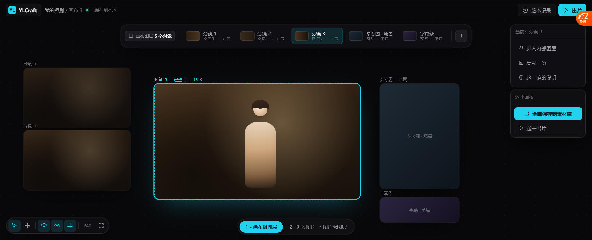
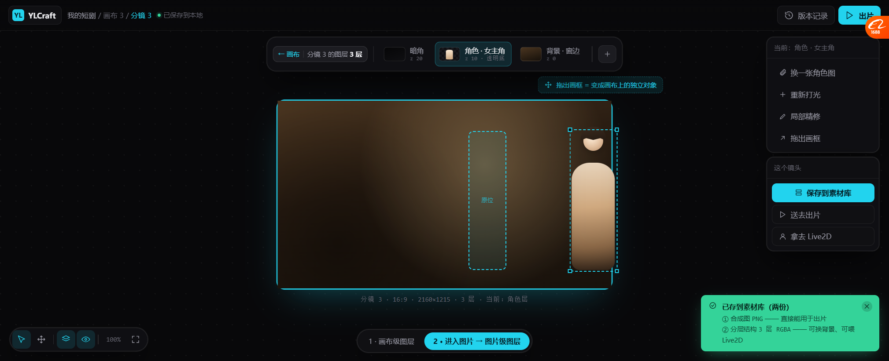

# 分层画布 v5：两级图层（按你的三个回答定稿）

> 原型：`docs/prototypes/canvas_layers_v5.html`（2 屏）
> 截图：`docs/prototypes/v5/01_canvas_layers.png`、`02_image_layers.png`

---

## 一、你问的第 1 个问题，是我之前最大的错

> 「这个是某个图片的图层，还是整体图层？」

**我上一版把两级混在一起了。** 图层条上摆的是「角色 / 背景 / 暗角」——
那是**分镜 3 内部**的东西，不该出现在画布级。

**正确的两级：**

| 层级 | 是什么 | 例子 |
| --- | --- | --- |
| 🔵 **画布级** | 画布上每个**对象**一层 | 分镜1 / 分镜2 / 分镜3 / 参考图 / 字幕条 |
| 🟦 **图片级** | 某个对象**内部**拆出的层 | 暗角 / 角色 / 背景 |

**所以图层条有两个状态，靠面包屑切换。**

---

## 二、屏 1 · 画布级图层



```
图层条：
┌────────────────────────────────────────────────────────────────────┐
│ [▢ 画布图层 5 个对象] │ [分镜1][分镜2][分镜3★][参考图][字幕条] │ [+] │
└────────────────────────────────────────────────────────────────────┘
```

| chip | 显示什么 |
| --- | --- |
| 分镜 1/2/3 | `图层组 · 3 层` ← 说明它**内含**多层 |
| 参考图 | `图片 · 单层` |
| 字幕条 | `文字 · 单层` |

**关键：画布级只看"有哪些对象"，不看"对象内部有什么"。**

右侧操作变成针对**整个画布**：`全部保存到素材库` / `送去出片`。

---

## 三、屏 2 · 进入图片 → 图片级图层



**面包屑变成**：`我的短剧 / 画布 3 / 分镜 3`（最后一级高亮）

**图层条变成**：
```
┌──────────────────────────────────────────────────────────────┐
│ [← 画布 │ 分镜3 的图层 3 层] │ [暗角][角色·女主角★][背景] │ [+] │
└──────────────────────────────────────────────────────────────┘
```

- **`← 画布` 可以退回上一级**
- chip 显示 `z 20 / z 10 · 透明底 / z 0`

### 🔴 框外拖（你选的）

画框里：
- **虚线框 = 原位**（角色本来在的地方，留个记忆）
- **角色现在被拖到了框外右侧**，带选中框和四角控制点
- 提示：**「拖出画框 = 变成画布上的独立对象」**

**拖出去之后，它就变成画布级的一个新对象**（回到屏 1 的图层条里会多一个 chip）。

### 🔴 两个都存（你选的）

右下角确认：

```
✓ 已存到素材库（两份）
  ① 合成图 PNG —— 直接能用于出片
  ② 分层结构 3 层 RGBA —— 可换背景、可喂 Live2D
```

**为什么两份都要：**
- 合成图给「出片」用（视频合成不需要层）
- 分层结构给「改」和「Live2D」用（能换背景、能绑骨）

---

## 四、两级之间怎么流动

```
        ┌─────────────────────────────────────┐
        │   画布级（对象）                      │
        │   分镜1 · 分镜2 · 分镜3 · 参考图 · 字幕 │
        └──────────────┬──────────────────────┘
                       │ 双击/点「进入内部图层」
                       ▼
        ┌─────────────────────────────────────┐
        │   图片级（分镜 3 内部）               │
        │   暗角 z20 · 角色 z10 · 背景 z0      │
        └──────────────┬──────────────────────┘
                       │ 「拖出画框」
                       ▼
        ┌─────────────────────────────────────┐
        │   回到画布级，多一个独立对象           │
        │   （角色层变成可复用的元素）           │
        └─────────────────────────────────────┘
```

**这就是"层能提出来复用"的机制** —— 也是你说的"存给 Live2D 用"能成立的前提。

---

## 五、这版还没解决的

| 问题 | 说明 |
| --- | --- |
| 🔴 **不是真能拖** | 静态图，只是画了状态 |
| 拖出去之后**原来那层留什么** | 原型画了虚线"原位"，但没说清是留空、还是留个引用 |
| 画布级太多对象时图层条怎么滚 | 现在是横向排，5 个还行，50 个就不行 |
| 分层结构和画布对象的**关系** | 一个分镜被拖出一层后，它还是"3 层"还是"2 层"？ |
| 没有"多画布" | 现在只有"画布 3" |

---

## 六、下一步

**这三个回答已经够我把交互定下来了。** 接下来该定的是**数据契约**：

1. 画布对象 = 什么结构？（图片对象 / 图层组对象 / 文字对象）
2. 图层组内部的层，和"拖出来的独立对象"是同一份数据还是拷贝？
3. 保存的两份（合成图 + 分层结构）在 Asset Hub 里怎么关联？

**这三条定了，才能动手写代码。**
