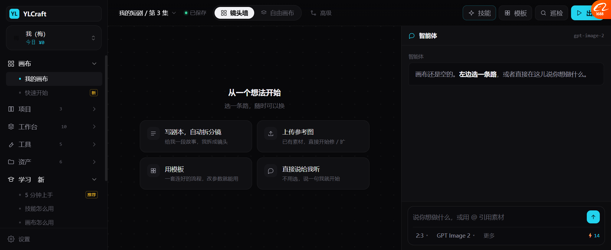
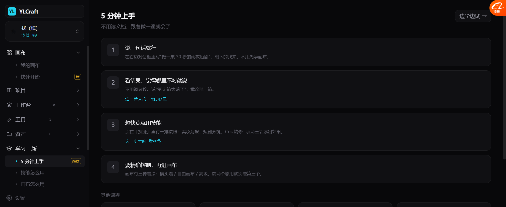
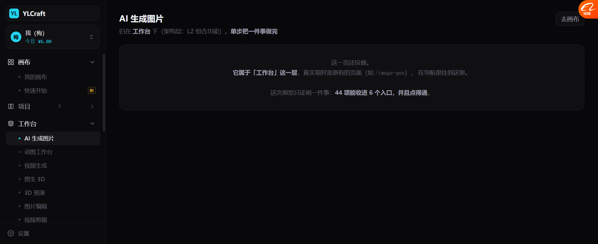

# 平台壳 v16：44 项 → 6 项 + 学习（P7）

> **按你的选择做的 B 方案**：新建平台壳原型，画布当一个子页面嵌进去，**画布原型一行没改**。
>
> 打开：`docs/prototypes/platform_shell_v16.html`
> 画布仍是：`docs/prototypes/canvas_unified_v14.html`（单独也能开）

---

## 一、两种原型的关系

```
platform_shell_v16.html   ← 平台壳（导航 + 内容区）
        │
        └─ iframe → canvas_unified_v14.html?embed=1   ← 画布当一个页面
```

| 文件 | 管什么 | 这次动了吗 |
| --- | --- | --- |
| `platform_shell_v16.html` | 导航、用户、学习、页面容器 | 🔴 **新建** |
| `canvas_unified_v14.html` | 画布三模式 | ✅ **只加了一个 embed 参数**（隐藏重复的品牌/用户chip），其余没动 |

**这就是 B 方案的好处**：画布那 2500 行不用重新调布局。

---

## 二、导航：6 项 + 设置



```
▾ 画布
    我的画布          ← 嵌入式画布
    快速开始  [新]
▸ 项目 (3)
    创作项目 / 分镜表 / 出片发布
▸ 工作台 (10)
    AI 生成图片 / 动图工作台 / 视频生成 / 图生 3D / 3D 预演
    图片编辑 / 视频剪辑 / 字幕提取 / BGM 配乐 / Live2D
▸ 工具 (5)
    裁剪缩放 / 滤镜调色 / 抠图 / 提示词优化 / OCR 取字
▸ 资产 (6)
    素材库 / 角色 / 世界观地图 / 提示词库 / 阅读中心 / 采集下载
▾ 学习  [新]
    5 分钟上手  [推荐]
    技能怎么用 / 画布怎么用 / 节点是什么
    模板与版本 / 钱是怎么花的 / 常见问题
──────────
⚙ 设置
```

**33 个子项收进 6 个分组**（前端现在是 8 组 44 项摊平）。

### 折叠策略（这是关键）

| 状态 | 显示 |
| --- | --- |
| 折叠 | 只有分组名 + **子项数量**（`项目 3`） |
| 展开 | 子项列表，当前项高亮 |
| 默认展开 | 只有「画布」和「学习」—— **其他默认收起** |

🔴 **默认只展开两个**。用户一进来不会看到一大片菜单。

---

## 三、学习菜单（新加的）



**7 门课，每门 3~5 步，不用读文档。**

| 课程 | 一句话 |
| --- | --- |
| **5 分钟上手** | 说一句话 → 看结果 → 想快用技能 → 要精确进画布 |
| 技能怎么用 | 一个按钮 + 一张表单 |
| 画布怎么用 | 一屏三区，三个模式 |
| **节点是什么** | 🔴 **第一句就是"可以完全跳过这一课"** |
| 模板与版本 | 模板会更新，但不会偷偷改你的东西 |
| 钱是怎么花的 | 没配价格的模型会拒绝执行 |
| 常见问题 | 我不懂技术能用吗 / 别人能看到我的画布吗 |

### 「节点是什么」的第一句

> **0. 先说：不知道也能用**
> 如果你只用技能和画布，**节点这个词你可以永远不碰**。

🔴 这是基调 P1「门槛优先于能力」最直接的体现 —— **不吓人，先给退路**。

### 「5 分钟上手」带成本

```
2  看结果，觉得哪里不对就说
   不用调参数。说"第 3 镜太暗了"，我改那一镜。
   这一步大约 ≈¥1.4/镜          ← 基调 I3
```

---

## 四、其他页面：诚实占位



点「AI 生成图片」：

```
AI 生成图片
归在 工作台 下（架构层：L2 组合功能）。单步把一件事做完

┌─────────────────────────────────────┐
│  这一页还没做。                        │
│  它属于「工作台」这一层，真实现时是原有的  │
│  页面（如 /image-gen），在导航里挂到这里。 │
│                                      │
│  这次原型只证明一件事：44 项能收进 6 个   │
│  入口，并且点得通。                     │
└─────────────────────────────────────┘
```

**每条占位都标了它属于哪一层**（L1/L2/L3/支撑）—— 这样以后做的时候不用重新想。

---

## 五、实测

| 项 | 结果 |
| --- | --- |
| 导航 6 组 + 设置 | ✅ |
| 子项总数 33 | ✅ |
| 默认只展开「画布」「学习」 | ✅ |
| 点画布 → iframe 显示画布 | ✅ |
| 点学习 → iframe 隐藏、显示课程 | ✅ |
| 点回画布 → iframe 回来 | ✅ |
| 学习页「5 分钟上手」4 步 + 其他课程 | ✅ |
| 7 门课都有内容 | ✅ |
| 工作台页显示所属层 | ✅ |
| 用户切换（今日花费跟着变） | ✅ 梅 ¥6.80 / 林 ¥0 |
| 画布嵌入不重复显示品牌/用户 | ✅ **修过** |

---

## 六、没做的

| 项 | 现状 |
| --- | --- |
| 工作台/项目/工具/资产的真页面 | 全是占位，写明所属层 |
| 导航搜索 | 没做（33 项以后可能需要） |
| 最近使用 / 收藏 | 没做 |
| 折叠状态记忆 | 刷新就重置 |
| 画布 → 壳通信 | iframe 单向，画布内的动作不会通知壳 |
| 学习课程和实际功能联动 | 文字说明，没做成可交互教学 |

---

## 七、这个改动的意义

| 之前 | 现在 |
| --- | --- |
| 8 组 44 项摊平，找东西要跨组 | **6 个入口，按"要做什么"分** |
| 画布藏在第 3 层 | **画布是第一个，也是默认** |
| 没有学习入口，用户靠文档 | **学习是独立菜单，7 门课** |
| 不知道每页属于哪层 | 每个占位页**标了架构层** |

**但要说清楚：这只证明了"菜单能收起来、点得通"。**
真做时，`/image-gen`、`/motion`、`/model-3d` 这些页面**一行都不用改**，只是导航里挂到新位置。
